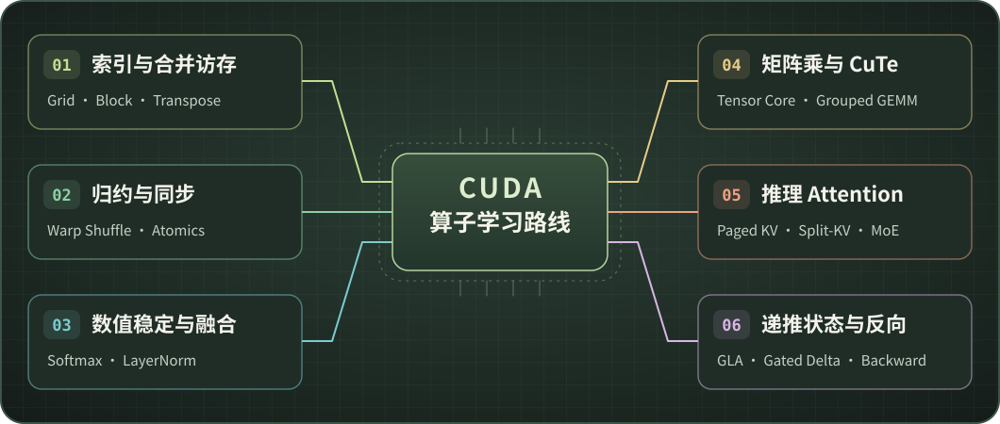

<h1 align="center">CUDA Operator Lab</h1>

<strong>从第一个 CUDA kernel 到可复现的算子优化</strong>

519 道练习 · 10 个题库 · 6 个学习阶段

  <a href="#快速开始">快速开始</a> ·
  <a href="docs/roadmap.md">学习路线</a> ·
  <a href="docs/progress.md">进度清单</a> ·
  <a href="problems/README.md">全部题目</a> ·
  <a href="docs/library-coverage.md">源码覆盖</a>

适合想从零写 CUDA kernel、学习 CUTLASS / CuTe 或动手做 LLM 算子的开发者。题面、实现模板、参考源码和用例随仓库提供。克隆后可离线编辑、编译、判题和测性能。

## 快速开始

~~~bash
git clone https://github.com/devillove084/cuda-operator-lab.git
cd cuda-operator-lab
./practice.sh show leetgpu 1            # 阅读 Vector Addition
./practice.sh edit leetgpu 1            # 写第一个 kernel
./practice.sh test leetgpu 1 --case 0   # 单跑题面的例子
./practice.sh test leetgpu 1            # 跑完整用例
~~~

第一次练习只需要写 **Vector Addition → ReLU → Matrix Transpose**。做完每一小节，用 `./practice.sh progress --edit` 打开自己的进度清单，将对应的 `[ ]` 改成 `[x]`。进度保存在仓库内的 `docs/progress.local.md`，该文件已被 Git 忽略。

## 六个阶段

| 阶段 | 练习主题 | 阶段验收 |
| :-- | :-- | :-- |
| [01 · CUDA 入门](docs/roadmap.md#stage-1) | Vector Addition、ReLU、Transpose | 三道通过，解释一次访存差异 |
| [02 · 归约与同步](docs/roadmap.md#stage-2) | Dot Product、Reduction、Histogram | 对比两种归约，跑内存和竞态检查 |
| [03 · 稳定性与融合](docs/roadmap.md#stage-3) | Softmax、Norm、Cross Entropy | 构造数值反例，用时间线验证融合 |
| [04 · GEMM 与 CuTe](docs/roadmap.md#stage-4) | 手写 GEMM、Grouped GEMM、FP8 | 对比不同形状和 cuBLAS 基线 |
| [05 · 推理 Attention](docs/roadmap.md#stage-5) | Paged KV、Split-KV、GQA、MoE 路由 | 测 decode 的延迟和长上下文吞吐 |
| [06 · 递推状态与反向](docs/roadmap.md#stage-6) | Simple GLA、Gated Delta、Packed、反向 | 验证跨段状态与梯度，复现一项优化 |

~~~bash
./practice.sh roadmap              # 看完整学习路线
./practice.sh selftest 1 --plan    # 查看本阶段题单
./practice.sh selftest 1 --smoke   # 每题先跑一个用例
./practice.sh selftest 1           # 完整阶段自测
./practice.sh progress             # 看自己的进度
~~~

## 题库

| 来源 | 练习范围 | 条目 |
| :-- | :-- | --: |
| [LeetGPU](catalogs/leetgpu.md) | CUDA 基础、机器学习与通用 GPU 算子 | 147 |
| [LeetCUDA](catalogs/leetcuda.md) | 手写 CUDA、CUTLASS / CuTe、GEMM 和 Attention 变体 | 215 |
| [XPUOJ](catalogs/xpuoj.md) | 混合精度、推理算子、CUDA / TileLang | 144 |
| [FlashInfer](catalogs/flashinfer.md) · [FLA](catalogs/fla.md) | 分页推理、线性注意力及反向 | 8 |
| [FlashAttention](catalogs/flashattn.md) · [CUTLASS](catalogs/cutlass.md) · [Triton](catalogs/triton.md) · [Quack](catalogs/quack.md) · [vLLM](catalogs/vllm.md) | 滑窗注意力、分组 GEMM、FP8、交叉熵、MoE 调度 | 5 |

每题在 [题面索引](problems/README.md) 有独立 Markdown。源码练习含从 7 个库选出的 13 道自编题和 87 个离线用例。[上游版本、许可和源码入口](docs/library-coverage.md)

## 从正确性到性能

~~~bash
./practice.sh cases leetgpu 1
./practice.sh bench leetgpu 1 --case 8
./practice.sh profile leetgpu 1 --case 6 --tool ncu
~~~

- `cases` 给出输入规格和编号。用 `test … --case N` 重跑单例，用 `--timeout 秒` 给支持该参数的独立判题设置评测时限。
- `bench` 对拍后采样，统一报告记录 p10、p50、p90 和原始样本。对比优化库时，固定 GPU、形状、数据类型和输出语义。
- `profile` 默认使用 Nsight Systems。加 `--tool ncu` 采集硬件计数器。报告保存在 `build/practice/reports/`。
- `./practice.sh` 打开终端题库，按 Enter 读题，Ctrl-E 编辑，Ctrl-T 编译判题，Ctrl-B 跑性能。Ctrl-P 切题库，Ctrl-S 筛进度，Ctrl-X 勾选单题。

环境与编辑器

需要 Linux NVIDIA GPU、Bash、Python 3.10+、CUDA 版 PyTorch、CUDA Toolkit、CMake 和 Ninja。终端菜单额外使用 `fzf`、`less`。个别 Python 题需要 Triton、TileLang 或 torchvision。

项目在 RTX PRO 5000 Blackwell、CUDA 13.2 上验证。CMake 默认编译 SM120a。其它 GPU 可通过 `PRACTICE_CUDA_ARCH` 选择架构，例如 `86-real`。Hopper WGMMA 题需要相应硬件。也可以设置 `CUDA_VISIBLE_DEVICES`、`CUDA_HOME` 和 `PRACTICE_PYTHON`。

编辑器按 `PRACTICE_EDITOR`、`VISUAL`、`EDITOR` 的顺序读取，默认 `vi`。用 `./practice.sh source <题库> <题号>` 获取实现路径。普通练习在 `practice/<题库>/<题号>/`，LeetCUDA 变体按算子共享文件。

用例与上游来源

LeetGPU 和 XPUOJ 保留公开功能用例，并追加固定种子和缓冲区守卫。LeetCUDA 支持逐变体判题及共享套件。源码练习使用仓库内的 PyTorch 数值参考。可用 `./practice.sh cases` 查看覆盖。

`references/` 保存冻结的题面、参考源码和所需头文件。LeetGPU 来自 [AlphaGPU/leetgpu-challenges](https://github.com/AlphaGPU/leetgpu-challenges) 的 `3b2ec31`。LeetCUDA 来自 [xlite-dev/LeetCUDA](https://github.com/xlite-dev/LeetCUDA) 的 `v4.2.2`。XPUOJ 来自 [公开题库](https://xpuoj.com/p) 和 [XPUOJ-ProblemSet](https://github.com/XPUOJ/XPUOJ-ProblemSet) 的 `1a1dd54`。其它上游的固定版本和许可见[算子库覆盖表](docs/library-coverage.md)。

