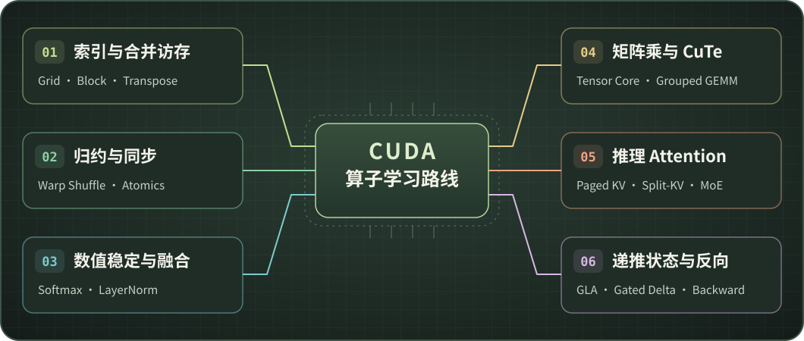

# CUDA 算子学习路线

[首页](../README.md) · [进度清单](progress.md) · [全部题目](../problems/README.md)

第一次写 CUDA，从阶段 1 开始。用第一周从空实现写出三个正确的 kernel，再用一次 profile 把代码和 GPU 行为对应起来。每周安排 5–7 小时，下面的主线约 16 周。以验收结果决定什么时候进入下一阶段。

## 第一周直接开始

~~~bash
ssh pro5000
cd ~/cuda-operator-lab
./practice.sh selftest 1 --plan
./practice.sh show leetgpu 1
./practice.sh edit leetgpu 1
./practice.sh test leetgpu 1 --case 0
./practice.sh cases leetgpu 1
./practice.sh test leetgpu 1
~~~

第一天画出 `N=10, blockDim.x=4` 的线程索引，再写 `i=blockIdx.x*blockDim.x+threadIdx.x` 和尾部判断。第二天做 ReLU，尝试从空模板独立写一遍。第三、四天做矩阵转置，先写朴素版，再写 shared-memory tile。周末运行阶段自测，在一张空闲 GPU 上保存一个小输入和一个带宽测试结果。习惯固定为**读接口 → 先跑通最小样例 → 扩到完整用例 → 对比两个实现**。

## 阶段安排

| 阶段 | 建议时间 | 主线 | 阶段产出 |
| --- | --- | --- | --- |
| [1 · 写出第一个 CUDA kernel](#stage-1) | 第 1–2 周 | 索引、launch、边界、合并访存 | 3 道 AC，1 份访存实验 |
| [2 · 掌握归约与同步](#stage-2) | 第 3–4 周 | warp、CTA、shared memory、原子操作 | 2 个 reduction 实现，1 次竞态检查 |
| [3 · 写稳定的融合算子](#stage-3) | 第 5–6 周 | safe softmax、FP32 累加、LayerNorm、RMSNorm | 用数值反例说明稳定性，测融合收益 |
| [4 · 读懂 GEMM 和 CuTe](#stage-4) | 第 7–10 周 | tiling、layout、Tensor Core、pipeline | 3 个 GEMM 版本，1 组库基线 |
| [5 · 做推理 Attention](#stage-5) | 第 11–13 周 | 在线 softmax、分页 KV、GQA、Split-KV | 1 个 paged decode 实验报告 |
| [6 · 做状态算子和反向](#stage-6) | 第 14–16 周 | GLA、Gated Delta、变长、状态梯度 | 1 份可复现实验与源码分析 |

`./practice.sh selftest <阶段>` 逐题运行当前实现，汇总每题通过或失败。加 `--smoke` 每题只跑第 1 例，加 `--plan` 列出命令。每做完一小节，用 `./practice.sh progress --edit` 在[个人清单](progress.md)打勾。LeetCUDA 有些代码是可运行的上游实现，把它作为阅读对象，随后独立复现一个核心内核来验收。

## 1 · 索引、边界和合并访存

- **主做** [Vector Addition](../problems/leetgpu/1.md) → [ReLU](../problems/leetgpu/21.md) → [Matrix Transpose](../problems/leetgpu/3.md)。
- **动手** 用方阵和非方阵比较朴素转置、共享内存 tile、带 padding 的共享内存 tile。写出每个 warp 发出的全局地址。向量题先写标量访问，再学向量化和尾部回退。
- **自测** `./practice.sh selftest 1`。手算长度 1、31、32、33、257 的边界。用 `./practice.sh bench leetgpu 1 --case 1` 测 31 个元素，用 `--case 8` 测 16,777,217 个元素，再比较不同 block 大小。对 FP32 向量加法，有效带宽使用 `12×N/时间`，给出单位和输入长度。解释小输入为何更容易被 launch 成本主导。
- **过关证据** 3 道 AC。画出线程到内存地址的映射，并记录一个性能差异及对应的访存现象。

## 2 · 归约和原子操作

- **主做** [Dot Product](../problems/leetgpu/17.md)、[Reduction](../problems/leetgpu/4.md)、[Histogramming](../problems/leetgpu/13.md)。源码对照 [LeetCUDA Histogram](../problems/leetcuda/7.md)。
- **动手** 写 shared-memory tree 与 warp shuffle 两种归约，覆盖部分 warp、非整 block 和多 block。对直方图比较高冲突和均匀分布，解释原子竞争。任何参与者都要经过匹配的同步，尾部用中性元素补齐。
- **自测** `./practice.sh selftest 2`。为归约记录两种写法在小、中、大输入的延迟。对课后选定的尾例先用 memcheck，再用 racecheck 检查 shared-memory 路径。
- **过关证据** 3 道 AC。能解释 shuffle 的参与线程、块内同步与块间合并的边界，能用一次定位记录说明竞态检查的结果。

~~~bash
compute-sanitizer --tool memcheck --target-processes all --error-exitcode 99 \
  ./practice.sh test leetgpu 4 --case 1
compute-sanitizer --tool racecheck --target-processes all --error-exitcode 99 \
  ./practice.sh test leetgpu 4 --case 1
~~~

## 3 · 数值稳定、归一化与融合

- **主做** [Softmax](../problems/leetgpu/5.md)、[LayerNorm](../problems/leetgpu/113.md)、[RMSNorm](../problems/leetgpu/50.md)、[Fused Residual Add and RMSNorm](../problems/leetgpu/83.md)。最后做 [Quack Cross Entropy 前反向](../problems/quack/1.md)。延伸阅读 [LeetCUDA Online Safe Softmax](../problems/leetcuda/97.md)。
- **动手** 从朴素指数推到 subtract-max 与在线状态 `(m, l)`。LayerNorm 用稳定的方差计算，理解接近常数的行为什么容易损失有效位。按题面约定 FP16/BF16 的输入输出与 FP32 中间值。写拆分和融合两个版本，在同一布局做 A/B。
- **自测** `./practice.sh selftest 3`。手造含大 logits 的行、近常数行、非整向量宽度和单元素行，比较 float64 参考的最大绝对误差与接近零时的绝对误差。用 `./practice.sh profile leetgpu 83 --case 0` 记录 launch 数量，比较融合前后 p50 和主要读写量。
- **过关证据** 5 道 AC。能给出一个让朴素版失败的输入，并用时间线验证融合前后 launch 数的改变。

## 4 · GEMM、Tensor Core 与 CuTe

- **主做** [Matrix Multiplication](../problems/leetgpu/2.md)、[朴素 SGEMM](../problems/leetcuda/127.md)、[CuTe HGEMM](../problems/leetcuda/157.md)。用 [CuTe Transpose](../problems/leetcuda/201.md) 练习 layout、shape、stride 和线程到 tile 的映射，用 [cuBLAS HGEMM](../problems/leetcuda/158.md) 看对照接口。最后完成 [CUTLASS 异形 Grouped GEMM](../problems/cutlass/1.md) 和 [Triton 来源的 FP8 分块缩放](../problems/triton/1.md)。
- **动手** 写全局内存朴素版、shared-memory tiling 版和寄存器分块版。画 `C[M,N]` 的一个 tile 的 CTA 分工，再进入 WMMA/MMA 与 CuTe 的 copy/MMA 布局。一次只改一个 tile、分块或流水级数。在现有 `sm_120a` 路径实验硬件特性，按题面选择架构。
- **自测** `./practice.sh selftest 4`。给方阵、小 M、非对齐矩形各保留一个数据点。用 `./practice.sh bench leetgpu 2`，记录 `2MNK/时间` 和 p50。另用相同 dtype、layout、TF32 配置、累加与 epilogue 对比 cuBLAS 或 CUTLASS Profiler。确认 Tensor Core 用量和寄存器、共享内存消耗。
- **过关证据** 三种手写版本可复跑。解释一次优化在大矩阵有效、在小 M 上无效或变慢的原因，给出可指向具体计数器的证据。

## 5 · 推理 Attention 与分页 KV

- **主做** [Softmax Attention](../problems/leetgpu/6.md) → [FlashAttention 不等长滑窗](../problems/flashattn/1.md) → [Paged Gather](../problems/flashinfer/1.md) → [Paged Append](../problems/flashinfer/2.md) → [Split-KV Merge](../problems/flashinfer/3.md) → [Paged GQA Decode](../problems/flashinfer/4.md)。完成 [vLLM MoE 路由分桶](../problems/vllm/1.md)，把计数、前缀和、散射接到阶段 4 的分组 GEMM 思路。
- **动手** 画两个序列的物理页表，手算尾页、共享首个满页和 GQA head 分组。对比单 CTA 扫全序列与 split-KV 后再合并的方案，记录每种方案的 scratch 大小和 launch 数。理解 prefill 和 decode 的 Q 长度及并行度差别。对照仓库的 [FlashInfer 源码](../references/FlashInfer/README.md)。
- **自测** `./practice.sh selftest 5`。单 token 时输出等于 V，全空时输出为 0 且 LSE 为负无穷。用 `./practice.sh bench flashinfer 4 --case 7` 测长上下文，用 `--case 8` 测较大 batch，用 `--case 1` 看单步。再用 `./practice.sh profile flashinfer 4 --case 7 --tool ncu` 观察显存流量和并行度。
- **过关证据** 所有用例 AC，至少两种不同形状的延迟与解释。用同页大小、有效 KV 长度、GQA head 数、dtype、LSE 输出和 CUDA Graph 设置对照本机可用的优化库。把 plan/metadata 预处理和稳态 run 分开测。

## 6 · 递推状态、变长和反向

- **主做** [GLA 递推](../problems/fla/1.md) → [Gated Delta](../problems/fla/2.md) → [Packed 变长](../problems/fla/3.md) → [GLA 反向](../problems/fla/4.md)。对照 [FLA 源码](../references/FLA/README.md) 里的 recurrent 和 chunk 路径。
- **动手** 先写 token-by-token 版本。把两段序列用 final/initial 连接，再尝试 chunkwise 版本。检查零 beta、无衰减、完全遗忘、填充和空序列。反向先推一个 token，引入末状态梯度，再考虑保存状态和重算的取舍。
- **自测** `./practice.sh selftest 6`。把固定长序列按 31/32/33 的边界分成两段，对照整段的输出与 final。为小样例挑一个 `q`、一个 `g` 和一个初始状态元素做中心差分，和 autograd 交叉检查。分别测较短、较长、长短混合的形状，记录 tokens/s 和状态中间量的显存占用。
- **过关证据** 4 道 AC。用一份设计记录说明状态为什么正确、并行化为何合理、哪些规格出现回退。从源码中复现一项优化，或把一个实测的退化缩成最小回归用例并附数据。

## 性能实验如何验收

1. 固定 GPU、输入 shape/seed、布局、dtype、累加方式、输出语义和 CUDA Graph 设置。在这台共享机器上把物理 GPU ID 一并记录。测量前预热并排除 JIT；分别记录端到端时间和 kernel 时间。
2. 先对拍。每次只改一个因素，保留原版本的数字。对内存算子看有效 GB/s 和 DRAM 流量，对 GEMM 看 TFLOP/s，对 decode 看 µs/token 和 tokens/s。每组至少报告 p50、p90 和三次独立运行的波动。
3. 用 Nsight Systems 看 launch、同步和空档，用 Nsight Compute 看内存吞吐、共享内存冲突、活跃 warp、寄存器和 Tensor Core。重复测量确认瓶颈假设。[NVIDIA CUDA Best Practices](https://docs.nvidia.com/cuda/cuda-c-best-practices-guide/index.html) · [Nsight Compute Profiling Guide](https://docs.nvidia.com/nsight-compute/ProfilingGuide/index.html)
4. 公平对照先锁定版本和 backend。文件中的 PyTorch eager 用于正确性及普通实现对照。要判断接近公开优化水平，再找同硬件同语义的 cuBLAS、CUTLASS、FlashInfer 或 FLA 路径，报告逐形状的差距与回退点。[CUTLASS Profiler](https://github.com/NVIDIA/cutlass/tree/main/tools/profiler) · [FlashInfer](https://github.com/flashinfer-ai/flashinfer) · [FLA](https://github.com/fla-org/flash-linear-attention)

用[算子库覆盖表](library-coverage.md) 对照各库的本地源码、用例与尚待补齐的路径。每阶段留一张小表，填写 GPU、提交、形状、数据类型、对照实现、p50/p90、误差、关键计数器和结论。阶段 5 或 6 任选其一作为第一个完整项目。能从接口设计、正确性、性能定位一路讲到回退边界，就具备开始读真实库代码和做可复现优化的基础。
