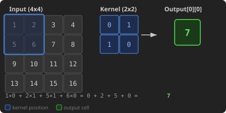

# 2D Convolution

LeetGPU · #10

[打开实现文件](../../practice/leetgpu/10/solution.cu) · [原始材料](../../references/LeetGPU/challenges/medium/10_2d_convolution/challenge.html)

Write a program that performs a 2D convolution operation on the GPU. Given an input matrix and a kernel (filter), compute the convolved output. The convolution should be performed with a "valid" boundary condition, meaning the kernel is only applied where it fully overlaps with the input.

 The input consists of:

- `input`: A 2D matrix of 32-bit floating-point numbers, represented as a 1D array in row-major order.

- `kernel`: A 2D kernel (filter) of 32-bit floating-point numbers, also represented as a 1D array in row-major order.

 The output should be written to the `output` matrix (also a 1D array in row-major order). The output matrix will have dimensions:

- `output_rows = input_rows - kernel_rows + 1`

- `output_cols = input_cols - kernel_cols + 1`

 The convolution operation is defined as:

 \(output[i][j] = \sum_{m=0}^{kernel\_rows-1} \sum_{n=0}^{kernel\_cols-1} input[i+m][j+n] * kernel[m][n]\)

## Implementation Requirements

- Use only native features (external libraries are not permitted)

- The `solve` function signature must remain unchanged

- The final result must be stored in the array `output`

## Example 1:

 **Input:**
 `input` (3×3): \[ \begin{bmatrix} 1 & 2 & 3 \\ 4 & 5 & 6 \\ 7 & 8 & 9 \end{bmatrix} \] `kernel` (2×2): \[ \begin{bmatrix} 0 & 1 \\ 1 & 0 \end{bmatrix} \] `input_rows = 3`
 `input_cols = 3`
 `kernel_rows = 2`
 `kernel_cols = 2`

 **Output:**
 `output` (2×2): \[ \begin{bmatrix} 6 & 8 \\ 12 & 14 \end{bmatrix} \]

## Example 2:

 **Input:**
 `input` (4×4): \[ \begin{bmatrix} 1 & 1 & 1 & 1 \\ 1 & 2 & 3 & 1 \\ 1 & 4 & 5 & 1 \\ 1 & 1 & 1 & 1 \end{bmatrix} \] `kernel` (1×3): \[ \begin{bmatrix} 1 & 0 & 1 \end{bmatrix} \] `input_rows = 4`
 `input_cols = 4`
 `kernel_rows = 1`
 `kernel_cols = 3`

 **Output:**
 `output` (4×2): \[ \begin{bmatrix} 2 & 2 \\ 4 & 3 \\ 6 & 5 \\ 2 & 2 \end{bmatrix} \]

## Constraints

- 1 ≤ `input_rows`, `input_cols` ≤ 3072

- 1 ≤ `kernel_rows`, `kernel_cols` ≤ 31

- `kernel_rows` ≤ `input_rows`

- `kernel_cols` ≤ `input_cols`

- Performance is measured with `input_cols` = 3,072, `input_rows` = 3,072, `kernel_cols` = 15, `kernel_rows` = 15

## 本地接口

~~~cpp
extern "C" void solve(const float* input, const float* kernel, float* output, int input_rows,
                      int input_cols, int kernel_rows, int kernel_cols);
~~~

## 本地用例

~~~bash
./practice.sh cases leetgpu 10
./practice.sh test leetgpu 10
~~~

展开输入规格

~~~text
  #0 公开样例 · input (9,) float32 · kernel (4,) float32 · output (4,) float32 · input_rows 3 · input_cols 3 · kernel_rows 2 · kernel_cols 2
  #1 公开功能用例 · input (9,) float32 · kernel (4,) float32 · output (4,) float32 · input_rows 3 · input_cols 3 · kernel_rows 2 · kernel_cols 2
  #2 公开功能用例 · input (6,) float32 · kernel (2,) float32 · output (4,) float32 · input_rows 2 · input_cols 3 · kernel_rows 1 · kernel_cols 2
  #3 公开功能用例 · input (9,) float32 · kernel (4,) float32 · output (4,) float32 · input_rows 3 · input_cols 3 · kernel_rows 2 · kernel_cols 2
  #4 公开功能用例 · input (9,) float32 · kernel (1,) float32 · output (9,) float32 · input_rows 3 · input_cols 3 · kernel_rows 1 · kernel_cols 1
  #5 公开功能用例 · input (4096,) float32 · kernel (9,) float32 · output (3844,) float32 · input_rows 64 · input_cols 64 · kernel_rows 3 · kernel_cols 3
  #6 公开功能用例 · input (16384,) float32 · kernel (49,) float32 · output (14884,) float32 · input_rows 128 · input_cols 128 · kernel_rows 7 · kernel_cols 7
  #7 公开功能用例 · input (32768,) float32 · kernel (25,) float32 · output (31248,) float32 · input_rows 128 · input_cols 256 · kernel_rows 5 · kernel_cols 5
  #8 首个用例复验 · 原用例 #1 · 种子 2034 · 缓冲区守卫 · input (9,) float32 · kernel (4,) float32 · output (4,) float32 · input_rows 3 · input_cols 3 · kernel_rows 2 · kernel_cols 2
  #9 中间用例复验 · 原用例 #4 · 种子 2035 · 缓冲区守卫 · input (9,) float32 · kernel (1,) float32 · output (9,) float32 · input_rows 3 · input_cols 3 · kernel_rows 1 · kernel_cols 1
  #10 末尾用例复验 · 原用例 #7 · 种子 2036 · 缓冲区守卫 · input (32768,) float32 · kernel (25,) float32 · output (31248,) float32 · input_rows 128 · input_cols 256 · kernel_rows 5 · kernel_cols 5
10 个功能用例，另有 1 个样例
~~~

