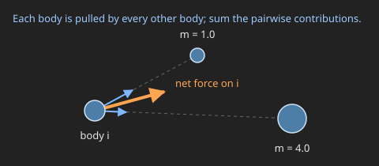

# N-body Gravitational Force

LeetGPU · #101

[打开实现文件](../../practice/leetgpu/101/solution.cu) · [原始材料](../../references/LeetGPU/challenges/medium/101_n_body_force/challenge.html)

Given `N` bodies in 3D space, each with a position vector `(x, y, z)` and a scalar mass, compute the gravitational force acting on each body due to all other bodies. The softened gravitational force on body `i` is:

 \[ \mathbf{F}_i = \sum_{j \neq i} m_j \frac{\mathbf{r}_j - \mathbf{r}_i} {\left(|\mathbf{r}_j - \mathbf{r}_i|^2 + \varepsilon^2\right)^{3/2}} \]

 where \(\varepsilon = 10^{-3}\) is a softening factor that prevents singularities when two bodies occupy the same position. Positions and forces are stored in row-major order: `array[i * 3 + k]` is the *k*-th coordinate of body `i`.

## Implementation Requirements

- Use only native GPU features (external libraries are not permitted)

- The `solve` function signature must remain unchanged

- The computed force for each body must be written to `forces`

## Example

 Input (`N` = 2):
 positions: \[ \begin{bmatrix} 0.0 & 0.0 & 0.0 \\ 0.0 & 3.0 & 4.0 \end{bmatrix} \] masses: \[ \begin{bmatrix} 2.0 & 1.0 \end{bmatrix} \] Output:
 forces: \[ \begin{bmatrix} 0.000 & 0.024 & 0.032 \\ 0.000 & -0.048 & -0.064 \end{bmatrix} \]

## Constraints

- 1 ≤ `N` ≤ 65,536

- Positions and forces are `float32` arrays of shape `N` × 3 in row-major order

- -10.0 ≤ `positions[i]` ≤ 10.0

- 0.0 < `masses[i]` ≤ 100.0

- Performance is measured with `N` = 8,192

## 本地接口

~~~cpp
extern "C" void solve(const float* positions, const float* masses, float* forces, int N);
~~~

## 本地用例

~~~bash
./practice.sh cases leetgpu 101
./practice.sh test leetgpu 101
~~~

展开输入规格

~~~text
  #0 公开样例 · positions (2, 3) float32 · masses (2,) float32 · forces (2, 3) float32 · N 2
  #1 公开功能用例 · positions (1, 3) float32 · masses (1,) float32 · forces (1, 3) float32 · N 1
  #2 公开功能用例 · positions (2, 3) float32 · masses (2,) float32 · forces (2, 3) float32 · N 2
  #3 公开功能用例 · positions (3, 3) float32 · masses (3,) float32 · forces (3, 3) float32 · N 3
  #4 公开功能用例 · positions (4, 3) float32 · masses (4,) float32 · forces (4, 3) float32 · N 4
  #5 公开功能用例 · positions (16, 3) float32 · masses (16,) float32 · forces (16, 3) float32 · N 16
  #6 公开功能用例 · positions (256, 3) float32 · masses (256,) float32 · forces (256, 3) float32 · N 256
  #7 公开功能用例 · positions (30, 3) float32 · masses (30,) float32 · forces (30, 3) float32 · N 30
  #8 公开功能用例 · positions (100, 3) float32 · masses (100,) float32 · forces (100, 3) float32 · N 100
  #9 公开功能用例 · positions (255, 3) float32 · masses (255,) float32 · forces (255, 3) float32 · N 255
  #10 公开功能用例 · positions (1024, 3) float32 · masses (1024,) float32 · forces (1024, 3) float32 · N 1024
  #11 首个用例复验 · 原用例 #1 · 种子 2037 · 缓冲区守卫 · positions (1, 3) float32 · masses (1,) float32 · forces (1, 3) float32 · N 1
  #12 中间用例复验 · 原用例 #6 · 种子 2038 · 缓冲区守卫 · positions (256, 3) float32 · masses (256,) float32 · forces (256, 3) float32 · N 256
  #13 末尾用例复验 · 原用例 #10 · 种子 2039 · 缓冲区守卫 · positions (1024, 3) float32 · masses (1024,) float32 · forces (1024, 3) float32 · N 1024
13 个功能用例，另有 1 个样例
~~~

