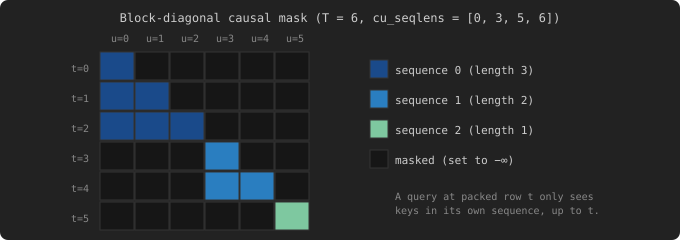

# Variable-Length Causal Attention

LeetGPU · #102

[打开实现文件](../../practice/leetgpu/102/solution.cu) · [原始材料](../../references/LeetGPU/challenges/medium/102_varlen_causal_attention/challenge.html)

Implement variable-length causal self-attention over a packed batch of sequences. The tensors `Q`, `K`, and `V` each have shape `T × d`, where `T` is the total number of tokens across all sequences concatenated end-to-end. The 1D tensor `cu_seqlens` of shape `S + 1` stores cumulative sequence lengths, so sequence `s` occupies rows `[cu_seqlens[s], cu_seqlens[s+1])`.

 For each token at packed position `t` belonging to sequence `s` with in-sequence position `p = t − cu_seqlens[s]`, attention is restricted to tokens of the same sequence at positions `0, 1, …, p` (causal). Concretely:

 \[ \text{scores}[t, u] = \begin{cases} \dfrac{Q[t] \cdot K[u]}{\sqrt{d}} & \text{if } u \text{ is in the same sequence as } t \text{ and } u \text{ is at or before } t, \\[4pt] -\infty & \text{otherwise.} \end{cases} \] \[ \text{output}[t] = \sum_{u} \text{softmax}(\text{scores}[t])[u] \cdot V[u]. \]

 This is the packed-sequence attention kernel used by inference engines such as vLLM and FlashAttention’s `varlen` path. By packing variable-length sequences into a single tensor and indexing through `cu_seqlens`, a serving stack avoids padding waste and amortizes kernel launch overhead across requests with very different lengths.

## Implementation Requirements

- Implement the `solve` function; do not change its signature.

- External libraries are not permitted.

- Write the result into `output`.

## Example

 Example 1 — with `T` = 3, `d` = 4, `S` = 2 and `cu_seqlens` = `[0, 2, 3]` (sequences of lengths 2 and 1):

 \[ Q = \begin{bmatrix} 1 & 0 & 0 & 0 \\ 0 & 1 & 0 & 0 \\ 1 & 1 & 0 & 0 \end{bmatrix}, \quad K = \begin{bmatrix} 1 & 0 & 0 & 0 \\ 0 & 1 & 0 & 0 \\ 1 & 0 & 0 & 0 \end{bmatrix}, \quad V = \begin{bmatrix} 1 & 2 & 3 & 4 \\ 5 & 6 & 7 & 8 \\ 9 & 10 & 11 & 12 \end{bmatrix} \]

 Scaled scores \(QK^\top / \sqrt{4}\) followed by the block-diagonal causal mask leave the allowed (sequence, position) pairs only: \[ \text{masked scores} = \begin{bmatrix} 0.5 & -\infty & -\infty \\ 0 & 0.5 & -\infty \\ -\infty & -\infty & 0.5 \end{bmatrix} \] After per-row softmax and multiplication by \(V\): \[ \text{output} \approx \begin{bmatrix} 1.0000 & 2.0000 & 3.0000 & 4.0000 \\ 3.4898 & 4.4898 & 5.4898 & 6.4898 \\ 9.0000 & 10.0000 & 11.0000 & 12.0000 \end{bmatrix} \]

## Constraints

- 1 ≤ `S` ≤ 256

- 1 ≤ sequence length ≤ 2,048 (each individual sequence)

- 1 ≤ `T` ≤ 16,384 (total packed tokens)

- 1 ≤ `d` ≤ 256

- `cu_seqlens` is monotonically non-decreasing with `cu_seqlens[0]` = 0 and `cu_seqlens[S]` = `T`.

- `Q`, `K`, `V`, `output` are `float32`; `cu_seqlens` is `int32`.

- Performance is measured with `T` = 8,192, `d` = 64, `S` = 32 (sequence lengths between 128 and 384).

## 本地接口

~~~cpp
extern "C" void solve(const float* Q, const float* K, const float* V, const int* cu_seqlens,
                      float* output, int T, int d, int S);
~~~

## 本地用例

~~~bash
./practice.sh cases leetgpu 102
./practice.sh test leetgpu 102
~~~

展开输入规格

~~~text
  #0 公开样例 · Q (3, 4) float32 · K (3, 4) float32 · V (3, 4) float32 · cu_seqlens (3,) int32 · output (3, 4) float32 · T 3 · d 4 · S 2
  #1 公开功能用例 · Q (1, 4) float32 · K (1, 4) float32 · V (1, 4) float32 · cu_seqlens (2,) int32 · output (1, 4) float32 · T 1 · d 4 · S 1
  #2 公开功能用例 · Q (8, 16) float32 · K (8, 16) float32 · V (8, 16) float32 · cu_seqlens (2,) int32 · output (8, 16) float32 · T 8 · d 16 · S 1
  #3 公开功能用例 · Q (16, 8) float32 · K (16, 8) float32 · V (16, 8) float32 · cu_seqlens (17,) int32 · output (16, 8) float32 · T 16 · d 8 · S 16
  #4 公开功能用例 · Q (14, 16) float32 · K (14, 16) float32 · V (14, 16) float32 · cu_seqlens (5,) int32 · output (14, 16) float32 · T 14 · d 16 · S 4
  #5 公开功能用例 · Q (120, 32) float32 · K (120, 32) float32 · V (120, 32) float32 · cu_seqlens (5,) int32 · output (120, 32) float32 · T 120 · d 32 · S 4
  #6 公开功能用例 · Q (66, 64) float32 · K (66, 64) float32 · V (66, 64) float32 · cu_seqlens (6,) int32 · output (66, 64) float32 · T 66 · d 64 · S 5
  #7 公开功能用例 · Q (20, 16) float32 · K (20, 16) float32 · V (20, 16) float32 · cu_seqlens (4,) int32 · output (20, 16) float32 · T 20 · d 16 · S 3
  #8 公开功能用例 · Q (32, 32) float32 · K (32, 32) float32 · V (32, 32) float32 · cu_seqlens (3,) int32 · output (32, 32) float32 · T 32 · d 32 · S 2
  #9 公开功能用例 · Q (944, 64) float32 · K (944, 64) float32 · V (944, 64) float32 · cu_seqlens (9,) int32 · output (944, 64) float32 · T 944 · d 64 · S 8
  #10 公开功能用例 · Q (216, 64) float32 · K (216, 64) float32 · V (216, 64) float32 · cu_seqlens (10,) int32 · output (216, 64) float32 · T 216 · d 64 · S 9
  #11 首个用例复验 · 原用例 #1 · 种子 2037 · 缓冲区守卫 · Q (1, 4) float32 · K (1, 4) float32 · V (1, 4) float32 · cu_seqlens (2,) int32 · output (1, 4) float32 · T 1 · d 4 · S 1
  #12 中间用例复验 · 原用例 #6 · 种子 2038 · 缓冲区守卫 · Q (66, 64) float32 · K (66, 64) float32 · V (66, 64) float32 · cu_seqlens (6,) int32 · output (66, 64) float32 · T 66 · d 64 · S 5
  #13 末尾用例复验 · 原用例 #10 · 种子 2039 · 缓冲区守卫 · Q (216, 64) float32 · K (216, 64) float32 · V (216, 64) float32 · cu_seqlens (10,) int32 · output (216, 64) float32 · T 216 · d 64 · S 9
13 个功能用例，另有 1 个样例
~~~

