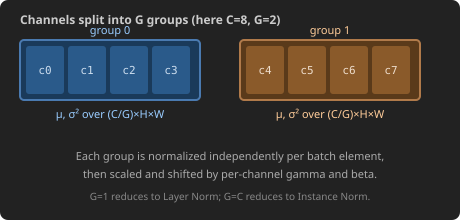

# Group Normalization

LeetGPU · #105

[打开实现文件](../../practice/leetgpu/105/solution.cu) · [原始材料](../../references/LeetGPU/challenges/medium/105_group_normalization/challenge.html)

Implement Group Normalization for 4D activation tensors, the normalization layer used by Stable Diffusion U-Nets and many ResNet variants. Given an input tensor `X` of shape `(N, C, H, W)`, the channels are split into `G` contiguous groups of `C/G` channels each. For every `(batch, group)` pair, the mean and variance are computed over all `(C/G) × H × W` elements, the activations are normalized, then scaled and shifted by per-channel parameters `gamma` and `beta`.

 For each batch index `n` and group index `g`, let \( \mathcal{S}_{n,g} = \{(n, c, h, w) : c \in [g \cdot C/G,\, (g+1) \cdot C/G)\} \). Group Normalization computes: \[ \begin{align} \mu_{n,g} &= \frac{1}{|\mathcal{S}_{n,g}|} \sum_{(n,c,h,w) \in \mathcal{S}_{n,g}} x_{n,c,h,w} \\ \sigma_{n,g}^2 &= \frac{1}{|\mathcal{S}_{n,g}|} \sum_{(n,c,h,w) \in \mathcal{S}_{n,g}} (x_{n,c,h,w} - \mu_{n,g})^2 \\ \hat{x}_{n,c,h,w} &= \frac{x_{n,c,h,w} - \mu_{n,g(c)}}{\sqrt{\sigma_{n,g(c)}^2 + \epsilon}} \\ y_{n,c,h,w} &= \gamma_c \, \hat{x}_{n,c,h,w} + \beta_c \end{align} \] where \( g(c) = \lfloor c \cdot G / C \rfloor \) maps a channel to its group.

## Implementation Requirements

- Use only native features (external libraries are not permitted)

- The `solve` function signature must remain unchanged

- The final result must be stored in the `Y` tensor

## Example 1:

~~~text

Input:  N=1, C=4, H=2, W=2, G=2, eps=1e-5
        X[0,0] = [[1, 1], [1, 1]]
        X[0,1] = [[3, 3], [3, 3]]
        X[0,2] = [[2, 2], [2, 2]]
        X[0,3] = [[6, 6], [6, 6]]
        gamma = [1, 1, 1, 1]
        beta  = [0, 0, 0, 0]
Output: Y[0,0] = [[-1, -1], [-1, -1]]
        Y[0,1] = [[ 1,  1], [ 1,  1]]
        Y[0,2] = [[-1, -1], [-1, -1]]
        Y[0,3] = [[ 1,  1], [ 1,  1]]
Note:   Group 0 = channels {0, 1}: mean = 2, var = 1, std = 1
        Group 1 = channels {2, 3}: mean = 4, var = 4, std = 2

~~~

## Example 2:

~~~text

Input:  N=1, C=2, H=1, W=2, G=2, eps=1e-5
        X[0,0] = [[1, 3]]
        X[0,1] = [[2, 6]]
        gamma = [2, 1]
        beta  = [0, 0]
Output: Y[0,0] = [[-2,  2]]
        Y[0,1] = [[-1,  1]]
Note:   G=C, so each channel is its own group (Instance Norm).
        Channel 0: mean=2, var=1, std=1
        Channel 1: mean=4, var=4, std=2

~~~

## Constraints

- 1 ≤ `N` ≤ 32

- 1 ≤ `C` ≤ 1,024 and `C` is divisible by `G`

- 1 ≤ `G` ≤ `C`

- 1 ≤ `H`, `W` ≤ 128

- `eps` = 1e-5

- -100.0 ≤ input values ≤ 100.0

- 0.1 ≤ `gamma` values ≤ 10.0

- -10.0 ≤ `beta` values ≤ 10.0

- Performance is measured with `N` = 8, `C` = 512, `H` = 64, `W` = 64, `G` = 32

## 本地接口

~~~cpp
extern "C" void solve(const float* X, const float* gamma, const float* beta, float* Y, int N, int C,
                      int H, int W, int G, float eps);
~~~

## 本地用例

~~~bash
./practice.sh cases leetgpu 105
./practice.sh test leetgpu 105
~~~

展开输入规格

~~~text
  #0 公开样例 · X (1, 4, 2, 2) float32 · gamma (4,) float32 · beta (4,) float32 · Y (1, 4, 2, 2) float32 · N 1 · C 4 · H 2 · W 2 · G 2 · eps 1e-05
  #1 公开功能用例 · X (1, 4, 2, 2) float32 · gamma (4,) float32 · beta (4,) float32 · Y (1, 4, 2, 2) float32 · N 1 · C 4 · H 2 · W 2 · G 2 · eps 1e-05
  #2 公开功能用例 · X (2, 8, 4, 4) float32 · gamma (8,) float32 · beta (8,) float32 · Y (2, 8, 4, 4) float32 · N 2 · C 8 · H 4 · W 4 · G 1 · eps 1e-05
  #3 公开功能用例 · X (2, 4, 3, 3) float32 · gamma (4,) float32 · beta (4,) float32 · Y (2, 4, 3, 3) float32 · N 2 · C 4 · H 3 · W 3 · G 4 · eps 1e-05
  #4 公开功能用例 · X (2, 8, 4, 4) float32 · gamma (8,) float32 · beta (8,) float32 · Y (2, 8, 4, 4) float32 · N 2 · C 8 · H 4 · W 4 · G 2 · eps 1e-05
  #5 公开功能用例 · X (2, 6, 4, 4) float32 · gamma (6,) float32 · beta (6,) float32 · Y (2, 6, 4, 4) float32 · N 2 · C 6 · H 4 · W 4 · G 3 · eps 1e-05
  #6 公开功能用例 · X (3, 12, 7, 7) float32 · gamma (12,) float32 · beta (12,) float32 · Y (3, 12, 7, 7) float32 · N 3 · C 12 · H 7 · W 7 · G 4 · eps 1e-05
  #7 公开功能用例 · X (4, 32, 16, 16) float32 · gamma (32,) float32 · beta (32,) float32 · Y (4, 32, 16, 16) float32 · N 4 · C 32 · H 16 · W 16 · G 8 · eps 1e-05
  #8 公开功能用例 · X (2, 64, 32, 32) float32 · gamma (64,) float32 · beta (64,) float32 · Y (2, 64, 32, 32) float32 · N 2 · C 64 · H 32 · W 32 · G 16 · eps 1e-05
  #9 公开功能用例 · X (2, 16, 8, 32) float32 · gamma (16,) float32 · beta (16,) float32 · Y (2, 16, 8, 32) float32 · N 2 · C 16 · H 8 · W 32 · G 4 · eps 1e-05
  #10 首个用例复验 · 原用例 #1 · 种子 2036 · 缓冲区守卫 · X (1, 4, 2, 2) float32 · gamma (4,) float32 · beta (4,) float32 · Y (1, 4, 2, 2) float32 · N 1 · C 4 · H 2 · W 2 · G 2 · eps 1e-05
  #11 中间用例复验 · 原用例 #5 · 种子 2037 · 缓冲区守卫 · X (2, 6, 4, 4) float32 · gamma (6,) float32 · beta (6,) float32 · Y (2, 6, 4, 4) float32 · N 2 · C 6 · H 4 · W 4 · G 3 · eps 1e-05
  #12 末尾用例复验 · 原用例 #9 · 种子 2038 · 缓冲区守卫 · X (2, 16, 8, 32) float32 · gamma (16,) float32 · beta (16,) float32 · Y (2, 16, 8, 32) float32 · N 2 · C 16 · H 8 · W 32 · G 4 · eps 1e-05
12 个功能用例，另有 1 个样例
~~~

