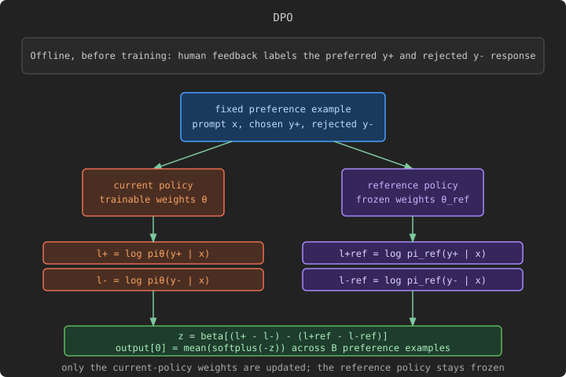

# DPO Sequence Loss

LeetGPU · #108

[打开实现文件](../../practice/leetgpu/108/solution.cu) · [原始材料](../../references/LeetGPU/challenges/medium/108_dpo_sequence_loss/challenge.html)

Given precomputed sequence log probabilities for chosen and rejected responses under a current policy and a reference policy, compute the Direct Preference Optimization (DPO) loss. Each input is a one-dimensional tensor of shape `[B]`. The output is one value: the DPO loss averaged across all `B` response pairs.

 Each batch entry represents one prompt and its chosen/rejected response pair. Token-level log probabilities have already been summed, and the same tokenization and masking convention was used for the current and reference policies.

 Before training, a reviewer labels one response as preferred and one as rejected. Each DPO update then consumes that fixed example: prompt `x`, chosen response `y+`, and rejected response `y-`. The current and reference policies each score both responses, producing four sequence log probabilities.

## Implementation Requirements

- Implement `solve(chosen_logps, rejected_logps, chosen_ref_logps, rejected_ref_logps, output, beta, B)` with the signature unchanged

- Write the mean DPO loss across the batch into `output[0]`

- Use only native features of the selected framework; external libraries are not permitted

- All four log-probability inputs have shape `[B]`

- Compute the loss stably as `softplus(-logits)` or an equivalent formulation

- The reference-policy log probabilities are fixed precomputed inputs

## Loss Calculation

 At batch index `i`, let `l+` and `l-` be the chosen and rejected log probabilities under the current policy. Let `l+_ref` and `l-_ref` be the corresponding values under the reference policy.
 \[ \Delta_i^{\pi} = \ell_i^{+} - \ell_i^{-} \] \[ \Delta_i^{\mathrm{ref}} = \ell_i^{+,\mathrm{ref}} - \ell_i^{-,\mathrm{ref}} \]
Subtract the reference margin from the current-policy margin, then scale by `beta`:
 \[ z_i = \beta\left(\Delta_i^{\pi} - \Delta_i^{\mathrm{ref}}\right) \]
 DPO maximizes the log-sigmoid of this preference logit. This challenge returns the equivalent loss for minimization, averaged across the batch:
 \[ \text{output}[0] = -\frac{1}{B}\sum_{i=0}^{B-1} \log\!\left(\sigma(z_i)\right) = \frac{1}{B}\sum_{i=0}^{B-1} \operatorname{softplus}(-z_i) \]
The `softplus` form is mathematically equivalent and remains finite for very large logits.

## Examples

For `B` = 4 and `beta` = 0.1:
 \[ \begin{aligned} \text{chosen_logps} &= \begin{bmatrix} 0.0 & 1.0 & -1.0 & 2.0 \end{bmatrix} \\[6pt] \text{rejected_logps} &= \begin{bmatrix} 0.0 & 0.0 & 0.0 & 0.0 \end{bmatrix} \\[6pt] \text{chosen_ref_logps} &= \begin{bmatrix} 0.0 & 0.0 & 0.0 & 0.0 \end{bmatrix} \\[6pt] \text{rejected_ref_logps} &= \begin{bmatrix} 0.0 & 0.0 & 0.0 & 0.0 \end{bmatrix} \end{aligned} \]
The reference margin is zero, so the preference logits and final loss are:
 \[ z = \begin{bmatrix} 0.0 & 0.1 & -0.1 & 0.2 \end{bmatrix} \] \[ \text{output}[0] = \operatorname{mean}\!\left(\operatorname{softplus}(-z)\right) = 0.67002 \]

## Constraints

- 1 ≤ `B` ≤ 65,536

- All tensors contain 32-bit floating point values

- `0 < beta ≤ 1`

- All input log probabilities are finite

- Sequence reductions and token masks are outside the scope of this challenge

- Performance is measured with `B` = 65,536

## Reference

 [Direct Preference Optimization: Your Language Model is Secretly a Reward Model, Rafailov et al. (2023)](https://arxiv.org/abs/2305.18290)

## 本地接口

~~~cpp
extern "C" void solve(const float* chosen_logps, const float* rejected_logps,
                      const float* chosen_ref_logps, const float* rejected_ref_logps, float* output,
                      float beta, int B);
~~~

## 本地用例

~~~bash
./practice.sh cases leetgpu 108
./practice.sh test leetgpu 108
~~~

展开输入规格

~~~text
  #0 公开样例 · chosen_logps (4,) float32 · rejected_logps (4,) float32 · chosen_ref_logps (4,) float32 · rejected_ref_logps (4,) float32 · output (1,) float32 · beta 0.1 · B 4
  #1 公开功能用例 · chosen_logps (4,) float32 · rejected_logps (4,) float32 · chosen_ref_logps (4,) float32 · rejected_ref_logps (4,) float32 · output (1,) float32 · beta 0.1 · B 4
  #2 公开功能用例 · chosen_logps (1,) float32 · rejected_logps (1,) float32 · chosen_ref_logps (1,) float32 · rejected_ref_logps (1,) float32 · output (1,) float32 · beta 0.1 · B 1
  #3 公开功能用例 · chosen_logps (2,) float32 · rejected_logps (2,) float32 · chosen_ref_logps (2,) float32 · rejected_ref_logps (2,) float32 · output (1,) float32 · beta 0.7 · B 2
  #4 公开功能用例 · chosen_logps (4,) float32 · rejected_logps (4,) float32 · chosen_ref_logps (4,) float32 · rejected_ref_logps (4,) float32 · output (1,) float32 · beta 0.1 · B 4
  #5 公开功能用例 · chosen_logps (1,) float32 · rejected_logps (1,) float32 · chosen_ref_logps (1,) float32 · rejected_ref_logps (1,) float32 · output (1,) float32 · beta 1.0 · B 1
  #6 公开功能用例 · chosen_logps (2,) float32 · rejected_logps (2,) float32 · chosen_ref_logps (2,) float32 · rejected_ref_logps (2,) float32 · output (1,) float32 · beta 0.5 · B 2
  #7 公开功能用例 · chosen_logps (127,) float32 · rejected_logps (127,) float32 · chosen_ref_logps (127,) float32 · rejected_ref_logps (127,) float32 · output (1,) float32 · beta 0.05 · B 127
  #8 公开功能用例 · chosen_logps (32,) float32 · rejected_logps (32,) float32 · chosen_ref_logps (32,) float32 · rejected_ref_logps (32,) float32 · output (1,) float32 · beta 0.1 · B 32
  #9 公开功能用例 · chosen_logps (6,) float32 · rejected_logps (6,) float32 · chosen_ref_logps (6,) float32 · rejected_ref_logps (6,) float32 · output (1,) float32 · beta 0.1 · B 6
  #10 公开功能用例 · chosen_logps (4,) float32 · rejected_logps (4,) float32 · chosen_ref_logps (4,) float32 · rejected_ref_logps (4,) float32 · output (1,) float32 · beta 0.1 · B 4
  #11 公开功能用例 · chosen_logps (4096,) float32 · rejected_logps (4096,) float32 · chosen_ref_logps (4096,) float32 · rejected_ref_logps (4096,) float32 · output (1,) float32 · beta 0.2 · B 4096
  #12 首个用例复验 · 原用例 #1 · 种子 2038 · 缓冲区守卫 · chosen_logps (4,) float32 · rejected_logps (4,) float32 · chosen_ref_logps (4,) float32 · rejected_ref_logps (4,) float32 · output (1,) float32 · beta 0.1 · B 4
  #13 中间用例复验 · 原用例 #6 · 种子 2039 · 缓冲区守卫 · chosen_logps (2,) float32 · rejected_logps (2,) float32 · chosen_ref_logps (2,) float32 · rejected_ref_logps (2,) float32 · output (1,) float32 · beta 0.5 · B 2
  #14 末尾用例复验 · 原用例 #11 · 种子 2040 · 缓冲区守卫 · chosen_logps (4096,) float32 · rejected_logps (4096,) float32 · chosen_ref_logps (4096,) float32 · rejected_ref_logps (4096,) float32 · output (1,) float32 · beta 0.2 · B 4096
14 个功能用例，另有 1 个样例
~~~

