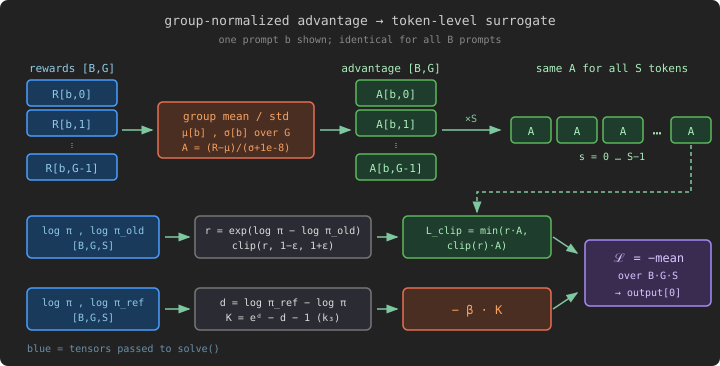

# GRPO Surrogate Loss

LeetGPU · #109

[打开实现文件](../../practice/leetgpu/109/solution.cu) · [原始材料](../../references/LeetGPU/challenges/medium/109_grpo_surrogate_loss/challenge.html)

For each of `B` prompts, GRPO compares the rewards of `G` sampled responses. It uses each response's reward relative to the rest of its group as an advantage, rather than learning a separate critic. That advantage is applied to every one of the response's `S` tokens in a clipped policy objective with a reference-policy KL regularizer.

 At position `[b, g, s]`, `log_pi`, `log_pi_old`, and `log_ref` all score the same sampled token `y[b,g,s]`, conditioned on prompt `b` and the preceding response tokens.

## Implementation Requirements

- Implement `solve(rewards, log_pi, log_pi_old, log_ref, output, clip_eps, beta, B, G, S)` with the signature unchanged

- Write the scalar mean loss into `output[0]`

- Use only native features of the selected framework; external libraries are not permitted

- Rewards have shape `[B, G]`; all log-probability tensors have shape `[B, G, S]`

- Token masks and padding handling are outside the scope of this challenge; all `S` positions participate in the reduction

- Rewards, `log_pi_old`, and `log_ref` are fixed precomputed inputs; do not differentiate through them

## Loss Calculation

 For one prompt `b`, normalize the `G` response rewards using the group's population mean and standard deviation. Let `R` denote `rewards`.
 \[ \mu_b = \frac{1}{G}\sum_{g=0}^{G-1} R_{b,g} \] \[ \sigma_b = \sqrt{\frac{1}{G}\sum_{g=0}^{G-1}(R_{b,g}-\mu_b)^2} \] \[ A_{b,g} = \frac{R_{b,g}-\mu_b}{\sigma_b + 10^{-8}} \]
 This is an outcome-level GRPO advantage. The same advantage is broadcast to every token of response `g`:
 \[ A_{b,g,s} = A_{b,g} \]
 Compare the current policy with the old policy that sampled the response.
 \[ r_{b,g,s} = \exp\!\left(\log\pi_{b,g,s} - \log\pi^{\mathrm{old}}_{b,g,s}\right) \]
 Clamp that ratio around one, then take the less optimistic of the clipped and unclipped values. Let `epsilon` denote `clip_eps`. This `min` applies correctly to both positive and negative advantages.
 \[ \widehat{r}_{b,g,s} = \operatorname{clip}\!\left(r_{b,g,s}, 1-\varepsilon, 1+\varepsilon\right) \] \[ L^{\mathrm{clip}}_{b,g,s} = \min\!\left(r_{b,g,s}A_{b,g,s},\; \widehat{r}_{b,g,s}A_{b,g,s}\right) \]
 GRPO also penalizes divergence from the frozen reference policy. Let `beta` be the KL coefficient. The non-negative `k3` sample estimator is:
 \[ d_{b,g,s} = \log\pi^{\mathrm{ref}}_{b,g,s} - \log\pi_{b,g,s} \] \[ K_{b,g,s} = \exp(d_{b,g,s}) - d_{b,g,s} - 1 \]
 GRPO maximizes the clipped objective minus this penalty. Because this challenge returns a loss for minimization, write the negated mean over all prompts, responses, and tokens to `output[0]`:
 \[ \text{output}[0] = -\frac{1}{BGS}\sum_{b=0}^{B-1}\sum_{g=0}^{G-1}\sum_{s=0}^{S-1} \left(L^{\mathrm{clip}}_{b,g,s} - \beta K_{b,g,s}\right) \]

## Examples

For `B` = 1, `G` = 2, `S` = 2, `clip_eps` = 0.2, and `beta` = 0.01:
 \[ \begin{aligned} \text{rewards} &= \begin{bmatrix} 10.0 & 0.0 \end{bmatrix} \\[6pt] \text{log_pi} &= \begin{bmatrix} 0.1 & 0.2 \\ -0.5 & -0.4 \end{bmatrix} \\[6pt] \text{log_pi_old} &= \begin{bmatrix} 0.0 & 0.0 \\ 0.0 & 0.0 \end{bmatrix} \\[6pt] \text{log_ref} &= \begin{bmatrix} 0.0 & 0.0 \\ 0.0 & 0.0 \end{bmatrix} \end{aligned} \] \[ \text{output}[0] \approx -0.17563 \]

## Constraints

- 1 ≤ `B` ≤ 256

- 2 ≤ `G` ≤ 32

- 1 ≤ `S` ≤ 16,384

- All tensors contain 32-bit floating point values

- `0 ≤ clip_eps < 1` and `0 ≤ beta ≤ 1`

- Both `log_pi - log_pi_old` and `log_ref - log_pi` lie in [-16, 16], so every exponential is finite in float32

- Performance is measured with `B` = 64, `G` = 16, `S` = 4,096

## Reference

 [DeepSeekMath: Pushing the Limits of Mathematical Reasoning in Open Language Models (GRPO), Shao et al. (2024)](https://arxiv.org/abs/2402.03300)

## 本地接口

~~~cpp
extern "C" void solve(const float* rewards, const float* log_pi, const float* log_pi_old,
                      const float* log_ref, float* output, float clip_eps, float beta, int B, int G,
                      int S);
~~~

## 本地用例

~~~bash
./practice.sh cases leetgpu 109
./practice.sh test leetgpu 109
~~~

展开输入规格

~~~text
  #0 公开样例 · rewards (1, 2) float32 · log_pi (1, 2, 2) float32 · log_pi_old (1, 2, 2) float32 · log_ref (1, 2, 2) float32 · output (1,) float32 · clip_eps 0.2 · beta 0.01 · B 1 · G 2 · S 2
  #1 公开功能用例 · rewards (1, 2) float32 · log_pi (1, 2, 2) float32 · log_pi_old (1, 2, 2) float32 · log_ref (1, 2, 2) float32 · output (1,) float32 · clip_eps 0.2 · beta 0.01 · B 1 · G 2 · S 2
  #2 公开功能用例 · rewards (2, 2) float32 · log_pi (2, 2, 4) float32 · log_pi_old (2, 2, 4) float32 · log_ref (2, 2, 4) float32 · output (1,) float32 · clip_eps 0.2 · beta 0.01 · B 2 · G 2 · S 4
  #3 公开功能用例 · rewards (1, 2) float32 · log_pi (1, 2, 1) float32 · log_pi_old (1, 2, 1) float32 · log_ref (1, 2, 1) float32 · output (1,) float32 · clip_eps 0.2 · beta 0.01 · B 1 · G 2 · S 1
  #4 公开功能用例 · rewards (2, 4) float32 · log_pi (2, 4, 8) float32 · log_pi_old (2, 4, 8) float32 · log_ref (2, 4, 8) float32 · output (1,) float32 · clip_eps 0.2 · beta 0.01 · B 2 · G 4 · S 8
  #5 公开功能用例 · rewards (1, 5) float32 · log_pi (1, 5, 7) float32 · log_pi_old (1, 5, 7) float32 · log_ref (1, 5, 7) float32 · output (1,) float32 · clip_eps 0.1 · beta 0.01 · B 1 · G 5 · S 7
  #6 公开功能用例 · rewards (2, 4) float32 · log_pi (2, 4, 16) float32 · log_pi_old (2, 4, 16) float32 · log_ref (2, 4, 16) float32 · output (1,) float32 · clip_eps 0.2 · beta 0.01 · B 2 · G 4 · S 16
  #7 公开功能用例 · rewards (4, 8) float32 · log_pi (4, 8, 64) float32 · log_pi_old (4, 8, 64) float32 · log_ref (4, 8, 64) float32 · output (1,) float32 · clip_eps 0.1 · beta 0.05 · B 4 · G 8 · S 64
  #8 公开功能用例 · rewards (3, 5) float32 · log_pi (3, 5, 27) float32 · log_pi_old (3, 5, 27) float32 · log_ref (3, 5, 27) float32 · output (1,) float32 · clip_eps 0.2 · beta 0.01 · B 3 · G 5 · S 27
  #9 公开功能用例 · rewards (2, 32) float32 · log_pi (2, 32, 3) float32 · log_pi_old (2, 32, 3) float32 · log_ref (2, 32, 3) float32 · output (1,) float32 · clip_eps 0.2 · beta 0.01 · B 2 · G 32 · S 3
  #10 公开功能用例 · rewards (2, 4) float32 · log_pi (2, 4, 8) float32 · log_pi_old (2, 4, 8) float32 · log_ref (2, 4, 8) float32 · output (1,) float32 · clip_eps 0.2 · beta 0.01 · B 2 · G 4 · S 8
  #11 公开功能用例 · rewards (2, 4) float32 · log_pi (2, 4, 8) float32 · log_pi_old (2, 4, 8) float32 · log_ref (2, 4, 8) float32 · output (1,) float32 · clip_eps 0.2 · beta 0.01 · B 2 · G 4 · S 8
  #12 公开功能用例 · rewards (8, 8) float32 · log_pi (8, 8, 256) float32 · log_pi_old (8, 8, 256) float32 · log_ref (8, 8, 256) float32 · output (1,) float32 · clip_eps 0.2 · beta 0.02 · B 8 · G 8 · S 256
  #13 首个用例复验 · 原用例 #1 · 种子 2039 · 缓冲区守卫 · rewards (1, 2) float32 · log_pi (1, 2, 2) float32 · log_pi_old (1, 2, 2) float32 · log_ref (1, 2, 2) float32 · output (1,) float32 · clip_eps 0.2 · beta 0.01 · B 1 · G 2 · S 2
  #14 中间用例复验 · 原用例 #7 · 种子 2040 · 缓冲区守卫 · rewards (4, 8) float32 · log_pi (4, 8, 64) float32 · log_pi_old (4, 8, 64) float32 · log_ref (4, 8, 64) float32 · output (1,) float32 · clip_eps 0.1 · beta 0.05 · B 4 · G 8 · S 64
  #15 末尾用例复验 · 原用例 #12 · 种子 2041 · 缓冲区守卫 · rewards (8, 8) float32 · log_pi (8, 8, 256) float32 · log_pi_old (8, 8, 256) float32 · log_ref (8, 8, 256) float32 · output (1,) float32 · clip_eps 0.2 · beta 0.02 · B 8 · G 8 · S 256
15 个功能用例，另有 1 个样例
~~~

