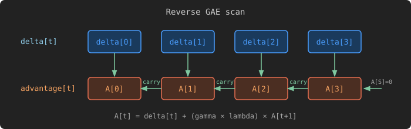

# Parallel Reverse Scan (GAE)

LeetGPU · #110

[打开实现文件](../../practice/leetgpu/110/solution.cu) · [原始材料](../../references/LeetGPU/challenges/medium/110_gae_reverse_scan/challenge.html)

Given reward and value sequences with shape `[B, S]`, compute the Generalized Advantage Estimate (GAE) for every batch element and timestep. GAE combines one-step temporal-difference errors with a reverse discounted accumulation, creating a dependency that runs from the end of each sequence toward the beginning.

## How GAE Is Computed

 The calculation has two stages. First, compute the one-step temporal-difference error at every position. The value after the final position is defined as zero:
 \[ \widetilde{V}_{b,t+1} = \begin{cases} V_{b,t+1}, & t < S - 1 \\ 0, & t = S - 1 \end{cases} \qquad \delta_{b,t} = r_{b,t} + \gamma \widetilde{V}_{b,t+1} - V_{b,t} \]
 Next, let `c = gamma × lambda`. The advantage at position `t` is the current TD error plus the decayed advantage from the next position:
 \[ A_{b,S} = 0, \qquad A_{b,S-1} = \delta_{b,S-1}, \qquad A_{b,t} = \delta_{b,t} + c A_{b,t+1} \quad \text{for } t = S-2, S-3, \ldots, 0 \]
 Therefore, implementations can compute all `delta` values in parallel, then perform a reverse scan over the sequence using the recurrence above. For long sequences, the reverse scan can be split into blocks: each block computes its local scan, then receives the decayed carry from the block to its right.

For the example below, `gamma` = 0.9 and `lambda` = 0.5, so `c` = 0.45:
 \[ \delta = \begin{bmatrix} 1.4 & 2.35 & 3.3 & 2.0 \end{bmatrix} \] \[ A_3 = 2.0, \quad A_2 = 3.3 + 0.45(2.0) = 4.2, \quad A_1 = 2.35 + 0.45(4.2) = 4.24, \quad A_0 = 1.4 + 0.45(4.24) = 3.308 \]

## Implementation Requirements

- Implement `solve(rewards, values, advantages, gamma, lam, B, S)` with the signature unchanged

- Write the result into the preallocated `advantages` tensor

- Use only native features of the selected framework; external libraries are not permitted

- For the final timestep, use a bootstrap value of zero

- Use float32 arithmetic for all tensors

- Every sequence terminates at `S`; padding, per-token terminal flags, and masks are outside the scope of this challenge

## Examples

For `B` = 1, `S` = 4, `gamma` = 0.9, and `lambda` = 0.5:
 \[ \text{rewards} = \begin{bmatrix} 1.0 & 2.0 & 3.0 & 4.0 \end{bmatrix}, \quad \text{values} = \begin{bmatrix} 0.5 & 1.0 & 1.5 & 2.0 \end{bmatrix} \] \[ \text{advantages} = \begin{bmatrix} 3.308 & 4.240 & 4.200 & 2.000 \end{bmatrix} \]
The final timestep uses `next_value` = 0, so its temporal-difference error is `4.0 - 2.0 = 2.0`. Each earlier advantage includes the discounted contribution from later timesteps.

## Constraints

- 1 ≤ `B` ≤ 256

- 1 ≤ `S` ≤ 65,536

- `rewards`, `values`, and `advantages` have shape `[B, S]`

- All tensors contain 32-bit floating point values

- `gamma` and `lambda` are in the range [0, 1]

- Performance is measured with `B` = 64, `S` = 4,096

## Reference

 [High-Dimensional Continuous Control Using Generalized Advantage Estimation, Schulman et al. (2015)](https://arxiv.org/abs/1506.02438)

## 本地接口

~~~cpp
extern "C" void solve(const float* rewards, const float* values, float* advantages, float gamma,
                      float lam, int B, int S);
~~~

## 本地用例

~~~bash
./practice.sh cases leetgpu 110
./practice.sh test leetgpu 110
~~~

展开输入规格

~~~text
  #0 公开样例 · rewards (1, 4) float32 · values (1, 4) float32 · advantages (1, 4) float32 · gamma 0.9 · lam 0.5 · B 1 · S 4
  #1 公开功能用例 · rewards (1, 1) float32 · values (1, 1) float32 · advantages (1, 1) float32 · gamma 0.99 · lam 0.95 · B 1 · S 1
  #2 公开功能用例 · rewards (1, 2) float32 · values (1, 2) float32 · advantages (1, 2) float32 · gamma 0.99 · lam 0.95 · B 1 · S 2
  #3 公开功能用例 · rewards (2, 4) float32 · values (2, 4) float32 · advantages (2, 4) float32 · gamma 0.99 · lam 0.95 · B 2 · S 4
  #4 公开功能用例 · rewards (1, 4) float32 · values (1, 4) float32 · advantages (1, 4) float32 · gamma 0.0 · lam 0.95 · B 1 · S 4
  #5 公开功能用例 · rewards (1, 4) float32 · values (1, 4) float32 · advantages (1, 4) float32 · gamma 0.9 · lam 0.0 · B 1 · S 4
  #6 公开功能用例 · rewards (1, 4) float32 · values (1, 4) float32 · advantages (1, 4) float32 · gamma 0.99 · lam 0.95 · B 1 · S 4
  #7 公开功能用例 · rewards (4, 16) float32 · values (4, 16) float32 · advantages (4, 16) float32 · gamma 0.99 · lam 0.95 · B 4 · S 16
  #8 公开功能用例 · rewards (8, 64) float32 · values (8, 64) float32 · advantages (8, 64) float32 · gamma 1.0 · lam 1.0 · B 8 · S 64
  #9 公开功能用例 · rewards (2, 30) float32 · values (2, 30) float32 · advantages (2, 30) float32 · gamma 0.99 · lam 0.95 · B 2 · S 30
  #10 公开功能用例 · rewards (4, 100) float32 · values (4, 100) float32 · advantages (4, 100) float32 · gamma 0.9 · lam 0.8 · B 4 · S 100
  #11 公开功能用例 · rewards (2, 257) float32 · values (2, 257) float32 · advantages (2, 257) float32 · gamma 0.99 · lam 0.95 · B 2 · S 257
  #12 公开功能用例 · rewards (16, 1024) float32 · values (16, 1024) float32 · advantages (16, 1024) float32 · gamma 0.99 · lam 0.95 · B 16 · S 1024
  #13 公开功能用例 · rewards (64, 4096) float32 · values (64, 4096) float32 · advantages (64, 4096) float32 · gamma 0.99 · lam 0.95 · B 64 · S 4096
  #14 首个用例复验 · 原用例 #1 · 种子 2040 · 缓冲区守卫 · rewards (1, 1) float32 · values (1, 1) float32 · advantages (1, 1) float32 · gamma 0.99 · lam 0.95 · B 1 · S 1
  #15 中间用例复验 · 原用例 #7 · 种子 2041 · 缓冲区守卫 · rewards (4, 16) float32 · values (4, 16) float32 · advantages (4, 16) float32 · gamma 0.99 · lam 0.95 · B 4 · S 16
  #16 末尾用例复验 · 原用例 #13 · 种子 2042 · 缓冲区守卫 · rewards (64, 4096) float32 · values (64, 4096) float32 · advantages (64, 4096) float32 · gamma 0.99 · lam 0.95 · B 64 · S 4096
16 个功能用例，另有 1 个样例
~~~

