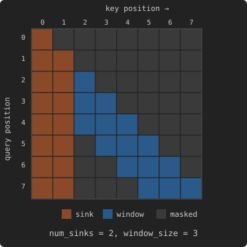

# Attention with Sinks

LeetGPU · #112

[打开实现文件](../../practice/leetgpu/112/solution.cu) · [原始材料](../../references/LeetGPU/challenges/medium/112_attention_with_sinks/challenge.html)

Implement **Attention with Sinks** for a given set of matrices. This is the attention pattern used in *StreamingLLM* to enable long-context inference: each query attends to a small number of leading *sink* tokens plus a sliding window of the most recent tokens. Combining a fixed prefix (sinks) with a moving window keeps the KV cache bounded while preserving the anchor tokens that stabilize the softmax distribution.

 Given query matrix `Q`, key matrix `K`, and value matrix `V`, each of shape `M × d`, compute for every query position `i`:

 \( \text{score}_{i,j} = \frac{Q_i \cdot K_j}{\sqrt{d}} \)

 The set of allowed key positions for query `i` is:

 \( \mathcal{A}_i = \{\, j : j \le i \;\wedge\; (\, j < \text{num_sinks} \;\vee\; j \ge i - \text{window_size} + 1 \,) \,\} \)

 Softmax is applied only over these allowed positions and the output is the weighted sum of the corresponding values:

 \( \text{output}_i = \sum_{j \in \mathcal{A}_i} \operatorname{softmax}\!\left(\text{score}_{i,\mathcal{A}_i}\right)_j \cdot V_j \)

## Implementation Requirements

- Use only native features (external libraries are not permitted)

- The `solve` function signature must remain unchanged

- The final result must be stored in the output matrix `output`

## Example 1:

 **Input:**
 `Q` (4×4): \[ \begin{bmatrix} 1.0 & 0.0 & 0.0 & 0.0 \\ 0.0 & 1.0 & 0.0 & 0.0 \\ 0.0 & 0.0 & 1.0 & 0.0 \\ 0.0 & 0.0 & 0.0 & 1.0 \end{bmatrix} \] `K` (4×4): \[ \begin{bmatrix} 1.0 & 0.0 & 0.0 & 0.0 \\ 0.0 & 1.0 & 0.0 & 0.0 \\ 0.0 & 0.0 & 1.0 & 0.0 \\ 0.0 & 0.0 & 0.0 & 1.0 \end{bmatrix} \] `V` (4×4): \[ \begin{bmatrix} 1.0 & 2.0 & 3.0 & 4.0 \\ 5.0 & 6.0 & 7.0 & 8.0 \\ 9.0 & 10.0 & 11.0 & 12.0 \\ 13.0 & 14.0 & 15.0 & 16.0 \end{bmatrix} \] `num_sinks`: 1, `window_size`: 2

 **Output:**
 `output` (4×4): \[ \begin{bmatrix} 1.0000000 & 2.0000000 & 3.0000000 & 4.0000000 \\ 3.4898374 & 4.4898372 & 5.4898376 & 6.4898376 \\ 5.7111764 & 6.7111769 & 7.7111769 & 8.7111759 \\ 8.6149015 & 9.6149015 & 10.6149025 & 11.6149025 \end{bmatrix} \]

 Query 3 attends to positions `{0, 2, 3}`: position `0` is a sink, positions `2` and `3` fall inside the causal window `[i - window_size + 1, i] = [2, 3]`, and position `1` is neither a sink nor in the window, so it is masked out.

## Constraints

- Matrices `Q`, `K`, and `V` are all of size `M × d`

- 1 ≤ `M` ≤ 10,000

- 1 ≤ `d` ≤ 128

- 1 ≤ `num_sinks` ≤ 16, and `num_sinks` ≤ `M`

- 1 ≤ `window_size` ≤ `M`

- All elements in `Q`, `K`, and `V` are sampled from `[-1.0, 1.0]`

- Data type for all matrices is `float32`

- Performance is measured with `M` = 5,000, `d` = 128, `num_sinks` = 4, `window_size` = 1,024

## References

-  Xiao et al., [Efficient Streaming Language Models with Attention Sinks](https://arxiv.org/abs/2309.17453) (arXiv:2309.17453, ICLR 2024) — introduces the attention sink phenomenon and the efficient LLM streaming mechanism. For a more in depth dive, please read the paper.

## 本地接口

~~~cpp
extern "C" void solve(const float* Q, const float* K, const float* V, float* output, int M, int d,
                      int num_sinks, int window_size);
~~~

## 本地用例

~~~bash
./practice.sh cases leetgpu 112
./practice.sh test leetgpu 112
~~~

展开输入规格

~~~text
  #0 公开样例 · Q (4, 4) float32 · K (4, 4) float32 · V (4, 4) float32 · output (4, 4) float32 · M 4 · d 4 · num_sinks 1 · window_size 2
  #1 公开功能用例 · Q (4, 4) float32 · K (4, 4) float32 · V (4, 4) float32 · output (4, 4) float32 · M 4 · d 4 · num_sinks 1 · window_size 2
  #2 公开功能用例 · Q (1, 4) float32 · K (1, 4) float32 · V (1, 4) float32 · output (1, 4) float32 · M 1 · d 4 · num_sinks 1 · window_size 1
  #3 公开功能用例 · Q (3, 3) float32 · K (3, 3) float32 · V (3, 3) float32 · output (3, 3) float32 · M 3 · d 3 · num_sinks 1 · window_size 3
  #4 公开功能用例 · Q (6, 8) float32 · K (6, 8) float32 · V (6, 8) float32 · output (6, 8) float32 · M 6 · d 8 · num_sinks 2 · window_size 2
  #5 公开功能用例 · Q (6, 4) float32 · K (6, 4) float32 · V (6, 4) float32 · output (6, 4) float32 · M 6 · d 4 · num_sinks 2 · window_size 2
  #6 公开功能用例 · Q (64, 32) float32 · K (64, 32) float32 · V (64, 32) float32 · output (64, 32) float32 · M 64 · d 32 · num_sinks 4 · window_size 16
  #7 公开功能用例 · Q (100, 48) float32 · K (100, 48) float32 · V (100, 48) float32 · output (100, 48) float32 · M 100 · d 48 · num_sinks 2 · window_size 32
  #8 公开功能用例 · Q (255, 64) float32 · K (255, 64) float32 · V (255, 64) float32 · output (255, 64) float32 · M 255 · d 64 · num_sinks 4 · window_size 1
  #9 公开功能用例 · Q (512, 64) float32 · K (512, 64) float32 · V (512, 64) float32 · output (512, 64) float32 · M 512 · d 64 · num_sinks 4 · window_size 128
  #10 公开功能用例 · Q (1024, 128) float32 · K (1024, 128) float32 · V (1024, 128) float32 · output (1024, 128) float32 · M 1024 · d 128 · num_sinks 8 · window_size 256
  #11 首个用例复验 · 原用例 #1 · 种子 2037 · 缓冲区守卫 · Q (4, 4) float32 · K (4, 4) float32 · V (4, 4) float32 · output (4, 4) float32 · M 4 · d 4 · num_sinks 1 · window_size 2
  #12 中间用例复验 · 原用例 #6 · 种子 2038 · 缓冲区守卫 · Q (64, 32) float32 · K (64, 32) float32 · V (64, 32) float32 · output (64, 32) float32 · M 64 · d 32 · num_sinks 4 · window_size 16
  #13 末尾用例复验 · 原用例 #10 · 种子 2039 · 缓冲区守卫 · Q (1024, 128) float32 · K (1024, 128) float32 · V (1024, 128) float32 · output (1024, 128) float32 · M 1024 · d 128 · num_sinks 8 · window_size 256
13 个功能用例，另有 1 个样例
~~~

