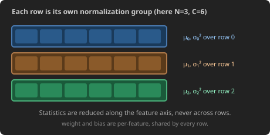

# Layer Normalization

LeetGPU · #113

[打开实现文件](../../practice/leetgpu/113/solution.cu) · [原始材料](../../references/LeetGPU/challenges/medium/113_layer_normalization/challenge.html)

Implement the forward pass of layer normalization for a 2D input tensor. Given an input tensor of shape [N, C] where N is the batch size and C is the number of features, normalize each sample independently across its C features, then apply learnable scale (`weight`) and shift (`bias`) parameters. Layer normalization is a core building block of transformer architectures.

 For each sample \(i\), layer normalization computes: \[ \begin{align} \mu_i &= \frac{1}{C} \sum_{j=0}^{C-1} x_{i,j} \\ \sigma_i^2 &= \frac{1}{C} \sum_{j=0}^{C-1} (x_{i,j} - \mu_i)^2 \\ y_{i,j} &= \text{weight}_j \cdot \frac{x_{i,j} - \mu_i}{\sqrt{\sigma_i^2 + \varepsilon}} + \text{bias}_j \end{align} \]

## Implementation Requirements

- Use only native features (external libraries are not permitted)

- The `solve` function signature must remain unchanged

- The final result must be stored in the `output` tensor

## Example

 Input:
 \(\text{input}\) (N=2, C=4): \[ \begin{bmatrix} 1.0 & 2.0 & 3.0 & 4.0 \\ -1.0 & 0.0 & 0.0 & 1.0 \end{bmatrix} \] \(\text{weight}\): \[ \begin{bmatrix} 1.0 & 1.0 & 1.0 & 1.0 \end{bmatrix} \] \(\text{bias}\): \[ \begin{bmatrix} 0.0 & 0.0 & 0.0 & 0.0 \end{bmatrix} \] \(\varepsilon\) = 1e-5

 Output:
 \(\text{output}\) (N=2, C=4): \[ \begin{bmatrix} -1.3416 & -0.4472 & 0.4472 & 1.3416 \\ -1.4142 & 0.0 & 0.0 & 1.4142 \end{bmatrix} \]

## Constraints

- 1 ≤ `N` ≤ 65,536

- 1 ≤ `C` ≤ 4,096

- `eps` = 1e-5

- Input values are in the range [-100.0, 100.0]

- Weight values are in the range [0.1, 10.0]

- Bias values are in the range [-10.0, 10.0]

- Performance is measured with `N` = 65,536, `C` = 512

## 本地接口

~~~cpp
extern "C" void solve(const float* input, const float* weight, const float* bias, float* output,
                      int N, int C, float eps);
~~~

## 本地用例

~~~bash
./practice.sh cases leetgpu 113
./practice.sh test leetgpu 113
~~~

展开输入规格

~~~text
  #0 公开样例 · input (2, 4) float32 · weight (4,) float32 · bias (4,) float32 · output (2, 4) float32 · N 2 · C 4 · eps 1e-05
  #1 公开功能用例 · input (1, 1) float32 · weight (1,) float32 · bias (1,) float32 · output (1, 1) float32 · N 1 · C 1 · eps 1e-05
  #2 公开功能用例 · input (2, 2) float32 · weight (2,) float32 · bias (2,) float32 · output (2, 2) float32 · N 2 · C 2 · eps 1e-05
  #3 公开功能用例 · input (4, 4) float32 · weight (4,) float32 · bias (4,) float32 · output (4, 4) float32 · N 4 · C 4 · eps 1e-05
  #4 公开功能用例 · input (8, 16) float32 · weight (16,) float32 · bias (16,) float32 · output (8, 16) float32 · N 8 · C 16 · eps 1e-05
  #5 公开功能用例 · input (4, 4096) float32 · weight (4096,) float32 · bias (4096,) float32 · output (4, 4096) float32 · N 4 · C 4096 · eps 1e-05
  #6 公开功能用例 · input (128, 256) float32 · weight (256,) float32 · bias (256,) float32 · output (128, 256) float32 · N 128 · C 256 · eps 1e-05
  #7 公开功能用例 · input (7, 30) float32 · weight (30,) float32 · bias (30,) float32 · output (7, 30) float32 · N 7 · C 30 · eps 1e-05
  #8 公开功能用例 · input (15, 100) float32 · weight (100,) float32 · bias (100,) float32 · output (15, 100) float32 · N 15 · C 100 · eps 1e-05
  #9 公开功能用例 · input (25, 255) float32 · weight (255,) float32 · bias (255,) float32 · output (25, 255) float32 · N 25 · C 255 · eps 1e-05
  #10 公开功能用例 · input (512, 768) float32 · weight (768,) float32 · bias (768,) float32 · output (512, 768) float32 · N 512 · C 768 · eps 1e-05
  #11 首个用例复验 · 原用例 #1 · 种子 2037 · 缓冲区守卫 · input (1, 1) float32 · weight (1,) float32 · bias (1,) float32 · output (1, 1) float32 · N 1 · C 1 · eps 1e-05
  #12 中间用例复验 · 原用例 #6 · 种子 2038 · 缓冲区守卫 · input (128, 256) float32 · weight (256,) float32 · bias (256,) float32 · output (128, 256) float32 · N 128 · C 256 · eps 1e-05
  #13 末尾用例复验 · 原用例 #10 · 种子 2039 · 缓冲区守卫 · input (512, 768) float32 · weight (768,) float32 · bias (768,) float32 · output (512, 768) float32 · N 512 · C 768 · eps 1e-05
13 个功能用例，另有 1 个样例
~~~

