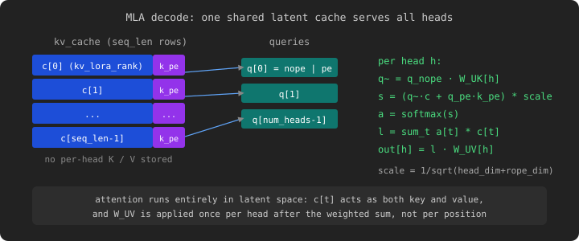

# Multi-Head Latent Attention Decode

LeetGPU · #114

[打开实现文件](../../practice/leetgpu/114/solution.cu) · [原始材料](../../references/LeetGPU/challenges/hard/114_multi_head_latent_attention/challenge.html)

Implement one decode step of Multi-Head Latent Attention (MLA), the attention variant used by DeepSeek-V2/V3. Instead of caching a full key and value vector per head, MLA caches a single low-rank latent vector `c` of size `kv_lora_rank` per position, shared by every head, plus a small rotary key `k_pe` of size `rope_dim` that is also shared. Keys and values are reconstructed on the fly from the latent through the per-head up-projections `W_UK` and `W_UV`.

 Materializing every key and value would defeat the purpose of the compressed cache, so production kernels use *weight absorption*: fold `W_UK` into the query and run the whole attention in latent space. For a single decode query with per-head query `q = [q_nope | q_pe]` and cache row `kv_cache[s] = [c[s] | k_pe[s]]`:

 \[ \tilde{q}_h = q\_nope_h W\_UK_h \qquad s_{h,t} = \frac{\tilde{q}_h \cdot c_t + q\_pe_h \cdot k\_pe_t}{\sqrt{head\_dim + rope\_dim}} \] \[ a_h = \text{softmax}(s_h) \qquad o_h = \left( \sum_{t=0}^{seq\_len-1} a_{h,t}\, c_t \right) W\_UV_h \]

 Note that `c` plays the role of both key and value, and that the rotary term uses the same `k_pe` for every head. All tensors are `float32`.

## Implementation Requirements

- Implement the function `solve(q, kv_cache, W_UK, W_UV, output, num_heads, seq_len, kv_lora_rank, head_dim, rope_dim)`.

- Do not change the function signature or use external libraries beyond the standard GPU framework.

- `q` has shape `(num_heads, head_dim + rope_dim)`: the first `head_dim` entries of each row are `q_nope`, the remaining `rope_dim` entries are `q_pe`.

- `kv_cache` has shape `(seq_len, kv_lora_rank + rope_dim)`: the first `kv_lora_rank` entries of each row are the latent `c`, the remaining `rope_dim` entries are `k_pe`.

- `W_UK` has shape `(num_heads, head_dim, kv_lora_rank)` and `W_UV` has shape `(num_heads, kv_lora_rank, head_dim)`.

- Use the scale factor `1 / sqrt(head_dim + rope_dim)` and a softmax over the `seq_len` cached positions.

- Write the result into the provided `output` buffer of shape `(num_heads, head_dim)`.

## Example

 With `num_heads` = 2, `seq_len` = 2, `kv_lora_rank` = 2, `head_dim` = 2, `rope_dim` = 1:

 \(q\) (2×3, last column is `q_pe`): \[ \begin{bmatrix} 1 & 0 & 1 \\ 0 & 1 & 0 \end{bmatrix} \qquad kv\_cache\text{ (2}\times\text{3, last column is } k\_pe\text{):} \begin{bmatrix} 1 & 0 & 0 \\ 0 & 1 & 1 \end{bmatrix} \] \(W\_UK_0\) (2×2): \[ \begin{bmatrix} 1 & 0 \\ 0 & 1 \end{bmatrix} \qquad W\_UK_1\text{ (2}\times\text{2):} \begin{bmatrix} 0 & 1 \\ 1 & 0 \end{bmatrix} \] \(W\_UV_0\) (2×2): \[ \begin{bmatrix} 1 & 2 \\ 3 & 4 \end{bmatrix} \qquad W\_UV_1\text{ (2}\times\text{2):} \begin{bmatrix} 1 & 0 \\ 0 & 1 \end{bmatrix} \]

 **Output** (2×2, values rounded to 4 decimals): \[ \begin{bmatrix} 2.0000 & 3.0000 \\ 0.6405 & 0.3595 \end{bmatrix} \]

 Head 0 scores are equal, so its attention is uniform and the latent result is `[0.5, 0.5]`. Head 1 sees scores `[0.5774, 0]`, giving weights `[0.6405, 0.3595]`, which pass through the identity `W_UV` unchanged.

## Constraints

- 1 ≤ `num_heads` ≤ 128

- 1 ≤ `seq_len` ≤ 8,192

- 1 ≤ `kv_lora_rank` ≤ 512

- 1 ≤ `head_dim` ≤ 128

- 1 ≤ `rope_dim` ≤ 64

- All tensor values are `float32`

- Performance is measured with `num_heads` = 128, `seq_len` = 4,096, `kv_lora_rank` = 512, `head_dim` = 128, `rope_dim` = 64

## 本地接口

~~~cpp
extern "C" void solve(const float* q, const float* kv_cache, const float* W_UK, const float* W_UV,
                      float* output, int num_heads, int seq_len, int kv_lora_rank, int head_dim,
                      int rope_dim);
~~~

## 本地用例

~~~bash
./practice.sh cases leetgpu 114
./practice.sh test leetgpu 114
~~~

展开输入规格

~~~text
  #0 公开样例 · q (2, 3) float32 · kv_cache (2, 3) float32 · W_UK (2, 2, 2) float32 · W_UV (2, 2, 2) float32 · output (2, 2) float32 · num_heads 2 · seq_len 2 · kv_lora_rank 2 · head_dim 2 · rope_dim 1
  #1 公开功能用例 · q (1, 3) float32 · kv_cache (1, 3) float32 · W_UK (1, 2, 2) float32 · W_UV (1, 2, 2) float32 · output (1, 2) float32 · num_heads 1 · seq_len 1 · kv_lora_rank 2 · head_dim 2 · rope_dim 1
  #2 公开功能用例 · q (2, 4) float32 · kv_cache (2, 6) float32 · W_UK (2, 2, 4) float32 · W_UV (2, 4, 2) float32 · output (2, 2) float32 · num_heads 2 · seq_len 2 · kv_lora_rank 4 · head_dim 2 · rope_dim 2
  #3 公开功能用例 · q (1, 6) float32 · kv_cache (3, 10) float32 · W_UK (1, 4, 8) float32 · W_UV (1, 8, 4) float32 · output (1, 4) float32 · num_heads 1 · seq_len 3 · kv_lora_rank 8 · head_dim 4 · rope_dim 2
  #4 公开功能用例 · q (4, 8) float32 · kv_cache (4, 12) float32 · W_UK (4, 4, 8) float32 · W_UV (4, 8, 4) float32 · output (4, 4) float32 · num_heads 4 · seq_len 4 · kv_lora_rank 8 · head_dim 4 · rope_dim 4
  #5 公开功能用例 · q (8, 48) float32 · kv_cache (64, 80) float32 · W_UK (8, 32, 64) float32 · W_UV (8, 64, 32) float32 · output (8, 32) float32 · num_heads 8 · seq_len 64 · kv_lora_rank 64 · head_dim 32 · rope_dim 16
  #6 公开功能用例 · q (16, 96) float32 · kv_cache (256, 160) float32 · W_UK (16, 64, 128) float32 · W_UV (16, 128, 64) float32 · output (16, 64) float32 · num_heads 16 · seq_len 256 · kv_lora_rank 128 · head_dim 64 · rope_dim 32
  #7 公开功能用例 · q (3, 36) float32 · kv_cache (30, 60) float32 · W_UK (3, 24, 48) float32 · W_UV (3, 48, 24) float32 · output (3, 24) float32 · num_heads 3 · seq_len 30 · kv_lora_rank 48 · head_dim 24 · rope_dim 12
  #8 公开功能用例 · q (5, 60) float32 · kv_cache (100, 116) float32 · W_UK (5, 40, 96) float32 · W_UV (5, 96, 40) float32 · output (5, 40) float32 · num_heads 5 · seq_len 100 · kv_lora_rank 96 · head_dim 40 · rope_dim 20
  #9 公开功能用例 · q (6, 48) float32 · kv_cache (255, 80) float32 · W_UK (6, 32, 64) float32 · W_UV (6, 64, 32) float32 · output (6, 32) float32 · num_heads 6 · seq_len 255 · kv_lora_rank 64 · head_dim 32 · rope_dim 16
  #10 公开功能用例 · q (32, 192) float32 · kv_cache (1024, 576) float32 · W_UK (32, 128, 512) float32 · W_UV (32, 512, 128) float32 · output (32, 128) float32 · num_heads 32 · seq_len 1024 · kv_lora_rank 512 · head_dim 128 · rope_dim 64
  #11 首个用例复验 · 原用例 #1 · 种子 2037 · 缓冲区守卫 · q (1, 3) float32 · kv_cache (1, 3) float32 · W_UK (1, 2, 2) float32 · W_UV (1, 2, 2) float32 · output (1, 2) float32 · num_heads 1 · seq_len 1 · kv_lora_rank 2 · head_dim 2 · rope_dim 1
  #12 中间用例复验 · 原用例 #6 · 种子 2038 · 缓冲区守卫 · q (16, 96) float32 · kv_cache (256, 160) float32 · W_UK (16, 64, 128) float32 · W_UV (16, 128, 64) float32 · output (16, 64) float32 · num_heads 16 · seq_len 256 · kv_lora_rank 128 · head_dim 64 · rope_dim 32
  #13 末尾用例复验 · 原用例 #10 · 种子 2039 · 缓冲区守卫 · q (32, 192) float32 · kv_cache (1024, 576) float32 · W_UK (32, 128, 512) float32 · W_UV (32, 512, 128) float32 · output (32, 128) float32 · num_heads 32 · seq_len 1024 · kv_lora_rank 512 · head_dim 128 · rope_dim 64
13 个功能用例，另有 1 个样例
~~~

