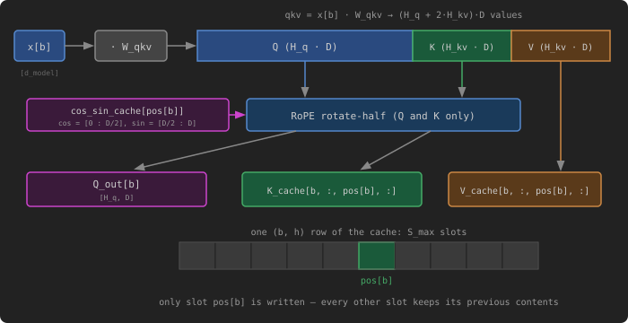

# Fused QKV Projection with RoPE and KV Cache Update

LeetGPU · #115

[打开实现文件](../../practice/leetgpu/115/solution.cu) · [原始材料](../../references/LeetGPU/challenges/medium/115_fused_qkv_rope_kv_cache_update/challenge.html)

Implement the fused **QKV projection + rotary embedding + KV-cache update** that every LLaMA-style attention layer runs at the start of a decoding step. A batch of `B` sequences each contribute a single new token, whose hidden state is row `b` of `x` (shape `[B, d_model]`). One fused weight matrix `W_qkv` (shape `[d_model, (H_q + 2 × H_kv) × D]`) produces the query, key, and value projections in a single matrix multiply. Rotary positional embeddings are applied to the query and key (never to the value), and the rotated key and the value are written into the slot `positions[b]` of the paged KV cache. All tensors are `float32` except `positions`, which is `int32`.

 For each sequence `b`, let `qkv = x[b] × W_qkv`. The first `H_q × D` values of `qkv` are the query heads, the next `H_kv × D` values are the key heads, and the last `H_kv × D` values are the value heads (grouped-query attention uses `H_kv ≤ H_q`). Each group is reshaped row-major into `[heads, D]`.

 Rotation uses the precomputed table `cos_sin_cache` of shape `[S_max, D]`, whose row `p` stores `D/2` cosines followed by `D/2` sines. With `p = positions[b]`, `c = cos_sin_cache[p, 0 : D/2]` and `s = cos_sin_cache[p, D/2 : D]`, the rotate-half transform of a head vector `t` of length `D` is:

 \( \text{RoPE}(t)_{j} = t_{j}\,c_{j} - t_{j + D/2}\,s_{j}, \qquad \text{RoPE}(t)_{j + D/2} = t_{j + D/2}\,c_{j} + t_{j}\,s_{j}, \qquad 0 \le j < D/2 \)

 The outputs are then, for every sequence `b`, every query head `hq`, and every KV head `h`:

 \( \text{Q_out}[b, hq, :] = \text{RoPE}(q[b, hq, :]) \)

 \( \text{K_cache}[b, h, \text{positions}[b], :] = \text{RoPE}(k[b, h, :]), \qquad \text{V_cache}[b, h, \text{positions}[b], :] = v[b, h, :] \)

 Every other slot of `K_cache` and `V_cache` must keep the value it had on entry.

## Implementation Requirements

- Use only native features (external libraries are not permitted)

- The `solve` function signature must remain unchanged

-  The rotated queries must be stored in `Q_out`, and the rotated keys and the values must be written in place into `K_cache` and `V_cache`

## Example

 **Input:** `B` = 1, `d_model` = 2, `H_q` = 1, `H_kv` = 1, `D` = 2, `S_max` = 2

 \(x\) (\(1 \times 2\)): \[ x = \begin{bmatrix} 1.0 & 0.0 \end{bmatrix} \] \(W_\text{qkv}\) (\(2 \times 6\)): \[ W_\text{qkv} = \begin{bmatrix} 1.0 & 0.0 & 0.0 & 1.0 & 1.0 & 1.0 \\ 0.0 & 1.0 & 1.0 & 0.0 & 2.0 & 2.0 \end{bmatrix} \] \(\text{cos_sin_cache}\) (\(2 \times 2\)): \[ \text{cos_sin_cache} = \begin{bmatrix} 1.0 & 0.0 \\ 0.5403023 & 0.8414710 \end{bmatrix} \] \(\text{positions} = \begin{bmatrix} 1 \end{bmatrix}\), and \(K_\text{cache}\), \(V_\text{cache}\) (each \(1 \times 1 \times 2 \times 2\)) start filled with zeros.

 Intermediate steps: the fused projection gives \[ qkv = x \cdot W_\text{qkv} = \begin{bmatrix} 1.0 & 0.0 & 0.0 & 1.0 & 1.0 & 1.0 \end{bmatrix} \] so \(q = \begin{bmatrix} 1.0 & 0.0 \end{bmatrix}\), \(k = \begin{bmatrix} 0.0 & 1.0 \end{bmatrix}\), \(v = \begin{bmatrix} 1.0 & 1.0 \end{bmatrix}\). With \(\text{positions}[0] = 1\) we read \(c = 0.5403023\), \(s = 0.8414710\), giving \[ \text{RoPE}(q) = \begin{bmatrix} 0.5403023 & 0.8414710 \end{bmatrix}, \qquad \text{RoPE}(k) = \begin{bmatrix} -0.8414710 & 0.5403023 \end{bmatrix} \]

 **Output:** \[ \text{Q_out}[0] = \begin{bmatrix} 0.5403023 & 0.8414710 \end{bmatrix} \] \[ \text{K_cache}[0, 0] = \begin{bmatrix} 0.0 & 0.0 \\ -0.8414710 & 0.5403023 \end{bmatrix}, \qquad \text{V_cache}[0, 0] = \begin{bmatrix} 0.0 & 0.0 \\ 1.0 & 1.0 \end{bmatrix} \] Slot `0` of both caches is untouched; only slot `1` is written.

## Constraints

- 1 ≤ `B` ≤ 1,024

- 1 ≤ `d_model` ≤ 8,192

- 1 ≤ `H_kv` ≤ `H_q` ≤ 128, and `H_q` is a multiple of `H_kv`

- `D` is even, 2 ≤ `D` ≤ 128

- 1 ≤ `S_max` ≤ 4,096

- 0 ≤ `positions[b]` < `S_max` for every `b`

- `positions` is `int32`; every other tensor is `float32`

- Values of `x`, `W_qkv`, `K_cache`, and `V_cache` are in the range [-10, 10]

-  Performance is measured with `B` = 64, `d_model` = 4,096, `H_q` = 32, `H_kv` = 8, `D` = 128, `S_max` = 2,048

## References

-  Su et al., [RoFormer: Enhanced Transformer with Rotary Position Embedding](https://arxiv.org/abs/2104.09864) (arXiv:2104.09864) — introduces rotary positional embeddings.

-  Ainslie et al., [GQA: Training Generalized Multi-Query Transformer Models from Multi-Head Checkpoints](https://arxiv.org/abs/2305.13245) (arXiv:2305.13245) — the grouped-query layout that makes `H_kv` smaller than `H_q`.

## 本地接口

~~~cpp
extern "C" void solve(const float* x, const float* W_qkv, const float* cos_sin_cache,
                      const int* positions, float* K_cache, float* V_cache, float* Q_out, int B,
                      int d_model, int H_q, int H_kv, int D, int S_max);
~~~

## 本地用例

~~~bash
./practice.sh cases leetgpu 115
./practice.sh test leetgpu 115
~~~

展开输入规格

~~~text
  #0 公开样例 · x (1, 2) float32 · W_qkv (2, 6) float32 · cos_sin_cache (2, 2) float32 · positions (1,) int32 · K_cache (1, 1, 2, 2) float32 · V_cache (1, 1, 2, 2) float32 · Q_out (1, 1, 2) float32 · B 1 · d_model 2 · H_q 1 · H_kv 1 · D 2 · S_max 2
  #1 公开功能用例 · x (1, 4) float32 · W_qkv (4, 6) float32 · cos_sin_cache (1, 2) float32 · positions (1,) int32 · K_cache (1, 1, 1, 2) float32 · V_cache (1, 1, 1, 2) float32 · Q_out (1, 1, 2) float32 · B 1 · d_model 4 · H_q 1 · H_kv 1 · D 2 · S_max 1
  #2 公开功能用例 · x (2, 4) float32 · W_qkv (4, 16) float32 · cos_sin_cache (2, 4) float32 · positions (2,) int32 · K_cache (2, 1, 2, 4) float32 · V_cache (2, 1, 2, 4) float32 · Q_out (2, 2, 4) float32 · B 2 · d_model 4 · H_q 2 · H_kv 1 · D 4 · S_max 2
  #3 公开功能用例 · x (3, 6) float32 · W_qkv (6, 18) float32 · cos_sin_cache (4, 2) float32 · positions (3,) int32 · K_cache (3, 3, 4, 2) float32 · V_cache (3, 3, 4, 2) float32 · Q_out (3, 3, 2) float32 · B 3 · d_model 6 · H_q 3 · H_kv 3 · D 2 · S_max 4
  #4 公开功能用例 · x (4, 8) float32 · W_qkv (8, 64) float32 · cos_sin_cache (8, 8) float32 · positions (4,) int32 · K_cache (4, 2, 8, 8) float32 · V_cache (4, 2, 8, 8) float32 · Q_out (4, 4, 8) float32 · B 4 · d_model 8 · H_q 4 · H_kv 2 · D 8 · S_max 8
  #5 公开功能用例 · x (16, 64) float32 · W_qkv (64, 192) float32 · cos_sin_cache (32, 16) float32 · positions (16,) int32 · K_cache (16, 2, 32, 16) float32 · V_cache (16, 2, 32, 16) float32 · Q_out (16, 8, 16) float32 · B 16 · d_model 64 · H_q 8 · H_kv 2 · D 16 · S_max 32
  #6 公开功能用例 · x (32, 128) float32 · W_qkv (128, 768) float32 · cos_sin_cache (64, 32) float32 · positions (32,) int32 · K_cache (32, 8, 64, 32) float32 · V_cache (32, 8, 64, 32) float32 · Q_out (32, 8, 32) float32 · B 32 · d_model 128 · H_q 8 · H_kv 8 · D 32 · S_max 64
  #7 公开功能用例 · x (30, 100) float32 · W_qkv (100, 90) float32 · cos_sin_cache (30, 6) float32 · positions (30,) int32 · K_cache (30, 5, 30, 6) float32 · V_cache (30, 5, 30, 6) float32 · Q_out (30, 5, 6) float32 · B 30 · d_model 100 · H_q 5 · H_kv 5 · D 6 · S_max 30
  #8 公开功能用例 · x (100, 96) float32 · W_qkv (96, 120) float32 · cos_sin_cache (255, 10) float32 · positions (100,) int32 · K_cache (100, 3, 255, 10) float32 · V_cache (100, 3, 255, 10) float32 · Q_out (100, 6, 10) float32 · B 100 · d_model 96 · H_q 6 · H_kv 3 · D 10 · S_max 255
  #9 公开功能用例 · x (64, 512) float32 · W_qkv (512, 768) float32 · cos_sin_cache (512, 64) float32 · positions (64,) int32 · K_cache (64, 2, 512, 64) float32 · V_cache (64, 2, 512, 64) float32 · Q_out (64, 8, 64) float32 · B 64 · d_model 512 · H_q 8 · H_kv 2 · D 64 · S_max 512
  #10 公开功能用例 · x (128, 1024) float32 · W_qkv (1024, 1536) float32 · cos_sin_cache (1024, 64) float32 · positions (128,) int32 · K_cache (128, 4, 1024, 64) float32 · V_cache (128, 4, 1024, 64) float32 · Q_out (128, 16, 64) float32 · B 128 · d_model 1024 · H_q 16 · H_kv 4 · D 64 · S_max 1024
  #11 首个用例复验 · 原用例 #1 · 种子 2037 · 缓冲区守卫 · x (1, 4) float32 · W_qkv (4, 6) float32 · cos_sin_cache (1, 2) float32 · positions (1,) int32 · K_cache (1, 1, 1, 2) float32 · V_cache (1, 1, 1, 2) float32 · Q_out (1, 1, 2) float32 · B 1 · d_model 4 · H_q 1 · H_kv 1 · D 2 · S_max 1
  #12 中间用例复验 · 原用例 #6 · 种子 2038 · 缓冲区守卫 · x (32, 128) float32 · W_qkv (128, 768) float32 · cos_sin_cache (64, 32) float32 · positions (32,) int32 · K_cache (32, 8, 64, 32) float32 · V_cache (32, 8, 64, 32) float32 · Q_out (32, 8, 32) float32 · B 32 · d_model 128 · H_q 8 · H_kv 8 · D 32 · S_max 64
  #13 末尾用例复验 · 原用例 #10 · 种子 2039 · 缓冲区守卫 · x (128, 1024) float32 · W_qkv (1024, 1536) float32 · cos_sin_cache (1024, 64) float32 · positions (128,) int32 · K_cache (128, 4, 1024, 64) float32 · V_cache (128, 4, 1024, 64) float32 · Q_out (128, 16, 64) float32 · B 128 · d_model 1024 · H_q 16 · H_kv 4 · D 64 · S_max 1024
13 个功能用例，另有 1 个样例
~~~

