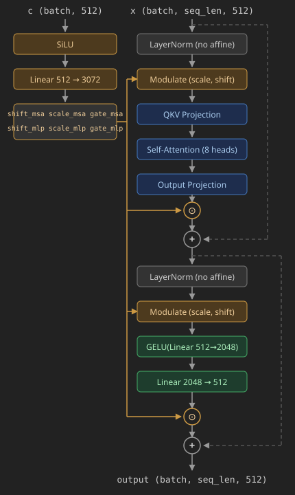

# Diffusion Transformer Block

LeetGPU · #116

[打开实现文件](../../practice/leetgpu/116/solution.cu) · [原始材料](../../references/LeetGPU/challenges/hard/116_dit_block/challenge.html)

Implement a single **DiT** (Diffusion Transformer) block, the layer that Stable Diffusion 3, Flux, and the original DiT stack dozens of times to denoise image latents. Given a batch of patch token sequences \(x\) of shape `(batch_size, seq_len, 512)`, a per-sample conditioning vector \(c\) of shape `(batch_size, 512)` (the timestep plus class/text embedding), and a packed weight buffer, compute the block output. Unlike a language model block, normalization here has *no learned affine parameters*: the scale, shift, and residual gate are predicted from \(c\) by an **adaLN-Zero** modulation layer, so every sample in the batch is normalized with different parameters.

 The six modulation vectors are produced once per sample and broadcast across all `seq_len` tokens of that sample:
 \[ \begin{aligned} \left[\gamma_{\text{msa}} \mid \alpha_{\text{msa}} \mid g_{\text{msa}} \mid \gamma_{\text{mlp}} \mid \alpha_{\text{mlp}} \mid g_{\text{mlp}}\right] &= \text{SiLU}(c)\, W_{\text{ada}}^\top + b_{\text{ada}} \in \mathbb{R}^{B \times 3072} \end{aligned} \]
where each of the six pieces is a contiguous slice of 512 values (in the order shown) and \(\text{SiLU}(z) = z \cdot \sigma(z)\). The block itself is then:
 \[ \begin{aligned} h &= \text{LN}(x) \odot (1 + \alpha_{\text{msa}}) + \gamma_{\text{msa}} \\[4pt] x' &= x + g_{\text{msa}} \odot \text{Attn}(h) \\[4pt] h' &= \text{LN}(x') \odot (1 + \alpha_{\text{mlp}}) + \gamma_{\text{mlp}} \\[4pt] \text{output} &= x' + g_{\text{mlp}} \odot \text{MLP}(h') \end{aligned} \]
with the sub-operations defined as:
 \[ \begin{aligned} \text{LN}(z) &= \frac{z - \mu}{\sqrt{\sigma^2 + \varepsilon}}, \quad \mu = \frac{1}{d}\sum_i z_i, \quad \sigma^2 = \frac{1}{d}\sum_i (z_i - \mu)^2, \quad \varepsilon = 10^{-6} \\[8pt] [Q \mid K \mid V] &= h\, W_{qkv}^\top + b_{qkv}, \quad \text{each reshaped to } (B, T, 8, 64) \\[4pt] \text{head}_i &= \text{softmax}\!\left(\frac{Q_i K_i^\top}{\sqrt{64}}\right) V_i \quad \text{(no causal mask)} \\[4pt] \text{Attn}(h) &= \text{Concat}(\text{head}_1, \ldots, \text{head}_8)\, W_o^\top + b_o \\[8pt] \text{MLP}(h') &= \text{GELU}\!\left(h'\, W_{fc1}^\top + b_{fc1}\right) W_{fc2}^\top + b_{fc2} \end{aligned} \]
Attention, normalization, and the MLP are applied independently per batch sample; tokens never mix across samples.

## Implementation Requirements

- Use only native features (external libraries are not permitted)

- The `solve` function signature must remain unchanged

- The final result must be stored in the `output` tensor

- LayerNorm uses \(\varepsilon = 10^{-6}\) and has no learned weight or bias

- Modulation scales by \(1 + \alpha\), not \(\alpha\)

- Self-attention is bidirectional — do *not* apply a causal mask

- Use the [GELU tanh approximation](https://docs.pytorch.org/docs/stable/generated/torch.nn.GELU.html): \(\text{GELU}(x) = 0.5\,x\!\left(1 + \tanh\!\left(\sqrt{\tfrac{2}{\pi}}\left(x + 0.044715\,x^3\right)\right)\right)\)

## Weight Layout

All block parameters are packed into a single contiguous `weights` buffer (4,726,272 floats) in the order below. All 2-D matrices are stored row-major with shape `(out_dim, in_dim)`, so \(W_{qkv}[i][j]\) lives at `weights[1575936 + i * 512 + j]`.

<table style="border-collapse:separate; border-spacing:16px 6px;">
  <tr>
    <th style="text-align:left;">Parameter</th>
    <th style="text-align:left;">Shape</th>
    <th style="text-align:right;">Size</th>
    <th style="text-align:right;">Offset</th>
  </tr>
  <tr>
    <td>\(W_{\text{ada}}\) (adaLN modulation)</td>
    <td>(3072, 512)</td>
    <td style="text-align:right;">1,572,864</td>
    <td style="text-align:right;">0</td>
  </tr>
  <tr>
    <td>\(b_{\text{ada}}\)</td>
    <td>(3072,)</td>
    <td style="text-align:right;">3,072</td>
    <td style="text-align:right;">1,572,864</td>
  </tr>
  <tr>
    <td>\(W_{qkv}\)</td>
    <td>(1536, 512)</td>
    <td style="text-align:right;">786,432</td>
    <td style="text-align:right;">1,575,936</td>
  </tr>
  <tr>
    <td>\(b_{qkv}\)</td>
    <td>(1536,)</td>
    <td style="text-align:right;">1,536</td>
    <td style="text-align:right;">2,362,368</td>
  </tr>
  <tr>
    <td>\(W_o\)</td>
    <td>(512, 512)</td>
    <td style="text-align:right;">262,144</td>
    <td style="text-align:right;">2,363,904</td>
  </tr>
  <tr>
    <td>\(b_o\)</td>
    <td>(512,)</td>
    <td style="text-align:right;">512</td>
    <td style="text-align:right;">2,626,048</td>
  </tr>
  <tr>
    <td>\(W_{fc1}\)</td>
    <td>(2048, 512)</td>
    <td style="text-align:right;">1,048,576</td>
    <td style="text-align:right;">2,626,560</td>
  </tr>
  <tr>
    <td>\(b_{fc1}\)</td>
    <td>(2048,)</td>
    <td style="text-align:right;">2,048</td>
    <td style="text-align:right;">3,675,136</td>
  </tr>
  <tr>
    <td>\(W_{fc2}\)</td>
    <td>(512, 2048)</td>
    <td style="text-align:right;">1,048,576</td>
    <td style="text-align:right;">3,677,184</td>
  </tr>
  <tr>
    <td>\(b_{fc2}\)</td>
    <td>(512,)</td>
    <td style="text-align:right;">512</td>
    <td style="text-align:right;">4,725,760</td>
  </tr>
</table>

## Example

With `batch_size` = 1, `seq_len` = 4, `x` drawn uniformly from [−1, 1], `c` drawn uniformly from [−2, 2], and randomly initialized weights:

~~~text

Input:  x.shape       = (1, 4, 512)     # 4 patch tokens
        c.shape       = (1, 512)        # timestep + class conditioning
        weights.shape = (4,726,272,)    # packed weight buffer
        batch_size    = 1
        seq_len       = 4
Output: output.shape  = (1, 4, 512)     # denoised patch tokens

~~~

## Constraints

- `d_model` = 512, `n_heads` = 8, `head_dim` = 64, `mlp_hidden` = 2,048

- 1 ≤ `batch_size` ≤ 16

- 1 ≤ `seq_len` ≤ 4,096

- All tensors use 32-bit floating point

- Performance is measured with `batch_size` = 4, `seq_len` = 1,024

## 本地接口

~~~cpp
extern "C" void solve(const float* x, const float* c, float* output, const float* weights,
                      int batch_size, int seq_len);
~~~

## 本地用例

~~~bash
./practice.sh cases leetgpu 116
./practice.sh test leetgpu 116
~~~

展开输入规格

~~~text
  #0 公开样例 · x (1, 4, 512) float32 · c (1, 512) float32 · output (1, 4, 512) float32 · weights (4726272,) float32 · batch_size 1 · seq_len 4
  #1 公开功能用例 · x (1, 1, 512) float32 · c (1, 512) float32 · output (1, 1, 512) float32 · weights (4726272,) float32 · batch_size 1 · seq_len 1
  #2 公开功能用例 · x (2, 3, 512) float32 · c (2, 512) float32 · output (2, 3, 512) float32 · weights (4726272,) float32 · batch_size 2 · seq_len 3
  #3 公开功能用例 · x (1, 4, 512) float32 · c (1, 512) float32 · output (1, 4, 512) float32 · weights (4726272,) float32 · batch_size 1 · seq_len 4
  #4 公开功能用例 · x (2, 16, 512) float32 · c (2, 512) float32 · output (2, 16, 512) float32 · weights (4726272,) float32 · batch_size 2 · seq_len 16
  #5 公开功能用例 · x (4, 64, 512) float32 · c (4, 512) float32 · output (4, 64, 512) float32 · weights (4726272,) float32 · batch_size 4 · seq_len 64
  #6 公开功能用例 · x (3, 30, 512) float32 · c (3, 512) float32 · output (3, 30, 512) float32 · weights (4726272,) float32 · batch_size 3 · seq_len 30
  #7 公开功能用例 · x (2, 100, 512) float32 · c (2, 512) float32 · output (2, 100, 512) float32 · weights (4726272,) float32 · batch_size 2 · seq_len 100
  #8 公开功能用例 · x (5, 255, 512) float32 · c (5, 512) float32 · output (5, 255, 512) float32 · weights (4726272,) float32 · batch_size 5 · seq_len 255
  #9 公开功能用例 · x (2, 256, 512) float32 · c (2, 512) float32 · output (2, 256, 512) float32 · weights (4726272,) float32 · batch_size 2 · seq_len 256
  #10 公开功能用例 · x (8, 196, 512) float32 · c (8, 512) float32 · output (8, 196, 512) float32 · weights (4726272,) float32 · batch_size 8 · seq_len 196
  #11 首个用例复验 · 原用例 #1 · 种子 2037 · 缓冲区守卫 · x (1, 1, 512) float32 · c (1, 512) float32 · output (1, 1, 512) float32 · weights (4726272,) float32 · batch_size 1 · seq_len 1
  #12 中间用例复验 · 原用例 #6 · 种子 2038 · 缓冲区守卫 · x (3, 30, 512) float32 · c (3, 512) float32 · output (3, 30, 512) float32 · weights (4726272,) float32 · batch_size 3 · seq_len 30
  #13 末尾用例复验 · 原用例 #10 · 种子 2039 · 缓冲区守卫 · x (8, 196, 512) float32 · c (8, 512) float32 · output (8, 196, 512) float32 · weights (4726272,) float32 · batch_size 8 · seq_len 196
13 个功能用例，另有 1 个样例
~~~

