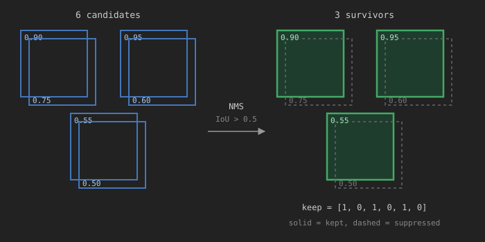

# Non-Maximum Suppression

LeetGPU · #117

[打开实现文件](../../practice/leetgpu/117/solution.cu) · [原始材料](../../references/LeetGPU/challenges/hard/117_non_max_suppression/challenge.html)

Implement **Non-Maximum Suppression** (NMS), the post-processing pass that every object detector runs after the network forward pass: the model emits thousands of overlapping candidate boxes, and NMS collapses them down to one box per object. Given `N` boxes in corner format `(x1, y1, x2, y2)` together with their confidence `scores`, walk the boxes from the highest score to the lowest; every box that has not been suppressed yet is kept, and it suppresses all lower-scoring boxes whose intersection over union (IoU) with it is greater than `iou_threshold`. Write a 1 into `keep[i]` for a surviving box and a 0 for a suppressed one.

The overlap of two boxes \(a\) and \(b\) is measured by their intersection over union:
 \[ \text{IoU}(a, b) = \frac{|a \cap b|}{|a| + |b| - |a \cap b|} \] \[ |a| = (x_2^a - x_1^a)\,(y_2^a - y_1^a), \qquad |a \cap b| = w \cdot h \] \[ w = \max\!\left(0,\; \min(x_2^a, x_2^b) - \max(x_1^a, x_1^b)\right), \qquad h = \max\!\left(0,\; \min(y_2^a, y_2^b) - \max(y_1^a, y_1^b)\right) \]

## Algorithm

1. Order the box indices by score, from highest to lowest. Boxes with equal scores are ordered by increasing index.

1. Traverse that order. If the current box has already been suppressed, skip it. Otherwise set its `keep` entry to 1 and suppress every box that appears later in the order whose IoU with it is greater than `iou_threshold`.

1. Every suppressed box gets a `keep` entry of 0.

 A suppressed box never suppresses anything itself, so the decisions are chained: whether box \(j\) survives depends on which higher-scoring boxes survived before it.

## Implementation Requirements

- Use only native features (external libraries are not permitted)

- The `solve` function signature must remain unchanged

- The final result must be stored in the `keep` tensor

- A box is suppressed only when its IoU is strictly greater than `iou_threshold`

- `keep` is indexed by the original box order, not by the score-sorted order

- Every entry of `keep` must be written: 1 for a kept box, 0 for a suppressed box

## Example

Six candidates covering three objects, with `iou_threshold` = 0.5:
 \[ \text{boxes} = \begin{bmatrix} 0 & 0 & 40 & 40 \\ 5 & 5 & 45 & 45 \\ 60 & 0 & 100 & 40 \\ 65 & 5 & 105 & 45 \\ 30 & 50 & 70 & 90 \\ 35 & 55 & 75 & 95 \end{bmatrix}, \qquad \text{scores} = \begin{bmatrix} 0.90 & 0.75 & 0.95 & 0.60 & 0.55 & 0.50 \end{bmatrix} \] \[ \text{keep} = \begin{bmatrix} 1 & 0 & 1 & 0 & 1 & 0 \end{bmatrix} \]
 Box 2 has the highest score, so it is kept and suppresses box 3 (\(\text{IoU} = \tfrac{1225}{1975} \approx 0.62\)). Box 0 is kept next and suppresses box 1 by the same overlap, and box 4 is kept and suppresses box 5. Boxes from different objects never overlap here, so all three winners survive.

## Constraints

- 1 ≤ `N` ≤ 20,000

- `boxes` has shape `(N, 4)` and is stored row-major as `(x1, y1, x2, y2)` with `x1` < `x2` and `y1` < `y2`

- Box coordinates are integer-valued and lie in [−10,000, 10,000]

- 0 ≤ `scores`[i] ≤ 1; equal scores are possible

- 0 ≤ `iou_threshold` ≤ 1

- `boxes` and `scores` are 32-bit floating point, `keep` is 32-bit signed integer

- Performance is measured with `N` = 16,384 and `iou_threshold` = 0.5

## 本地接口

~~~cpp
extern "C" void solve(const float* boxes, const float* scores, int* keep, int N,
                      float iou_threshold);
~~~

## 本地用例

~~~bash
./practice.sh cases leetgpu 117
./practice.sh test leetgpu 117
~~~

展开输入规格

~~~text
  #0 公开样例 · boxes (6, 4) float32 · scores (6,) float32 · keep (6,) int32 · N 6 · iou_threshold 0.5
  #1 公开功能用例 · boxes (1, 4) float32 · scores (1,) float32 · keep (1,) int32 · N 1 · iou_threshold 0.5
  #2 公开功能用例 · boxes (2, 4) float32 · scores (2,) float32 · keep (2,) int32 · N 2 · iou_threshold 0.5
  #3 公开功能用例 · boxes (3, 4) float32 · scores (3,) float32 · keep (3,) int32 · N 3 · iou_threshold 0.5
  #4 公开功能用例 · boxes (4, 4) float32 · scores (4,) float32 · keep (4,) int32 · N 4 · iou_threshold 0.5
  #5 公开功能用例 · boxes (16, 4) float32 · scores (16,) float32 · keep (16,) int32 · N 16 · iou_threshold 0.5
  #6 公开功能用例 · boxes (64, 4) float32 · scores (64,) float32 · keep (64,) int32 · N 64 · iou_threshold 0.25
  #7 公开功能用例 · boxes (30, 4) float32 · scores (30,) float32 · keep (30,) int32 · N 30 · iou_threshold 0.875
  #8 公开功能用例 · boxes (100, 4) float32 · scores (100,) float32 · keep (100,) int32 · N 100 · iou_threshold 0.5
  #9 公开功能用例 · boxes (255, 4) float32 · scores (255,) float32 · keep (255,) int32 · N 255 · iou_threshold 0.75
  #10 公开功能用例 · boxes (4096, 4) float32 · scores (4096,) float32 · keep (4096,) int32 · N 4096 · iou_threshold 0.375
  #11 首个用例复验 · 原用例 #1 · 种子 2037 · 缓冲区守卫 · boxes (1, 4) float32 · scores (1,) float32 · keep (1,) int32 · N 1 · iou_threshold 0.5
  #12 中间用例复验 · 原用例 #6 · 种子 2038 · 缓冲区守卫 · boxes (64, 4) float32 · scores (64,) float32 · keep (64,) int32 · N 64 · iou_threshold 0.25
  #13 末尾用例复验 · 原用例 #10 · 种子 2039 · 缓冲区守卫 · boxes (4096, 4) float32 · scores (4096,) float32 · keep (4096,) int32 · N 4096 · iou_threshold 0.375
13 个功能用例，另有 1 个样例
~~~

