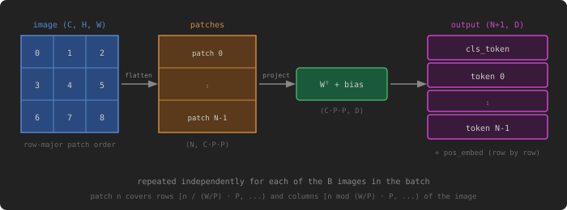

# Vision Transformer Patch Embedding

LeetGPU · #118

[打开实现文件](../../practice/leetgpu/118/solution.cu) · [原始材料](../../references/LeetGPU/challenges/medium/118_vit_patch_embedding/challenge.html)

Implement the patch embedding stem of a Vision Transformer — the layer that turns a batch of images into a sequence of tokens for ViT, CLIP, SigLIP and DiT. Given a batch of `B` images of shape `(C, H, W)`, split every image into non-overlapping `P × P` patches, project each flattened patch to a `D`-dimensional embedding with `patch_weight` and `patch_bias`, prepend the learned `cls_token`, and add the learned positional embedding `pos_embed`. All tensors are `float32`, and `H` and `W` are always divisible by `P`.

 With \(g_h = H/P\), \(g_w = W/P\) and \(N = g_h \cdot g_w\) patches per image, patch index \(n = p_y \cdot g_w + p_x\) covers image rows \(p_y P \ldots p_y P + P - 1\) and columns \(p_x P \ldots p_x P + P - 1\). The embedding of that patch is
 \[ \text{token}[b][n][d] = \text{patch_bias}[d] + \sum_{c=0}^{C-1} \sum_{i=0}^{P-1} \sum_{j=0}^{P-1} \text{images}[b][c][p_y P + i][p_x P + j] \cdot \text{patch_weight}[d][c][i][j] \]
and the output sequence for image \(b\) is the CLS token followed by the \(N\) patch tokens, with the positional embedding added to every row:
 \[ \begin{aligned} \text{output}[b][0][d] &= \text{cls_token}[d] + \text{pos_embed}[0][d] \\[4pt] \text{output}[b][n+1][d] &= \text{token}[b][n][d] + \text{pos_embed}[n+1][d] \end{aligned} \]
Note that the CLS token is *not* projected — it is a learned vector copied into row 0 of every sequence in the batch.

## Implementation Requirements

- Implement the `solve` function with the signature unchanged.

- Do not use external libraries beyond the framework provided.

- Write the result into `output` in-place.

-  All tensors are contiguous and row-major: `images` is `(B, C, H, W)`, `patch_weight` is `(D, C, P, P)`, `patch_bias` and `cls_token` are `(D,)`, `pos_embed` is `(N+1, D)`, and `output` is `(B, N+1, D)`.

## Example

 Input: `B` = 1, `C` = 1, `H` = 4, `W` = 4, `P` = 2, `D` = 2 (so \(g_h = g_w = 2\) and \(N = 4\))

 \(\text{images}[0][0]\) (\(4 \times 4\)): \[ \begin{bmatrix} 1 & 2 & 3 & 4 \\ 5 & 6 & 7 & 8 \\ 9 & 10 & 11 & 12 \\ 13 & 14 & 15 & 16 \end{bmatrix} \] \(\text{patch_weight}\) (\(2\) filters of shape \(1 \times 2 \times 2\)) — filter 0 selects the top-left pixel of a patch, filter 1 the bottom-right pixel: \[ \text{patch_weight}[0][0] = \begin{bmatrix} 1 & 0 \\ 0 & 0 \end{bmatrix}, \quad \text{patch_weight}[1][0] = \begin{bmatrix} 0 & 0 \\ 0 & 1 \end{bmatrix} \] \[ \text{patch_bias} = \begin{bmatrix} 0 & 0 \end{bmatrix}, \quad \text{cls_token} = \begin{bmatrix} 0.5 & -0.5 \end{bmatrix}, \quad \text{pos_embed} = \begin{bmatrix} 0 & 0 \\ 1 & -1 \\ 2 & -2 \\ 3 & -3 \\ 4 & -4 \end{bmatrix} \]

 The four patches are \(\begin{bmatrix} 1 & 2 \\ 5 & 6 \end{bmatrix}\), \(\begin{bmatrix} 3 & 4 \\ 7 & 8 \end{bmatrix}\), \(\begin{bmatrix} 9 & 10 \\ 13 & 14 \end{bmatrix}\) and \(\begin{bmatrix} 11 & 12 \\ 15 & 16 \end{bmatrix}\), so the projected tokens are \(\begin{bmatrix} 1 & 6 \end{bmatrix}\), \(\begin{bmatrix} 3 & 8 \end{bmatrix}\), \(\begin{bmatrix} 9 & 14 \end{bmatrix}\) and \(\begin{bmatrix} 11 & 16 \end{bmatrix}\).

 Output (\(5 \times 2\), after prepending the CLS token and adding `pos_embed`): \[ \text{output}[0] = \begin{bmatrix} 0.5 & -0.5 \\ 2 & 5 \\ 5 & 6 \\ 12 & 11 \\ 15 & 12 \end{bmatrix} \]

## Constraints

- 1 ≤ `B` ≤ 128

- 1 ≤ `C` ≤ 4

- 1 ≤ `H`, `W` ≤ 1,024, both divisible by `P`

- 1 ≤ `P` ≤ 32

- 1 ≤ `D` ≤ 1,024

- All tensors are `float32` on the GPU

- Image values are in the range [-10, 10]

-  Performance is measured with `B` = 64, `C` = 3, `H` = 224, `W` = 224, `P` = 16, `D` = 768

## 本地接口

~~~cpp
extern "C" void solve(const float* images, const float* patch_weight, const float* patch_bias,
                      const float* cls_token, const float* pos_embed, float* output, int B, int C,
                      int H, int W, int P, int D);
~~~

## 本地用例

~~~bash
./practice.sh cases leetgpu 118
./practice.sh test leetgpu 118
~~~

展开输入规格

~~~text
  #0 公开样例 · images (1, 1, 4, 4) float32 · patch_weight (2, 1, 2, 2) float32 · patch_bias (2,) float32 · cls_token (2,) float32 · pos_embed (5, 2) float32 · output (1, 5, 2) float32 · B 1 · C 1 · H 4 · W 4 · P 2 · D 2
  #1 公开功能用例 · images (1, 1, 2, 2) float32 · patch_weight (4, 1, 2, 2) float32 · patch_bias (4,) float32 · cls_token (4,) float32 · pos_embed (2, 4) float32 · output (1, 2, 4) float32 · B 1 · C 1 · H 2 · W 2 · P 2 · D 4
  #2 公开功能用例 · images (2, 3, 4, 4) float32 · patch_weight (8, 3, 2, 2) float32 · patch_bias (8,) float32 · cls_token (8,) float32 · pos_embed (5, 8) float32 · output (2, 5, 8) float32 · B 2 · C 3 · H 4 · W 4 · P 2 · D 8
  #3 公开功能用例 · images (1, 3, 8, 8) float32 · patch_weight (16, 3, 4, 4) float32 · patch_bias (16,) float32 · cls_token (16,) float32 · pos_embed (5, 16) float32 · output (1, 5, 16) float32 · B 1 · C 3 · H 8 · W 8 · P 4 · D 16
  #4 公开功能用例 · images (2, 3, 16, 16) float32 · patch_weight (32, 3, 4, 4) float32 · patch_bias (32,) float32 · cls_token (32,) float32 · pos_embed (17, 32) float32 · output (2, 17, 32) float32 · B 2 · C 3 · H 16 · W 16 · P 4 · D 32
  #5 公开功能用例 · images (4, 3, 32, 32) float32 · patch_weight (64, 3, 16, 16) float32 · patch_bias (64,) float32 · cls_token (64,) float32 · pos_embed (5, 64) float32 · output (4, 5, 64) float32 · B 4 · C 3 · H 32 · W 32 · P 16 · D 64
  #6 公开功能用例 · images (2, 3, 64, 64) float32 · patch_weight (128, 3, 8, 8) float32 · patch_bias (128,) float32 · cls_token (128,) float32 · pos_embed (65, 128) float32 · output (2, 65, 128) float32 · B 2 · C 3 · H 64 · W 64 · P 8 · D 128
  #7 公开功能用例 · images (3, 3, 30, 30) float32 · patch_weight (100, 3, 5, 5) float32 · patch_bias (100,) float32 · cls_token (100,) float32 · pos_embed (37, 100) float32 · output (3, 37, 100) float32 · B 3 · C 3 · H 30 · W 30 · P 5 · D 100
  #8 公开功能用例 · images (5, 1, 18, 24) float32 · patch_weight (48, 1, 6, 6) float32 · patch_bias (48,) float32 · cls_token (48,) float32 · pos_embed (13, 48) float32 · output (5, 13, 48) float32 · B 5 · C 1 · H 18 · W 24 · P 6 · D 48
  #9 公开功能用例 · images (8, 3, 224, 224) float32 · patch_weight (192, 3, 16, 16) float32 · patch_bias (192,) float32 · cls_token (192,) float32 · pos_embed (197, 192) float32 · output (8, 197, 192) float32 · B 8 · C 3 · H 224 · W 224 · P 16 · D 192
  #10 公开功能用例 · images (2, 3, 96, 96) float32 · patch_weight (256, 3, 8, 8) float32 · patch_bias (256,) float32 · cls_token (256,) float32 · pos_embed (145, 256) float32 · output (2, 145, 256) float32 · B 2 · C 3 · H 96 · W 96 · P 8 · D 256
  #11 首个用例复验 · 原用例 #1 · 种子 2037 · 缓冲区守卫 · images (1, 1, 2, 2) float32 · patch_weight (4, 1, 2, 2) float32 · patch_bias (4,) float32 · cls_token (4,) float32 · pos_embed (2, 4) float32 · output (1, 2, 4) float32 · B 1 · C 1 · H 2 · W 2 · P 2 · D 4
  #12 中间用例复验 · 原用例 #6 · 种子 2038 · 缓冲区守卫 · images (2, 3, 64, 64) float32 · patch_weight (128, 3, 8, 8) float32 · patch_bias (128,) float32 · cls_token (128,) float32 · pos_embed (65, 128) float32 · output (2, 65, 128) float32 · B 2 · C 3 · H 64 · W 64 · P 8 · D 128
  #13 末尾用例复验 · 原用例 #10 · 种子 2039 · 缓冲区守卫 · images (2, 3, 96, 96) float32 · patch_weight (256, 3, 8, 8) float32 · patch_bias (256,) float32 · cls_token (256,) float32 · pos_embed (145, 256) float32 · output (2, 145, 256) float32 · B 2 · C 3 · H 96 · W 96 · P 8 · D 256
13 个功能用例，另有 1 个样例
~~~

