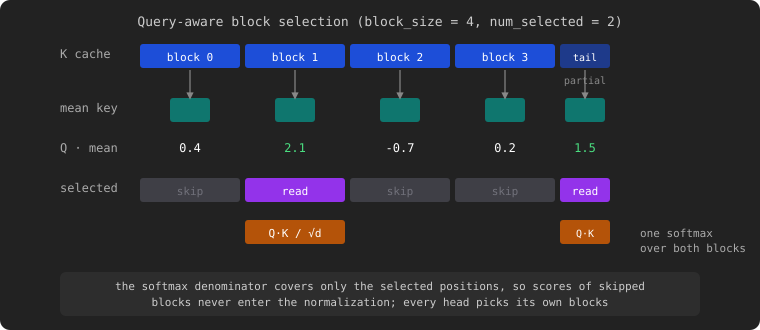

# Block-Sparse KV Selection Attention

LeetGPU · #119

[打开实现文件](../../practice/leetgpu/119/solution.cu) · [原始材料](../../references/LeetGPU/challenges/hard/119_block_sparse_kv_selection/challenge.html)

Implement one decode step of block-sparse attention with query-aware KV selection, the technique used by sparse-attention inference kernels such as NSA and Quest. Reading the whole KV cache for every generated token is bandwidth-bound, so the cache is split into contiguous blocks of `block_size` positions, each block is summarized by its mean-pooled key, and only the `num_selected` blocks whose summary looks most relevant to the current query are read at full resolution. Attention is then computed over the positions of the selected blocks only.

 For each head `h`, with `num_blocks = ceil(seq_len / block_size)` and block `b` covering positions `[b * block_size, min((b + 1) * block_size, seq_len))`:

 \[ \bar{k}_{h,b} = \frac{1}{|b|}\sum_{t \in b} K_{h,t} \qquad \sigma_{h,b} = Q_h \cdot \bar{k}_{h,b} \] \[ S_h = \text{top-}num\_selected\ \text{blocks by } \sigma_{h,b} \qquad P_h = \{\, t : t \in b,\; b \in S_h \,\} \] \[ o_h = \sum_{t \in P_h} \frac{\exp\!\left(\frac{Q_h \cdot K_{h,t}}{\sqrt{head\_dim}}\right)} {\sum_{u \in P_h} \exp\!\left(\frac{Q_h \cdot K_{h,u}}{\sqrt{head\_dim}}\right)} V_{h,t} \]

 Each head selects its own blocks. The tail block may be partial when `seq_len` is not a multiple of `block_size`, and its mean-pooled key must average only the positions that exist. If `num_selected` is at least `num_blocks` every block is kept and the attention becomes dense. Selection must be deterministic: when two blocks have equal scores, the block with the smaller index is selected. All tensors are `float32`.

## Implementation Requirements

- Implement the function `solve(Q, K, V, output, num_heads, seq_len, head_dim, block_size, num_selected)`.

- Do not change the function signature or use external libraries beyond the standard GPU framework.

- `Q` has shape `(num_heads, head_dim)`: a single decode query per head.

- `K` and `V` have shape `(num_heads, seq_len, head_dim)`.

- Score block `b` of head `h` with the unscaled dot product `Q[h] · mean(K[h, t] for t in block b)`, and keep the `min(num_selected, num_blocks)` highest-scoring blocks, breaking ties toward the smaller block index.

- Compute a single softmax attention per head over the positions of the selected blocks, using the scale factor `1 / sqrt(head_dim)`.

- Write the result into the provided `output` buffer of shape `(num_heads, head_dim)`.

## Example

 With `num_heads` = 2, `seq_len` = 4, `head_dim` = 2, `block_size` = 2, `num_selected` = 1:

 \(Q\) (2×2): \[ \begin{bmatrix} 1 & 0 \\ 0 & 1 \end{bmatrix} \] \(K_0 = K_1\) (4×2, identical for both heads): \[ \begin{bmatrix} 1 & 0 \\ 1 & 0 \\ 0 & 1 \\ 0 & 1 \end{bmatrix} \qquad V_0 = V_1\text{ (4}\times\text{2):} \begin{bmatrix} 1 & 2 \\ 3 & 4 \\ 5 & 6 \\ 7 & 8 \end{bmatrix} \]

 **Output** (2×2): \[ \begin{bmatrix} 2 & 3 \\ 6 & 7 \end{bmatrix} \]

 The pooled keys are `[1, 0]` for block 0 (positions 0–1) and `[0, 1]` for block 1 (positions 2–3). Head 0 scores them `[1, 0]` and keeps block 0, so it attends to positions 0 and 1 with equal weights and returns `([1, 2] + [3, 4]) / 2 = [2, 3]`. Head 1 scores them `[0, 1]` and keeps block 1, returning `([5, 6] + [7, 8]) / 2 = [6, 7]`.

## Constraints

- 1 ≤ `num_heads` ≤ 64

- 1 ≤ `seq_len` ≤ 8,192

- 1 ≤ `head_dim` ≤ 128

- 1 ≤ `block_size` ≤ 256

- 1 ≤ `num_selected`; if `num_selected` ≥ `num_blocks` every block is selected

- All tensor values are `float32`

- Performance is measured with `num_heads` = 32, `seq_len` = 8,192, `head_dim` = 128, `block_size` = 64, `num_selected` = 32

## 本地接口

~~~cpp
extern "C" void solve(const float* Q, const float* K, const float* V, float* output, int num_heads,
                      int seq_len, int head_dim, int block_size, int num_selected);
~~~

## 本地用例

~~~bash
./practice.sh cases leetgpu 119
./practice.sh test leetgpu 119
~~~

展开输入规格

~~~text
  #0 公开样例 · Q (2, 2) float32 · K (2, 4, 2) float32 · V (2, 4, 2) float32 · output (2, 2) float32 · num_heads 2 · seq_len 4 · head_dim 2 · block_size 2 · num_selected 1
  #1 公开功能用例 · Q (1, 8) float32 · K (1, 1, 8) float32 · V (1, 1, 8) float32 · output (1, 8) float32 · num_heads 1 · seq_len 1 · head_dim 8 · block_size 1 · num_selected 1
  #2 公开功能用例 · Q (2, 8) float32 · K (2, 3, 8) float32 · V (2, 3, 8) float32 · output (2, 8) float32 · num_heads 2 · seq_len 3 · head_dim 8 · block_size 2 · num_selected 1
  #3 公开功能用例 · Q (2, 8) float32 · K (2, 10, 8) float32 · V (2, 10, 8) float32 · output (2, 8) float32 · num_heads 2 · seq_len 10 · head_dim 8 · block_size 4 · num_selected 5
  #4 公开功能用例 · Q (1, 16) float32 · K (1, 16, 16) float32 · V (1, 16, 16) float32 · output (1, 16) float32 · num_heads 1 · seq_len 16 · head_dim 16 · block_size 4 · num_selected 2
  #5 公开功能用例 · Q (4, 32) float32 · K (4, 64, 32) float32 · V (4, 64, 32) float32 · output (4, 32) float32 · num_heads 4 · seq_len 64 · head_dim 32 · block_size 16 · num_selected 2
  #6 公开功能用例 · Q (8, 64) float32 · K (8, 128, 64) float32 · V (8, 128, 64) float32 · output (8, 64) float32 · num_heads 8 · seq_len 128 · head_dim 64 · block_size 16 · num_selected 4
  #7 公开功能用例 · Q (4, 128) float32 · K (4, 512, 128) float32 · V (4, 512, 128) float32 · output (4, 128) float32 · num_heads 4 · seq_len 512 · head_dim 128 · block_size 32 · num_selected 8
  #8 公开功能用例 · Q (2, 64) float32 · K (2, 30, 64) float32 · V (2, 30, 64) float32 · output (2, 64) float32 · num_heads 2 · seq_len 30 · head_dim 64 · block_size 8 · num_selected 3
  #9 公开功能用例 · Q (6, 100) float32 · K (6, 255, 100) float32 · V (6, 255, 100) float32 · output (6, 100) float32 · num_heads 6 · seq_len 255 · head_dim 100 · block_size 25 · num_selected 4
  #10 公开功能用例 · Q (16, 128) float32 · K (16, 1024, 128) float32 · V (16, 1024, 128) float32 · output (16, 128) float32 · num_heads 16 · seq_len 1024 · head_dim 128 · block_size 64 · num_selected 8
  #11 首个用例复验 · 原用例 #1 · 种子 2037 · 缓冲区守卫 · Q (1, 8) float32 · K (1, 1, 8) float32 · V (1, 1, 8) float32 · output (1, 8) float32 · num_heads 1 · seq_len 1 · head_dim 8 · block_size 1 · num_selected 1
  #12 中间用例复验 · 原用例 #6 · 种子 2038 · 缓冲区守卫 · Q (8, 64) float32 · K (8, 128, 64) float32 · V (8, 128, 64) float32 · output (8, 64) float32 · num_heads 8 · seq_len 128 · head_dim 64 · block_size 16 · num_selected 4
  #13 末尾用例复验 · 原用例 #10 · 种子 2039 · 缓冲区守卫 · Q (16, 128) float32 · K (16, 1024, 128) float32 · V (16, 1024, 128) float32 · output (16, 128) float32 · num_heads 16 · seq_len 1024 · head_dim 128 · block_size 64 · num_selected 8
13 个功能用例，另有 1 个样例
~~~

