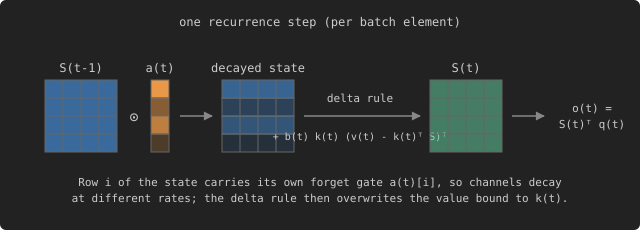

# Kimi Delta Attention

LeetGPU · #120

[打开实现文件](../../practice/leetgpu/120/solution.cu) · [原始材料](../../references/LeetGPU/challenges/medium/120_kimi_delta_attention/challenge.html)

Implement **Kimi Delta Attention** (KDA), the linear attention mechanism introduced in ["Kimi Linear: An Expressive, Efficient Attention Architecture"](https://arxiv.org/abs/2510.26692). KDA extends the gated delta rule with a *channel-wise* forget gate: the recurrent state \( S_t \in \mathbb{R}^{d \times d} \) is a fast-weight associative memory that is decayed per feature channel, corrected by the delta rule, and then queried. For each batch, the state starts at \( S_0 = 0 \) and is updated for `t = 1, ..., seq_len`: $$ S_t = \left(I - \beta_t k_t k_t^\top\right) \text{Diag}(\alpha_t)\, S_{t-1} + \beta_t k_t v_t^\top $$ $$ o_t = S_t^\top q_t $$ where \( q_t, k_t, v_t \in \mathbb{R}^{d} \) are the query, key, and value vectors at step `t`, \( \alpha_t \in (0, 1]^{d} \) is the channel-wise decay gate, and \( \beta_t \in [0, 1] \) is the update strength. The update can be read as online gradient descent on the reconstruction loss \( \frac{1}{2}\lVert S^\top k_t - v_t \rVert^2 \) with per-channel weight decay: old associations fade channel by channel while the delta rule overwrites the value currently associated with \( k_t \).

 All tensors are `float32`. `Q`, `K`, `V`, `alpha`, and `output` have shape `batch × seq_len × d`; `beta` has shape `batch × seq_len`. Key vectors are L2-normalized, so \( \lVert k_t \rVert_2 = 1 \) (or \( k_t = 0 \)). Each batch element is an independent sequence.

## Implementation Requirements

- Use only native features (external libraries are not permitted)

- The `solve` function signature must remain unchanged

- The final result must be stored in `output`

## Example

 Input (`batch` = 1, `seq_len` = 2, `d` = 2): $$ Q = \begin{bmatrix} 1 & 0 \\ 1 & 1 \end{bmatrix},\quad K = \begin{bmatrix} 1 & 0 \\ 0 & 1 \end{bmatrix},\quad V = \begin{bmatrix} 1 & 2 \\ 2 & 0 \end{bmatrix},\quad \alpha = \begin{bmatrix} 1 & 1 \\ 0.5 & 0.5 \end{bmatrix},\quad \beta = \begin{bmatrix} 1 & 0.5 \end{bmatrix} $$

 Step 1: \( S_1 = k_1 v_1^\top = \begin{bmatrix} 1 & 2 \\ 0 & 0 \end{bmatrix} \), so \( o_1 = S_1^\top q_1 = \begin{bmatrix} 1 \\ 2 \end{bmatrix} \). Step 2: the decayed state is \( \begin{bmatrix} 0.5 & 1 \\ 0 & 0 \end{bmatrix} \), and the delta update with \( k_2 = (0, 1) \) adds \( 0.5\, k_2 v_2^\top \), giving \( S_2 = \begin{bmatrix} 0.5 & 1 \\ 1 & 0 \end{bmatrix} \) and \( o_2 = S_2^\top q_2 = \begin{bmatrix} 1.5 \\ 1 \end{bmatrix} \).

 Output: $$ \text{output} = \begin{bmatrix} 1 & 2 \\ 1.5 & 1 \end{bmatrix} $$

## Constraints

- 1 ≤ `batch` ≤ 8

- 1 ≤ `seq_len` ≤ 16,384

- 1 ≤ `d` ≤ 128

- 0 < `alpha` values ≤ 1, 0 ≤ `beta` values ≤ 1

- Rows of `K` are L2-normalized (unit norm or all-zero)

- Performance is measured with `batch` = 4, `seq_len` = 8,192, `d` = 128

## References

-  Moonshot AI, ["Kimi Linear: An Expressive, Efficient Attention Architecture"](https://arxiv.org/abs/2510.26692) (arXiv:2510.26692) — introduces Kimi Delta Attention

-  Yang et al., ["Gated Delta Networks: Improving Mamba2 with Delta Rule"](https://arxiv.org/abs/2412.06464) (arXiv:2412.06464) — the head-wise gated delta rule KDA refines

-  ["Linear Attention: Kimi Delta Attention"](https://jianyuh.github.io/attention/2025/12/13/KDA.html) — walkthrough of the KDA recurrence and chunkwise algorithm

## 本地接口

~~~cpp
extern "C" void solve(const float* Q, const float* K, const float* V, const float* alpha,
                      const float* beta, float* output, int batch, int seq_len, int d);
~~~

## 本地用例

~~~bash
./practice.sh cases leetgpu 120
./practice.sh test leetgpu 120
~~~

展开输入规格

~~~text
  #0 公开样例 · Q (1, 2, 2) float32 · K (1, 2, 2) float32 · V (1, 2, 2) float32 · alpha (1, 2, 2) float32 · beta (1, 2) float32 · output (1, 2, 2) float32 · batch 1 · seq_len 2 · d 2
  #1 公开功能用例 · Q (1, 1, 1) float32 · K (1, 1, 1) float32 · V (1, 1, 1) float32 · alpha (1, 1, 1) float32 · beta (1, 1) float32 · output (1, 1, 1) float32 · batch 1 · seq_len 1 · d 1
  #2 公开功能用例 · Q (1, 2, 2) float32 · K (1, 2, 2) float32 · V (1, 2, 2) float32 · alpha (1, 2, 2) float32 · beta (1, 2) float32 · output (1, 2, 2) float32 · batch 1 · seq_len 2 · d 2
  #3 公开功能用例 · Q (1, 4, 4) float32 · K (1, 4, 4) float32 · V (1, 4, 4) float32 · alpha (1, 4, 4) float32 · beta (1, 4) float32 · output (1, 4, 4) float32 · batch 1 · seq_len 4 · d 4
  #4 公开功能用例 · Q (2, 8, 4) float32 · K (2, 8, 4) float32 · V (2, 8, 4) float32 · alpha (2, 8, 4) float32 · beta (2, 8) float32 · output (2, 8, 4) float32 · batch 2 · seq_len 8 · d 4
  #5 公开功能用例 · Q (2, 16, 8) float32 · K (2, 16, 8) float32 · V (2, 16, 8) float32 · alpha (2, 16, 8) float32 · beta (2, 16) float32 · output (2, 16, 8) float32 · batch 2 · seq_len 16 · d 8
  #6 公开功能用例 · Q (2, 64, 32) float32 · K (2, 64, 32) float32 · V (2, 64, 32) float32 · alpha (2, 64, 32) float32 · beta (2, 64) float32 · output (2, 64, 32) float32 · batch 2 · seq_len 64 · d 32
  #7 公开功能用例 · Q (1, 30, 7) float32 · K (1, 30, 7) float32 · V (1, 30, 7) float32 · alpha (1, 30, 7) float32 · beta (1, 30) float32 · output (1, 30, 7) float32 · batch 1 · seq_len 30 · d 7
  #8 公开功能用例 · Q (3, 100, 24) float32 · K (3, 100, 24) float32 · V (3, 100, 24) float32 · alpha (3, 100, 24) float32 · beta (3, 100) float32 · output (3, 100, 24) float32 · batch 3 · seq_len 100 · d 24
  #9 公开功能用例 · Q (2, 200, 64) float32 · K (2, 200, 64) float32 · V (2, 200, 64) float32 · alpha (2, 200, 64) float32 · beta (2, 200) float32 · output (2, 200, 64) float32 · batch 2 · seq_len 200 · d 64
  #10 公开功能用例 · Q (2, 1024, 128) float32 · K (2, 1024, 128) float32 · V (2, 1024, 128) float32 · alpha (2, 1024, 128) float32 · beta (2, 1024) float32 · output (2, 1024, 128) float32 · batch 2 · seq_len 1024 · d 128
  #11 首个用例复验 · 原用例 #1 · 种子 2037 · 缓冲区守卫 · Q (1, 1, 1) float32 · K (1, 1, 1) float32 · V (1, 1, 1) float32 · alpha (1, 1, 1) float32 · beta (1, 1) float32 · output (1, 1, 1) float32 · batch 1 · seq_len 1 · d 1
  #12 中间用例复验 · 原用例 #6 · 种子 2038 · 缓冲区守卫 · Q (2, 64, 32) float32 · K (2, 64, 32) float32 · V (2, 64, 32) float32 · alpha (2, 64, 32) float32 · beta (2, 64) float32 · output (2, 64, 32) float32 · batch 2 · seq_len 64 · d 32
  #13 末尾用例复验 · 原用例 #10 · 种子 2039 · 缓冲区守卫 · Q (2, 1024, 128) float32 · K (2, 1024, 128) float32 · V (2, 1024, 128) float32 · alpha (2, 1024, 128) float32 · beta (2, 1024) float32 · output (2, 1024, 128) float32 · batch 2 · seq_len 1024 · d 128
13 个功能用例，另有 1 个样例
~~~

