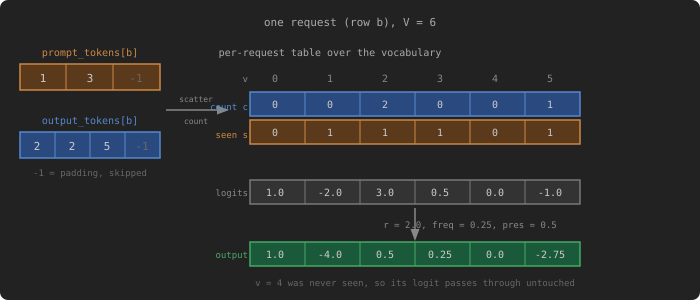

# Fused Logit Penalties

LeetGPU · #121

[打开实现文件](../../practice/leetgpu/121/solution.cu) · [原始材料](../../references/LeetGPU/challenges/medium/121_fused_logit_penalties/challenge.html)

Implement the fused *logit penalty* stage that LLM serving stacks such as vLLM, SGLang and Hugging Face TGI run on every decoding step, right before sampling. Given a batch of `B` in-flight requests, a logit row of `V` vocabulary entries per request, the tokens each request has already seen, and per-request penalty coefficients, produce the penalized logits in `output`. Every tensor is `float32` except the token id tensors, which are `int32`.

 For request \(b\), let \(c_{b,v}\) be how many times token \(v\) appears in `output_tokens[b]` (the tokens generated so far), and let \(s_{b,v}\) be true when token \(v\) appears anywhere in `prompt_tokens[b]` or `output_tokens[b]`. Entries equal to `-1` are padding and are ignored everywhere. Starting from \(z = \texttt{logits}[b][v]\), apply the three penalties **in this order**:

1.  **Repetition** (multiplicative, only for tokens that were seen): if \(s_{b,v}\), then \(z \leftarrow z / r_b\) when \(z > 0\) and \(z \leftarrow z \cdot r_b\) otherwise, where \(r_b = \texttt{repetition_penalty}[b]\).

1.  **Frequency** (scales with the generated count): \(z \leftarrow z - \texttt{frequency_penalty}[b] \cdot c_{b,v}\).

1.  **Presence** (flat, applied once per generated token): \(z \leftarrow z - \texttt{presence_penalty}[b]\) when \(c_{b,v} > 0\).

 Note the asymmetry that makes this kernel interesting: the repetition penalty keys off *prompt and generated* tokens, while the frequency and presence penalties key off *generated* tokens only. Since \(V\) is far larger than the histories, scanning the token lists once per vocabulary entry is hopelessly slow — build the per-request occurrence counts first, then stream the logits.

## Implementation Requirements

- Implement `solve(logits, prompt_tokens, output_tokens, presence_penalty, frequency_penalty, repetition_penalty, output, B, V, P, G)`; do not change the signature or use external libraries beyond the standard GPU frameworks.

- Write the penalized logits into the provided `output` buffer; leave `logits` unmodified.

- Each request has its own `presence_penalty`, `frequency_penalty` and `repetition_penalty` value.

- Apply the penalties in the order listed above; the repetition penalty must be applied before the additive penalties.

- Token ids equal to `-1` are padding slots and contribute to no count; padding may appear at any position in a row.

## Example

 With `B` = 2, `V` = 6, `P` = 3, `G` = 4:

 **Input** `logits` (2×6): \[ \begin{bmatrix} 1.0 & -2.0 & 3.0 & 0.5 & 0.0 & -1.0 \\ 2.0 & 1.0 & -1.0 & 0.0 & 4.0 & -3.0 \end{bmatrix} \] `prompt_tokens` (2×3), `output_tokens` (2×4): \[ \begin{bmatrix} 1 & 3 & -1 \\ 0 & 0 & 2 \end{bmatrix} \qquad \begin{bmatrix} 2 & 2 & 5 & -1 \\ 4 & -1 & -1 & -1 \end{bmatrix} \] `presence_penalty` = \([0.5,\ 1.0]\), `frequency_penalty` = \([0.25,\ 0.5]\), `repetition_penalty` = \([2.0,\ 1.0]\).

 **Output** `output` (2×6): \[ \begin{bmatrix} 1.0 & -4.0 & 0.5 & 0.25 & 0.0 & -2.75 \\ 2.0 & 1.0 & -1.0 & 0.0 & 2.5 & -3.0 \end{bmatrix} \]

 Row 0 has \(s = \{1, 2, 3, 5\}\) and counts \(c_2 = 2\), \(c_5 = 1\). Token 1 is seen with a negative logit, so it is multiplied: \(-2.0 \times 2.0 = -4.0\). Token 2 is seen with a positive logit, so it is divided and then charged both additive penalties: \(3.0 / 2.0 - 0.25 \cdot 2 - 0.5 = 0.5\). Token 4 is untouched. Row 1 has \(\text{repetition_penalty} = 1.0\), so only token 4 changes: \(4.0 - 0.5 \cdot 1 - 1.0 = 2.5\).

## Constraints

- 1 ≤ `B` ≤ 256

- 1 ≤ `V` ≤ 131,072

- 1 ≤ `P` ≤ 1,024

- 1 ≤ `G` ≤ 512

- Token ids are `-1` (padding) or in the range \([0, V)\)

- -50.0 ≤ `logits[b][v]` ≤ 50.0

- 0.0 ≤ `presence_penalty[b]`, `frequency_penalty[b]` ≤ 2.0

- 0.5 ≤ `repetition_penalty[b]` ≤ 2.0

- `logits`, the penalty vectors and `output` are `float32`; `prompt_tokens` and `output_tokens` are `int32`

- Performance is measured with `B` = 256, `V` = 128,256, `P` = 1,024, `G` = 512

## 本地接口

~~~cpp
extern "C" void solve(const float* logits, const int* prompt_tokens, const int* output_tokens,
                      const float* presence_penalty, const float* frequency_penalty,
                      const float* repetition_penalty, float* output, int B, int V, int P, int G);
~~~

## 本地用例

~~~bash
./practice.sh cases leetgpu 121
./practice.sh test leetgpu 121
~~~

展开输入规格

~~~text
  #0 公开样例 · logits (2, 6) float32 · prompt_tokens (2, 3) int32 · output_tokens (2, 4) int32 · presence_penalty (2,) float32 · frequency_penalty (2,) float32 · repetition_penalty (2,) float32 · output (2, 6) float32 · B 2 · V 6 · P 3 · G 4
  #1 公开功能用例 · logits (1, 4) float32 · prompt_tokens (1, 1) int32 · output_tokens (1, 1) int32 · presence_penalty (1,) float32 · frequency_penalty (1,) float32 · repetition_penalty (1,) float32 · output (1, 4) float32 · B 1 · V 4 · P 1 · G 1
  #2 公开功能用例 · logits (2, 3) float32 · prompt_tokens (2, 2) int32 · output_tokens (2, 2) int32 · presence_penalty (2,) float32 · frequency_penalty (2,) float32 · repetition_penalty (2,) float32 · output (2, 3) float32 · B 2 · V 3 · P 2 · G 2
  #3 公开功能用例 · logits (1, 4) float32 · prompt_tokens (1, 3) int32 · output_tokens (1, 2) int32 · presence_penalty (1,) float32 · frequency_penalty (1,) float32 · repetition_penalty (1,) float32 · output (1, 4) float32 · B 1 · V 4 · P 3 · G 2
  #4 公开功能用例 · logits (3, 8) float32 · prompt_tokens (3, 4) int32 · output_tokens (3, 5) int32 · presence_penalty (3,) float32 · frequency_penalty (3,) float32 · repetition_penalty (3,) float32 · output (3, 8) float32 · B 3 · V 8 · P 4 · G 5
  #5 公开功能用例 · logits (2, 1024) float32 · prompt_tokens (2, 64) int32 · output_tokens (2, 32) int32 · presence_penalty (2,) float32 · frequency_penalty (2,) float32 · repetition_penalty (2,) float32 · output (2, 1024) float32 · B 2 · V 1024 · P 64 · G 32
  #6 公开功能用例 · logits (8, 255) float32 · prompt_tokens (8, 64) int32 · output_tokens (8, 17) int32 · presence_penalty (8,) float32 · frequency_penalty (8,) float32 · repetition_penalty (8,) float32 · output (8, 255) float32 · B 8 · V 255 · P 64 · G 17
  #7 公开功能用例 · logits (4, 100) float32 · prompt_tokens (4, 30) int32 · output_tokens (4, 30) int32 · presence_penalty (4,) float32 · frequency_penalty (4,) float32 · repetition_penalty (4,) float32 · output (4, 100) float32 · B 4 · V 100 · P 30 · G 30
  #8 公开功能用例 · logits (64, 1024) float32 · prompt_tokens (64, 4) int32 · output_tokens (64, 2) int32 · presence_penalty (64,) float32 · frequency_penalty (64,) float32 · repetition_penalty (64,) float32 · output (64, 1024) float32 · B 64 · V 1024 · P 4 · G 2
  #9 公开功能用例 · logits (16, 4096) float32 · prompt_tokens (16, 256) int32 · output_tokens (16, 128) int32 · presence_penalty (16,) float32 · frequency_penalty (16,) float32 · repetition_penalty (16,) float32 · output (16, 4096) float32 · B 16 · V 4096 · P 256 · G 128
  #10 公开功能用例 · logits (32, 32000) float32 · prompt_tokens (32, 512) int32 · output_tokens (32, 256) int32 · presence_penalty (32,) float32 · frequency_penalty (32,) float32 · repetition_penalty (32,) float32 · output (32, 32000) float32 · B 32 · V 32000 · P 512 · G 256
  #11 首个用例复验 · 原用例 #1 · 种子 2037 · 缓冲区守卫 · logits (1, 4) float32 · prompt_tokens (1, 1) int32 · output_tokens (1, 1) int32 · presence_penalty (1,) float32 · frequency_penalty (1,) float32 · repetition_penalty (1,) float32 · output (1, 4) float32 · B 1 · V 4 · P 1 · G 1
  #12 中间用例复验 · 原用例 #6 · 种子 2038 · 缓冲区守卫 · logits (8, 255) float32 · prompt_tokens (8, 64) int32 · output_tokens (8, 17) int32 · presence_penalty (8,) float32 · frequency_penalty (8,) float32 · repetition_penalty (8,) float32 · output (8, 255) float32 · B 8 · V 255 · P 64 · G 17
  #13 末尾用例复验 · 原用例 #10 · 种子 2039 · 缓冲区守卫 · logits (32, 32000) float32 · prompt_tokens (32, 512) int32 · output_tokens (32, 256) int32 · presence_penalty (32,) float32 · frequency_penalty (32,) float32 · repetition_penalty (32,) float32 · output (32, 32000) float32 · B 32 · V 32000 · P 512 · G 256
13 个功能用例，另有 1 个样例
~~~

