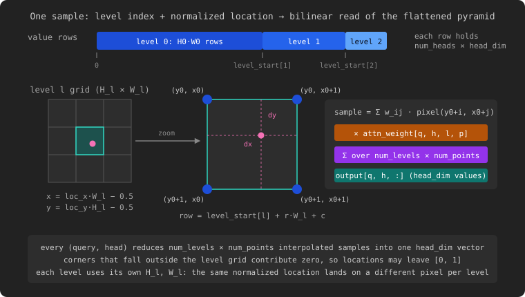

# Multi-Scale Deformable Attention

LeetGPU · #123

[打开实现文件](../../practice/leetgpu/123/solution.cu) · [原始材料](../../references/LeetGPU/challenges/hard/123_multi_scale_deformable_attention/challenge.html)

Implement multi-scale deformable attention, the kernel at the heart of detectors such as Deformable DETR, Grounding DINO and BEVFormer. Instead of attending to every position of a feature map, each query predicts a handful of *sampling locations* per attention head and per feature-pyramid level, reads the feature map at those (fractional) locations with bilinear interpolation, and combines the samples with pre-computed attention weights. The feature maps of all `num_levels` levels are concatenated into one `value` tensor, so the kernel must turn a level index plus a normalized coordinate into a row of that flat tensor.

 The levels are stored back to back in `value`, level `l` having shape `(H_l, W_l)` in row-major order, so its first row sits at the exclusive prefix sum `level_start[l]` of the level sizes `H_l × W_l`. For a query `q`, head `h`, level `l` and point `p`, the normalized location `(loc_x, loc_y)` is mapped to the pixel grid of its own level and interpolated:

 \[ x = loc_x \cdot W_l - 0.5 \qquad y = loc_y \cdot H_l - 0.5 \] \[ x_0 = \lfloor x \rfloor,\quad y_0 = \lfloor y \rfloor, \quad dx = x - x_0, \quad dy = y - y_0 \] \[ \text{sample}_{q,h,l,p} = \sum_{i=0}^{1}\sum_{j=0}^{1} w_{ij}\; \text{pixel}_l\!\left(y_0 + i,\; x_0 + j\right), \qquad w_{ij} = \big(i\,dy + (1-i)(1-dy)\big)\big(j\,dx + (1-j)(1-dx)\big) \] \[ \text{pixel}_l(r, c) = \begin{cases} value[\,level\_start[l] + r\,W_l + c,\; h,\; :\,] & 0 \le r < H_l \text{ and } 0 \le c < W_l \\ 0 & \text{otherwise} \end{cases} \] \[ output[q, h, :] = \sum_{l=0}^{num\_levels-1} \sum_{p=0}^{num\_points-1} attn\_weight[q, h, l, p] \cdot \text{sample}_{q,h,l,p} \]

 Sampling locations are not clamped: a location may fall outside `[0, 1]`, in which case the corners that land outside the level's grid contribute zero (zero padding, as in `grid_sample` with `align_corners=False`). The attention weights are already normalized by the caller and must be used exactly as given. All feature data is `float32`; `spatial_shapes` is `int32`.

## Implementation Requirements

- Implement the function `solve(value, spatial_shapes, sampling_loc, attn_weight, output, num_queries, num_heads, head_dim, num_levels, num_points)`.

- Do not change the function signature or use external libraries beyond the standard GPU framework.

- `value` has shape `(total_spatial, num_heads, head_dim)`, where `total_spatial` is the sum of `H_l × W_l` over all levels.

- `spatial_shapes` has shape `(num_levels, 2)` and holds `(H_l, W_l)` per level as `int32`; the level offsets are the exclusive prefix sum of `H_l × W_l`.

- `sampling_loc` has shape `(num_queries, num_heads, num_levels, num_points, 2)`, the last dimension being `(loc_x, loc_y)` normalized by the width and height of that level.

- `attn_weight` has shape `(num_queries, num_heads, num_levels, num_points)` and is applied as given; do not re-normalize it.

- Use bilinear interpolation with the half-pixel convention above and zero padding for corners outside the level grid.

- Write the result into the provided `output` buffer of shape `(num_queries, num_heads, head_dim)`.

## Example

 With `num_queries` = 2, `num_heads` = 1, `head_dim` = 1, `num_levels` = 2, `num_points` = 1 and `spatial_shapes` = `[(2, 2), (1, 1)]`, the five rows of `value` are the 2×2 map of level 0 followed by the 1×1 map of level 1:

 \[ \text{level }0 = \begin{bmatrix} 1 & 2 \\ 3 & 4 \end{bmatrix} \qquad \text{level }1 = \begin{bmatrix} 10 \end{bmatrix} \qquad value = \begin{bmatrix} 1 & 2 & 3 & 4 & 10 \end{bmatrix}^{\top} \]

 Sampling locations (one point per level, per query) and attention weights: \[ sampling\_loc = \begin{bmatrix} (0.5, 0.5) & (0.5, 0.5) \\ (1.0, 1.0) & (0.5, 0.5) \end{bmatrix} \qquad attn\_weight = \begin{bmatrix} 0.5 & 0.5 \\ 0.75 & 0.25 \end{bmatrix} \]

 **Output** (2×1×1): \[ \begin{bmatrix} 6.25 \\ 3.25 \end{bmatrix} \]

 Query 0 samples the center of level 0 at `x = y = 0.5`, which averages all four pixels to `2.5`, and the single pixel of level 1 at `x = y = 0`, giving `10`; the weighted sum is `0.5 × 2.5 + 0.5 × 10 = 6.25`. Query 0's level-1 location is exactly on a pixel center, so `dx = dy = 0` and the three phantom corners get weight zero. Query 1 samples level 0 at `x = y = 1.5`, where only the `(1, 1)` corner is inside the grid, so the sample is `0.25 × 4 = 1.0`, and the total is `0.75 × 1.0 + 0.25 × 10 = 3.25`.

## Constraints

- 1 ≤ `num_queries` ≤ 25,000

- 1 ≤ `num_heads` ≤ 16

- 1 ≤ `head_dim` ≤ 64

- 1 ≤ `num_levels` ≤ 8

- 1 ≤ `num_points` ≤ 8

- 1 ≤ `H_l`, `W_l` ≤ 128 and `total_spatial` ≤ 25,000

- `sampling_loc` values lie in `[-0.25, 1.25]`; `attn_weight` values lie in `[-5, 5]`

- `value`, `sampling_loc`, `attn_weight` and `output` are `float32`; `spatial_shapes` is `int32`

- Performance is measured with `num_queries` = 21,760, `num_heads` = 8, `head_dim` = 32, `num_levels` = 4, `num_points` = 4 and `spatial_shapes` = [(128, 128), (64, 64), (32, 32), (16, 16)]

## 本地接口

~~~cpp
extern "C" void solve(const float* value, const int* spatial_shapes, const float* sampling_loc,
                      const float* attn_weight, float* output, int num_queries, int num_heads,
                      int head_dim, int num_levels, int num_points);
~~~

## 本地用例

~~~bash
./practice.sh cases leetgpu 123
./practice.sh test leetgpu 123
~~~

展开输入规格

~~~text
  #0 公开样例 · value (5, 1, 1) float32 · spatial_shapes (2, 2) int32 · sampling_loc (2, 1, 2, 1, 2) float32 · attn_weight (2, 1, 2, 1) float32 · output (2, 1, 1) float32 · num_queries 2 · num_heads 1 · head_dim 1 · num_levels 2 · num_points 1
  #1 公开功能用例 · value (1, 1, 1) float32 · spatial_shapes (1, 2) int32 · sampling_loc (1, 1, 1, 1, 2) float32 · attn_weight (1, 1, 1, 1) float32 · output (1, 1, 1) float32 · num_queries 1 · num_heads 1 · head_dim 1 · num_levels 1 · num_points 1
  #2 公开功能用例 · value (6, 1, 2) float32 · spatial_shapes (1, 2) int32 · sampling_loc (2, 1, 1, 2, 2) float32 · attn_weight (2, 1, 1, 2) float32 · output (2, 1, 2) float32 · num_queries 2 · num_heads 1 · head_dim 2 · num_levels 1 · num_points 2
  #3 公开功能用例 · value (5, 2, 4) float32 · spatial_shapes (2, 2) int32 · sampling_loc (3, 2, 2, 1, 2) float32 · attn_weight (3, 2, 2, 1) float32 · output (3, 2, 4) float32 · num_queries 3 · num_heads 2 · head_dim 4 · num_levels 2 · num_points 1
  #4 公开功能用例 · value (20, 2, 8) float32 · spatial_shapes (2, 2) int32 · sampling_loc (4, 2, 2, 2, 2) float32 · attn_weight (4, 2, 2, 2) float32 · output (4, 2, 8) float32 · num_queries 4 · num_heads 2 · head_dim 8 · num_levels 2 · num_points 2
  #5 公开功能用例 · value (320, 4, 32) float32 · spatial_shapes (2, 2) int32 · sampling_loc (128, 4, 2, 4, 2) float32 · attn_weight (128, 4, 2, 4) float32 · output (128, 4, 32) float32 · num_queries 128 · num_heads 4 · head_dim 32 · num_levels 2 · num_points 4
  #6 公开功能用例 · value (1344, 8, 32) float32 · spatial_shapes (3, 2) int32 · sampling_loc (256, 8, 3, 4, 2) float32 · attn_weight (256, 8, 3, 4) float32 · output (256, 8, 32) float32 · num_queries 256 · num_heads 8 · head_dim 32 · num_levels 3 · num_points 4
  #7 公开功能用例 · value (320, 4, 64) float32 · spatial_shapes (2, 2) int32 · sampling_loc (1024, 4, 2, 8, 2) float32 · attn_weight (1024, 4, 2, 8) float32 · output (1024, 4, 64) float32 · num_queries 1024 · num_heads 4 · head_dim 64 · num_levels 2 · num_points 8
  #8 公开功能用例 · value (120, 3, 30) float32 · spatial_shapes (2, 2) int32 · sampling_loc (100, 3, 2, 3, 2) float32 · attn_weight (100, 3, 2, 3) float32 · output (100, 3, 30) float32 · num_queries 100 · num_heads 3 · head_dim 30 · num_levels 2 · num_points 3
  #9 公开功能用例 · value (189, 5, 17) float32 · spatial_shapes (4, 2) int32 · sampling_loc (255, 5, 4, 5, 2) float32 · attn_weight (255, 5, 4, 5) float32 · output (255, 5, 17) float32 · num_queries 255 · num_heads 5 · head_dim 17 · num_levels 4 · num_points 5
  #10 公开功能用例 · value (5440, 8, 32) float32 · spatial_shapes (4, 2) int32 · sampling_loc (5440, 8, 4, 4, 2) float32 · attn_weight (5440, 8, 4, 4) float32 · output (5440, 8, 32) float32 · num_queries 5440 · num_heads 8 · head_dim 32 · num_levels 4 · num_points 4
  #11 首个用例复验 · 原用例 #1 · 种子 2037 · 缓冲区守卫 · value (1, 1, 1) float32 · spatial_shapes (1, 2) int32 · sampling_loc (1, 1, 1, 1, 2) float32 · attn_weight (1, 1, 1, 1) float32 · output (1, 1, 1) float32 · num_queries 1 · num_heads 1 · head_dim 1 · num_levels 1 · num_points 1
  #12 中间用例复验 · 原用例 #6 · 种子 2038 · 缓冲区守卫 · value (1344, 8, 32) float32 · spatial_shapes (3, 2) int32 · sampling_loc (256, 8, 3, 4, 2) float32 · attn_weight (256, 8, 3, 4) float32 · output (256, 8, 32) float32 · num_queries 256 · num_heads 8 · head_dim 32 · num_levels 3 · num_points 4
  #13 末尾用例复验 · 原用例 #10 · 种子 2039 · 缓冲区守卫 · value (5440, 8, 32) float32 · spatial_shapes (4, 2) int32 · sampling_loc (5440, 8, 4, 4, 2) float32 · attn_weight (5440, 8, 4, 4) float32 · output (5440, 8, 32) float32 · num_queries 5440 · num_heads 8 · head_dim 32 · num_levels 4 · num_points 4
13 个功能用例，另有 1 个样例
~~~

