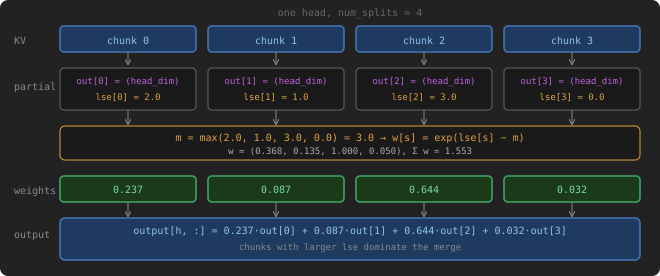

# Split-KV Attention Reduction

LeetGPU · #128

[打开实现文件](../../practice/leetgpu/128/solution.cu) · [原始材料](../../references/LeetGPU/challenges/medium/128_split_kv_attention_reduction/challenge.html)

When decoding a token against a long KV cache, Flash-Decoding splits the KV cache into `num_splits` chunks and computes a partial attention output on each chunk in parallel. Each partial output `partial_out[s]` is the softmax of that chunk's scores applied to that chunk's values, and each `partial_lse[s]` is the log-sum-exp of the chunk's scores. This kernel merges the per-chunk results into the final attention output using the log-sum-exp trick, so no chunk's contribution overflows when scores span very different magnitudes.

 For each head \(h\) and each embedding dimension \(d\), given the split log-sum-exps \(\ell_{s,h} = \text{partial_lse}[s, h]\) and partial outputs \(o_{s,h,d} = \text{partial_out}[s, h, d]\), let \[ m_h = \max_{s} \ell_{s,h}, \qquad w_{s,h} = \exp\!\bigl(\ell_{s,h} - m_h\bigr). \] The merged attention output is the per-split-weighted average \[ \text{output}[h, d] \;=\; \frac{\sum_{s=0}^{S-1} w_{s,h} \cdot o_{s,h,d}}{\sum_{s=0}^{S-1} w_{s,h}}. \]

## Implementation Requirements

- External libraries are not permitted

- The `solve` function signature must remain unchanged

- `partial_out` has shape `(num_splits, num_heads, head_dim)` with `float32` values

- `partial_lse` has shape `(num_splits, num_heads)` with `float32` values

- Subtract \(m_h\) before exponentiating to keep the merge numerically stable

- The final result must be stored in the `output` tensor with shape `(num_heads, head_dim)`

## Example 1:

 With `num_splits` = 2, `num_heads` = 2, `head_dim` = 2, each split contributes one \((\text{num_heads} \times \text{head_dim})\) partial output and one log-sum-exp per head. Rows index heads: \[ \text{partial_out}[0] = \begin{bmatrix} 1 & 2 \\ 4 & 0 \end{bmatrix}, \qquad \text{partial_lse}[0] = \begin{bmatrix} 0 & \ln 3 \end{bmatrix} \] \[ \text{partial_out}[1] = \begin{bmatrix} 3 & 4 \\ 0 & 8 \end{bmatrix}, \qquad \text{partial_lse}[1] = \begin{bmatrix} 0 & 0 \end{bmatrix} \] The two heads merge differently. Head 0 has equal log-sum-exps, so its weights are \(\tfrac{1}{2},\tfrac{1}{2}\); head 1 has log-sum-exps of \(\ln 3\) and \(0\), so its weights are \(\tfrac{3}{4},\tfrac{1}{4}\). The result is \[ \text{output} = \begin{bmatrix} 2 & 3 \\ 3 & 2 \end{bmatrix}. \]

## Constraints

- 1 ≤ `num_splits` ≤ 256

- 1 ≤ `num_heads` ≤ 128

- 1 ≤ `head_dim` ≤ 256

- All tensors are `float32`

- Performance is measured with `num_splits` = 128, `num_heads` = 64, `head_dim` = 128

## 本地接口

~~~cpp
extern "C" void solve(const float* partial_out, const float* partial_lse, float* output,
                      int num_splits, int num_heads, int head_dim);
~~~

## 本地用例

~~~bash
./practice.sh cases leetgpu 128
./practice.sh test leetgpu 128
~~~

展开输入规格

~~~text
  #0 公开样例 · partial_out (2, 2, 2) float32 · partial_lse (2, 2) float32 · output (2, 2) float32 · num_splits 2 · num_heads 2 · head_dim 2
  #1 公开功能用例 · partial_out (1, 4, 8) float32 · partial_lse (1, 4) float32 · output (4, 8) float32 · num_splits 1 · num_heads 4 · head_dim 8
  #2 公开功能用例 · partial_out (2, 1, 16) float32 · partial_lse (2, 1) float32 · output (1, 16) float32 · num_splits 2 · num_heads 1 · head_dim 16
  #3 公开功能用例 · partial_out (3, 2, 8) float32 · partial_lse (3, 2) float32 · output (2, 8) float32 · num_splits 3 · num_heads 2 · head_dim 8
  #4 公开功能用例 · partial_out (4, 4, 8) float32 · partial_lse (4, 4) float32 · output (4, 8) float32 · num_splits 4 · num_heads 4 · head_dim 8
  #5 公开功能用例 · partial_out (4, 8, 16) float32 · partial_lse (4, 8) float32 · output (8, 16) float32 · num_splits 4 · num_heads 8 · head_dim 16
  #6 公开功能用例 · partial_out (8, 16, 64) float32 · partial_lse (8, 16) float32 · output (16, 64) float32 · num_splits 8 · num_heads 16 · head_dim 64
  #7 公开功能用例 · partial_out (17, 12, 64) float32 · partial_lse (17, 12) float32 · output (12, 64) float32 · num_splits 17 · num_heads 12 · head_dim 64
  #8 公开功能用例 · partial_out (16, 30, 96) float32 · partial_lse (16, 30) float32 · output (30, 96) float32 · num_splits 16 · num_heads 30 · head_dim 96
  #9 公开功能用例 · partial_out (32, 32, 128) float32 · partial_lse (32, 32) float32 · output (32, 128) float32 · num_splits 32 · num_heads 32 · head_dim 128
  #10 公开功能用例 · partial_out (64, 16, 128) float32 · partial_lse (64, 16) float32 · output (16, 128) float32 · num_splits 64 · num_heads 16 · head_dim 128
  #11 首个用例复验 · 原用例 #1 · 种子 2037 · 缓冲区守卫 · partial_out (1, 4, 8) float32 · partial_lse (1, 4) float32 · output (4, 8) float32 · num_splits 1 · num_heads 4 · head_dim 8
  #12 中间用例复验 · 原用例 #6 · 种子 2038 · 缓冲区守卫 · partial_out (8, 16, 64) float32 · partial_lse (8, 16) float32 · output (16, 64) float32 · num_splits 8 · num_heads 16 · head_dim 64
  #13 末尾用例复验 · 原用例 #10 · 种子 2039 · 缓冲区守卫 · partial_out (64, 16, 128) float32 · partial_lse (64, 16) float32 · output (16, 128) float32 · num_splits 64 · num_heads 16 · head_dim 128
13 个功能用例，另有 1 个样例
~~~

