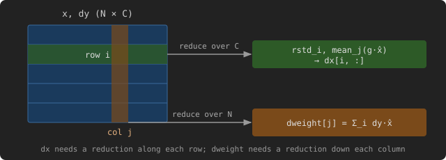

# RMS Norm Backward

LeetGPU · #142

[打开实现文件](../../practice/leetgpu/142/solution.cu) · [原始材料](../../references/LeetGPU/challenges/medium/142_rms_norm_backward/challenge.html)

Implement the backward pass of RMS Normalization, the normalization layer used in every block of LLaMA, Mistral, and Qwen. The forward pass normalized each row (token) of the float32 input `x` of shape `(N, C)` and scaled it by a learned per-feature `weight` of shape `(C,)`. Given `x`, `weight`, and the upstream gradient `dy` of shape `(N, C)`, compute the input gradient `dx` of shape `(N, C)` and the weight gradient `dweight` of shape `(C,)`. The per-row statistic is not saved from the forward pass and must be recomputed.

 With \(\varepsilon\) = `eps`, for each row \(i\) and column \(j\):

 \[ \begin{align} r_i &= \frac{1}{\sqrt{\frac{1}{C}\sum_{k=0}^{C-1} x_{i,k}^2 + \varepsilon}}, \qquad \hat{x}_{i,j} = x_{i,j}\, r_i, \qquad g_{i,j} = dy_{i,j}\, w_j \\ dx_{i,j} &= r_i \left( g_{i,j} - \hat{x}_{i,j} \cdot \frac{1}{C}\sum_{k=0}^{C-1} g_{i,k}\, \hat{x}_{i,k} \right) \\ dweight_j &= \sum_{i=0}^{N-1} dy_{i,j}\, \hat{x}_{i,j} \end{align} \]

## Implementation Requirements

- Use only native features (external libraries are not permitted)

- The `solve` function signature must remain unchanged

- The results must be stored in `dx` and `dweight`

- `dx` and `dweight` are not zero-initialized; every element must be written

## Example

 Input (`N` = 2, `C` = 4, `eps` = 1e-5): \[ x = \begin{bmatrix} 1.0 & -1.0 & 1.0 & -1.0 \\ 2.0 & 0.0 & 0.0 & 0.0 \end{bmatrix}, \quad dy = \begin{bmatrix} 1.0 & 1.0 & 1.0 & 1.0 \\ 1.0 & 0.0 & 0.0 & 1.0 \end{bmatrix}, \quad weight = \begin{bmatrix} 1.0 & 2.0 & 0.5 & 1.0 \end{bmatrix} \] Output: \[ dx = \begin{bmatrix} 1.3750 & 1.6250 & 0.8750 & 0.6250 \\ 0.0000 & 0.0000 & 0.0000 & 1.0000 \end{bmatrix}, \quad dweight = \begin{bmatrix} 3.0000 & -1.0000 & 1.0000 & -1.0000 \end{bmatrix} \]

## Constraints

- 1 ≤ `N` ≤ 65,536

- 1 ≤ `C` ≤ 16,384

- All tensors are float32

- Values of `x` are in [−250, 250]; values of `dy` are in [−10, 10]; values of `weight` are in [−2, 2]

- 1e-6 ≤ `eps` ≤ 1.0

- Performance is measured with `N` = 16,384, `C` = 4,096

## 本地接口

~~~cpp
extern "C" void solve(const float* x, const float* weight, const float* dy, float* dx,
                      float* dweight, int N, int C, float eps);
~~~

## 本地用例

~~~bash
./practice.sh cases leetgpu 142
./practice.sh test leetgpu 142
~~~

展开输入规格

~~~text
  #0 公开样例 · x (2, 4) float32 · weight (4,) float32 · dy (2, 4) float32 · dx (2, 4) float32 · dweight (4,) float32 · N 2 · C 4 · eps 1e-05
  #1 公开功能用例 · x (2, 4) float32 · weight (4,) float32 · dy (2, 4) float32 · dx (2, 4) float32 · dweight (4,) float32 · N 2 · C 4 · eps 1e-05
  #2 公开功能用例 · x (1, 1) float32 · weight (1,) float32 · dy (1, 1) float32 · dx (1, 1) float32 · dweight (1,) float32 · N 1 · C 1 · eps 1e-05
  #3 公开功能用例 · x (1, 3) float32 · weight (3,) float32 · dy (1, 3) float32 · dx (1, 3) float32 · dweight (3,) float32 · N 1 · C 3 · eps 1e-05
  #4 公开功能用例 · x (3, 4) float32 · weight (4,) float32 · dy (3, 4) float32 · dx (3, 4) float32 · dweight (4,) float32 · N 3 · C 4 · eps 1e-05
  #5 公开功能用例 · x (4, 8) float32 · weight (8,) float32 · dy (4, 8) float32 · dx (4, 8) float32 · dweight (8,) float32 · N 4 · C 8 · eps 1.0
  #6 公开功能用例 · x (5, 16) float32 · weight (16,) float32 · dy (5, 16) float32 · dx (5, 16) float32 · dweight (16,) float32 · N 5 · C 16 · eps 1e-05
  #7 公开功能用例 · x (16, 64) float32 · weight (64,) float32 · dy (16, 64) float32 · dx (16, 64) float32 · dweight (64,) float32 · N 16 · C 64 · eps 1e-05
  #8 公开功能用例 · x (32, 128) float32 · weight (128,) float32 · dy (32, 128) float32 · dx (32, 128) float32 · dweight (128,) float32 · N 32 · C 128 · eps 1e-05
  #9 公开功能用例 · x (100, 30) float32 · weight (30,) float32 · dy (100, 30) float32 · dx (100, 30) float32 · dweight (30,) float32 · N 100 · C 30 · eps 1e-05
  #10 公开功能用例 · x (255, 1000) float32 · weight (1000,) float32 · dy (255, 1000) float32 · dx (255, 1000) float32 · dweight (1000,) float32 · N 255 · C 1000 · eps 1e-05
  #11 公开功能用例 · x (4099, 256) float32 · weight (256,) float32 · dy (4099, 256) float32 · dx (4099, 256) float32 · dweight (256,) float32 · N 4099 · C 256 · eps 1e-05
  #12 公开功能用例 · x (1024, 2048) float32 · weight (2048,) float32 · dy (1024, 2048) float32 · dx (1024, 2048) float32 · dweight (2048,) float32 · N 1024 · C 2048 · eps 1e-05
  #13 首个用例复验 · 原用例 #1 · 种子 2039 · 缓冲区守卫 · x (2, 4) float32 · weight (4,) float32 · dy (2, 4) float32 · dx (2, 4) float32 · dweight (4,) float32 · N 2 · C 4 · eps 1e-05
  #14 中间用例复验 · 原用例 #7 · 种子 2040 · 缓冲区守卫 · x (16, 64) float32 · weight (64,) float32 · dy (16, 64) float32 · dx (16, 64) float32 · dweight (64,) float32 · N 16 · C 64 · eps 1e-05
  #15 末尾用例复验 · 原用例 #12 · 种子 2041 · 缓冲区守卫 · x (1024, 2048) float32 · weight (2048,) float32 · dy (1024, 2048) float32 · dx (1024, 2048) float32 · dweight (2048,) float32 · N 1024 · C 2048 · eps 1e-05
15 个功能用例，另有 1 个样例
~~~

