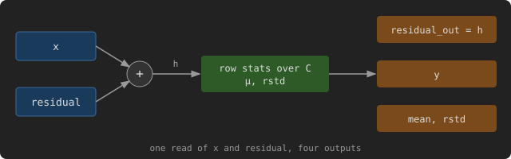

# Fused Residual Add and LayerNorm with Saved Statistics

LeetGPU · #143

[打开实现文件](../../practice/leetgpu/143/solution.cu) · [原始材料](../../references/LeetGPU/challenges/hard/143_fused_residual_add_layernorm/challenge.html)

Implement the fused pre-norm residual block entry used in GPT-2, BERT, and most LayerNorm transformers: add the sublayer output `x` to the residual stream `residual`, apply Layer Normalization with learned `gamma` and `beta`, and in the same pass write out everything the next layer and the backward pass need. All inputs are float32; `x` and `residual` have shape `(N, C)` (one row per token), `gamma` and `beta` have shape `(C,)`. You must produce four outputs: the normalized output `y` `(N, C)`, the updated residual stream `residual_out` `(N, C)`, and the per-row `mean` and reciprocal standard deviation `rstd`, each of shape `(N,)`.

 With \(\varepsilon\) = `eps`, for each row \(i\) and column \(j\):

 \[ \begin{align} h_{i,j} &= x_{i,j} + \text{residual}_{i,j} \\ \mu_i &= \frac{1}{C}\sum_{k=0}^{C-1} h_{i,k}, \qquad r_i = \frac{1}{\sqrt{\frac{1}{C}\sum_{k=0}^{C-1} \left(h_{i,k} - \mu_i\right)^2 + \varepsilon}} \\ y_{i,j} &= \left(h_{i,j} - \mu_i\right) r_i \, \gamma_j + \beta_j \end{align} \]

 Store \(h\) in `residual_out`, \(\mu\) in `mean`, and \(r\) in `rstd`. The variance is the biased (population) variance. Rows may have a large mean relative to their spread, so compute the variance in a numerically stable way.

## Implementation Requirements

- Use only native features (external libraries are not permitted)

- The `solve` function signature must remain unchanged

- The results must be stored in `y`, `residual_out`, `mean`, and `rstd`

- The outputs are not zero-initialized; every element must be written

## Example

 Input (`N` = 2, `C` = 4, `eps` = 1e-5): \[ x = \begin{bmatrix} 1.0 & 2.0 & 3.0 & 4.0 \\ 0.0 & 0.0 & 2.0 & 2.0 \end{bmatrix}, \quad \text{residual} = \begin{bmatrix} 1.0 & 0.0 & -1.0 & 0.0 \\ 1.0 & 1.0 & -1.0 & -1.0 \end{bmatrix} \] \[ \gamma = \begin{bmatrix} 1.0 & 2.0 & 1.0 & 0.5 \end{bmatrix}, \quad \beta = \begin{bmatrix} 0.0 & 0.0 & 1.0 & 0.0 \end{bmatrix} \] Output: \[ y = \begin{bmatrix} -0.5773 & -1.1547 & 0.4227 & 0.8660 \\ 0.0000 & 0.0000 & 1.0000 & 0.0000 \end{bmatrix}, \quad \text{residual\_out} = \begin{bmatrix} 2.0 & 2.0 & 2.0 & 4.0 \\ 1.0 & 1.0 & 1.0 & 1.0 \end{bmatrix} \] \[ \text{mean} = \begin{bmatrix} 2.5 & 1.0 \end{bmatrix}, \quad \text{rstd} = \begin{bmatrix} 1.1547 & 316.2278 \end{bmatrix} \]

## Constraints

- 1 ≤ `N` ≤ 65,536

- 1 ≤ `C` ≤ 16,384

- All tensors are float32

- Values of `x` and `residual` are in [−1,000, 1,000]; values of `gamma` are in [−2, 2] and `beta` in [−0.5, 0.5]

- 1e-6 ≤ `eps` ≤ 1.0

- Performance is measured with `N` = 16,384, `C` = 4,096

## 本地接口

~~~cpp
extern "C" void solve(const float* x, const float* residual, const float* gamma, const float* beta,
                      float* y, float* residual_out, float* mean, float* rstd, int N, int C,
                      float eps);
~~~

## 本地用例

~~~bash
./practice.sh cases leetgpu 143
./practice.sh test leetgpu 143
~~~

展开输入规格

~~~text
  #0 公开样例 · x (2, 4) float32 · residual (2, 4) float32 · gamma (4,) float32 · beta (4,) float32 · y (2, 4) float32 · residual_out (2, 4) float32 · mean (2,) float32 · rstd (2,) float32 · N 2 · C 4 · eps 1e-05
  #1 公开功能用例 · x (2, 4) float32 · residual (2, 4) float32 · gamma (4,) float32 · beta (4,) float32 · y (2, 4) float32 · residual_out (2, 4) float32 · mean (2,) float32 · rstd (2,) float32 · N 2 · C 4 · eps 1e-05
  #2 公开功能用例 · x (1, 1) float32 · residual (1, 1) float32 · gamma (1,) float32 · beta (1,) float32 · y (1, 1) float32 · residual_out (1, 1) float32 · mean (1,) float32 · rstd (1,) float32 · N 1 · C 1 · eps 1e-05
  #3 公开功能用例 · x (3, 8) float32 · residual (3, 8) float32 · gamma (8,) float32 · beta (8,) float32 · y (3, 8) float32 · residual_out (3, 8) float32 · mean (3,) float32 · rstd (3,) float32 · N 3 · C 8 · eps 1e-05
  #4 公开功能用例 · x (4, 16) float32 · residual (4, 16) float32 · gamma (16,) float32 · beta (16,) float32 · y (4, 16) float32 · residual_out (4, 16) float32 · mean (4,) float32 · rstd (4,) float32 · N 4 · C 16 · eps 1.0
  #5 公开功能用例 · x (5, 32) float32 · residual (5, 32) float32 · gamma (32,) float32 · beta (32,) float32 · y (5, 32) float32 · residual_out (5, 32) float32 · mean (5,) float32 · rstd (5,) float32 · N 5 · C 32 · eps 1e-05
  #6 公开功能用例 · x (7, 30) float32 · residual (7, 30) float32 · gamma (30,) float32 · beta (30,) float32 · y (7, 30) float32 · residual_out (7, 30) float32 · mean (7,) float32 · rstd (7,) float32 · N 7 · C 30 · eps 1e-05
  #7 公开功能用例 · x (33, 1000) float32 · residual (33, 1000) float32 · gamma (1000,) float32 · beta (1000,) float32 · y (33, 1000) float32 · residual_out (33, 1000) float32 · mean (33,) float32 · rstd (33,) float32 · N 33 · C 1000 · eps 1e-05
  #8 公开功能用例 · x (64, 1024) float32 · residual (64, 1024) float32 · gamma (1024,) float32 · beta (1024,) float32 · y (64, 1024) float32 · residual_out (64, 1024) float32 · mean (64,) float32 · rstd (64,) float32 · N 64 · C 1024 · eps 1e-05
  #9 公开功能用例 · x (17, 3000) float32 · residual (17, 3000) float32 · gamma (3000,) float32 · beta (3000,) float32 · y (17, 3000) float32 · residual_out (17, 3000) float32 · mean (17,) float32 · rstd (17,) float32 · N 17 · C 3000 · eps 1e-05
  #10 公开功能用例 · x (4099, 256) float32 · residual (4099, 256) float32 · gamma (256,) float32 · beta (256,) float32 · y (4099, 256) float32 · residual_out (4099, 256) float32 · mean (4099,) float32 · rstd (4099,) float32 · N 4099 · C 256 · eps 1e-05
  #11 公开功能用例 · x (512, 1600) float32 · residual (512, 1600) float32 · gamma (1600,) float32 · beta (1600,) float32 · y (512, 1600) float32 · residual_out (512, 1600) float32 · mean (512,) float32 · rstd (512,) float32 · N 512 · C 1600 · eps 1e-05
  #12 公开功能用例 · x (256, 5120) float32 · residual (256, 5120) float32 · gamma (5120,) float32 · beta (5120,) float32 · y (256, 5120) float32 · residual_out (256, 5120) float32 · mean (256,) float32 · rstd (256,) float32 · N 256 · C 5120 · eps 1e-05
  #13 首个用例复验 · 原用例 #1 · 种子 2039 · 缓冲区守卫 · x (2, 4) float32 · residual (2, 4) float32 · gamma (4,) float32 · beta (4,) float32 · y (2, 4) float32 · residual_out (2, 4) float32 · mean (2,) float32 · rstd (2,) float32 · N 2 · C 4 · eps 1e-05
  #14 中间用例复验 · 原用例 #7 · 种子 2040 · 缓冲区守卫 · x (33, 1000) float32 · residual (33, 1000) float32 · gamma (1000,) float32 · beta (1000,) float32 · y (33, 1000) float32 · residual_out (33, 1000) float32 · mean (33,) float32 · rstd (33,) float32 · N 33 · C 1000 · eps 1e-05
  #15 末尾用例复验 · 原用例 #12 · 种子 2041 · 缓冲区守卫 · x (256, 5120) float32 · residual (256, 5120) float32 · gamma (5120,) float32 · beta (5120,) float32 · y (256, 5120) float32 · residual_out (256, 5120) float32 · mean (256,) float32 · rstd (256,) float32 · N 256 · C 5120 · eps 1e-05
15 个功能用例，另有 1 个样例
~~~

