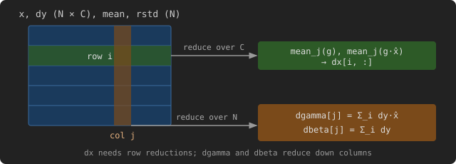

# Layer Norm Backward

LeetGPU · #144

[打开实现文件](../../practice/leetgpu/144/solution.cu) · [原始材料](../../references/LeetGPU/challenges/medium/144_layer_norm_backward/challenge.html)

Implement the backward pass of Layer Normalization, the foundational normalization layer used in GPT-2, BERT, ViT, and standard transformer architectures. The forward pass normalized each row (token) of the float32 input `x` of shape `(N, C)` using per-row `mean` and reciprocal standard deviation `rstd`, and applied per-feature learned scale `gamma` and shift `beta`. Given `x`, `gamma`, `mean`, `rstd`, and the upstream gradient `dy` of shape `(N, C)`, compute the input gradient `dx` of shape `(N, C)` and the parameter gradients `dgamma` and `dbeta`, each of shape `(C,)`.

 For each row \(i\) and column \(j\), with normalized value \(\hat{x}_{i,j} = (x_{i,j} - \mu_i) r_i\) and scaled upstream gradient \(g_{i,j} = dy_{i,j} \gamma_j\):

 \[ \begin{align} dx_{i,j} &= r_i \left( g_{i,j} - \frac{1}{C}\sum_{k=0}^{C-1} g_{i,k} - \hat{x}_{i,j} \cdot \frac{1}{C}\sum_{k=0}^{C-1} g_{i,k} \hat{x}_{i,k} \right) \\ d\gamma_j &= \sum_{i=0}^{N-1} dy_{i,j} \hat{x}_{i,j} \\ d\beta_j &= \sum_{i=0}^{N-1} dy_{i,j} \end{align} \]

## Implementation Requirements

- Use only native features (external libraries are not permitted)

- The `solve` function signature must remain unchanged

- The results must be stored in `dx`, `dgamma`, and `dbeta`

- `dx`, `dgamma`, and `dbeta` are not zero-initialized; every element must be written

## Example

 Input (`N` = 2, `C` = 4): \[ x = \begin{bmatrix} 1.0 & 2.0 & 3.0 & 4.0 \\ -1.0 & 0.0 & 0.0 & 1.0 \end{bmatrix}, \quad \gamma = \begin{bmatrix} 1.0 & 1.0 & 1.0 & 1.0 \end{bmatrix} \] \[ \text{mean} = \begin{bmatrix} 2.5 & 0.0 \end{bmatrix}, \quad \text{rstd} = \begin{bmatrix} 0.8944 & 1.4142 \end{bmatrix} \] \[ dy = \begin{bmatrix} 1.0 & 1.0 & 1.0 & 1.0 \\ 1.0 & 0.0 & 0.0 & 1.0 \end{bmatrix} \] Output: \[ dx = \begin{bmatrix} 0.0000 & 0.0000 & 0.0000 & 0.0000 \\ 0.7071 & -0.7071 & -0.7071 & 0.7071 \end{bmatrix} \] \[ d\gamma = \begin{bmatrix} -2.7559 & -0.4472 & 0.4472 & 2.7559 \end{bmatrix}, \quad d\beta = \begin{bmatrix} 2.0000 & 1.0000 & 1.0000 & 2.0000 \end{bmatrix} \]

## Constraints

- 1 ≤ `N` ≤ 65,536

- 1 ≤ `C` ≤ 16,384

- All tensors are float32

- Values of `x` are in [−250, 250]; values of `dy` are in [−10, 10]; values of `gamma` are in [−2, 2]

- Performance is measured with `N` = 16,384, `C` = 4,096

## 本地接口

~~~cpp
extern "C" void solve(const float* x, const float* gamma, const float* mean, const float* rstd,
                      const float* dy, float* dx, float* dgamma, float* dbeta, int N, int C);
~~~

## 本地用例

~~~bash
./practice.sh cases leetgpu 144
./practice.sh test leetgpu 144
~~~

展开输入规格

~~~text
  #0 公开样例 · x (2, 4) float32 · gamma (4,) float32 · mean (2,) float32 · rstd (2,) float32 · dy (2, 4) float32 · dx (2, 4) float32 · dgamma (4,) float32 · dbeta (4,) float32 · N 2 · C 4
  #1 公开功能用例 · x (2, 4) float32 · gamma (4,) float32 · mean (2,) float32 · rstd (2,) float32 · dy (2, 4) float32 · dx (2, 4) float32 · dgamma (4,) float32 · dbeta (4,) float32 · N 2 · C 4
  #2 公开功能用例 · x (1, 1) float32 · gamma (1,) float32 · mean (1,) float32 · rstd (1,) float32 · dy (1, 1) float32 · dx (1, 1) float32 · dgamma (1,) float32 · dbeta (1,) float32 · N 1 · C 1
  #3 公开功能用例 · x (1, 3) float32 · gamma (3,) float32 · mean (1,) float32 · rstd (1,) float32 · dy (1, 3) float32 · dx (1, 3) float32 · dgamma (3,) float32 · dbeta (3,) float32 · N 1 · C 3
  #4 公开功能用例 · x (3, 4) float32 · gamma (4,) float32 · mean (3,) float32 · rstd (3,) float32 · dy (3, 4) float32 · dx (3, 4) float32 · dgamma (4,) float32 · dbeta (4,) float32 · N 3 · C 4
  #5 公开功能用例 · x (5, 16) float32 · gamma (16,) float32 · mean (5,) float32 · rstd (5,) float32 · dy (5, 16) float32 · dx (5, 16) float32 · dgamma (16,) float32 · dbeta (16,) float32 · N 5 · C 16
  #6 公开功能用例 · x (16, 64) float32 · gamma (64,) float32 · mean (16,) float32 · rstd (16,) float32 · dy (16, 64) float32 · dx (16, 64) float32 · dgamma (64,) float32 · dbeta (64,) float32 · N 16 · C 64
  #7 公开功能用例 · x (32, 128) float32 · gamma (128,) float32 · mean (32,) float32 · rstd (32,) float32 · dy (32, 128) float32 · dx (32, 128) float32 · dgamma (128,) float32 · dbeta (128,) float32 · N 32 · C 128
  #8 公开功能用例 · x (100, 30) float32 · gamma (30,) float32 · mean (100,) float32 · rstd (100,) float32 · dy (100, 30) float32 · dx (100, 30) float32 · dgamma (30,) float32 · dbeta (30,) float32 · N 100 · C 30
  #9 公开功能用例 · x (255, 1000) float32 · gamma (1000,) float32 · mean (255,) float32 · rstd (255,) float32 · dy (255, 1000) float32 · dx (255, 1000) float32 · dgamma (1000,) float32 · dbeta (1000,) float32 · N 255 · C 1000
  #10 公开功能用例 · x (4099, 256) float32 · gamma (256,) float32 · mean (4099,) float32 · rstd (4099,) float32 · dy (4099, 256) float32 · dx (4099, 256) float32 · dgamma (256,) float32 · dbeta (256,) float32 · N 4099 · C 256
  #11 公开功能用例 · x (1024, 2048) float32 · gamma (2048,) float32 · mean (1024,) float32 · rstd (1024,) float32 · dy (1024, 2048) float32 · dx (1024, 2048) float32 · dgamma (2048,) float32 · dbeta (2048,) float32 · N 1024 · C 2048
  #12 首个用例复验 · 原用例 #1 · 种子 2038 · 缓冲区守卫 · x (2, 4) float32 · gamma (4,) float32 · mean (2,) float32 · rstd (2,) float32 · dy (2, 4) float32 · dx (2, 4) float32 · dgamma (4,) float32 · dbeta (4,) float32 · N 2 · C 4
  #13 中间用例复验 · 原用例 #6 · 种子 2039 · 缓冲区守卫 · x (16, 64) float32 · gamma (64,) float32 · mean (16,) float32 · rstd (16,) float32 · dy (16, 64) float32 · dx (16, 64) float32 · dgamma (64,) float32 · dbeta (64,) float32 · N 16 · C 64
  #14 末尾用例复验 · 原用例 #11 · 种子 2040 · 缓冲区守卫 · x (1024, 2048) float32 · gamma (2048,) float32 · mean (1024,) float32 · rstd (1024,) float32 · dy (1024, 2048) float32 · dx (1024, 2048) float32 · dgamma (2048,) float32 · dbeta (2048,) float32 · N 1024 · C 2048
14 个功能用例，另有 1 个样例
~~~

