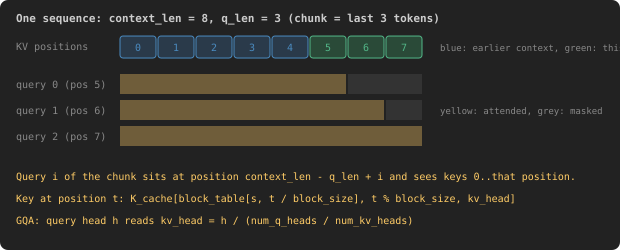

# Paged Chunked Prefill Attention

LeetGPU · #145

[打开实现文件](../../practice/leetgpu/145/solution.cu) · [原始材料](../../references/LeetGPU/challenges/hard/145_paged_chunked_prefill_attention/challenge.html)

Implement the attention step of a **chunked-prefill** LLM serving batch over a **paged KV cache** with grouped-query attention (GQA). Each sequence in the batch contributes a chunk of its newest `q_len` query tokens: a decode step (`q_len` = 1), a fresh prompt, or the next chunk of a long prompt. The keys and values for all `context_lens[s]` tokens of sequence `s` (including the chunk itself, already appended) live in fixed-size blocks scattered through a shared cache pool and are located through `block_table`. Every query token attends causally to its own sequence's cache. All tensors are `float32` except the index tensors, which are `int32`.

## Implementation Requirements

 Implement `solve(Q, K_cache, V_cache, block_table, context_lens, cu_seqlens_q, output, num_seqs, total_q, num_q_heads, num_kv_heads, head_dim, block_size, max_blocks_per_seq)`:

- `Q`: shape `(total_q, num_q_heads, head_dim)`, the query chunks of all sequences packed back to back

- `K_cache`, `V_cache`: shape `(num_blocks, block_size, num_kv_heads, head_dim)`, the shared paged cache pool

- `block_table`: shape `(num_seqs, max_blocks_per_seq)`; `block_table[s, j]` is the physical block holding logical block `j` of sequence `s`

- `context_lens`: shape `(num_seqs,)`, the number of cached tokens of each sequence, including its chunk

- `cu_seqlens_q`: shape `(num_seqs + 1,)`, with `cu_seqlens_q[0]` = 0; rows `cu_seqlens_q[s]` to `cu_seqlens_q[s + 1] - 1` of `Q` and `output` belong to sequence `s`, so `q_len[s] = cu_seqlens_q[s + 1] - cu_seqlens_q[s]`

- `output`: shape `(total_q, num_q_heads, head_dim)`

 For sequence \(s\) with \(L = \text{context_lens}[s]\) and \(n = \text{q_len}[s]\), query token \(i\) (row \(\text{cu_seqlens_q}[s] + i\)) has position \(p_i = L - n + i\). For query head \(h\), with \(g = h \,/\, (\text{num_q_heads} / \text{num_kv_heads})\) (integer division): \[ \text{scores}[t] = \frac{Q[i, h] \cdot K_{s}[t, g]}{\sqrt{\text{head_dim}}}, \quad 0 \le t \le p_i \] \[ \text{output}[i, h] = \sum_{t=0}^{p_i} \text{softmax}(\text{scores})[t] \, V_{s}[t, g] \] where \(K_s[t]\) is `K_cache[block_table[s, t / block_size], t % block_size]` (and likewise for \(V_s\)). Keys after \(p_i\) are masked out.

- Use only native features of the framework you choose (no external libraries); keep the function signature unchanged

- Write the result into `output`; every row of `output` must be written

- Compute scores and accumulate in `float32` or better; reduced-precision (TF32/FP16) products of `Q` and `K` exceed the tolerance

## Example

 Input: `num_seqs` = 1, `total_q` = 2, `num_q_heads` = 2, `num_kv_heads` = 1, `head_dim` = 2, `block_size` = 2, `max_blocks_per_seq` = 2, `context_lens` = [3], `cu_seqlens_q` = [0, 2], `block_table` = [[2, 0]]

 The chunk is the last 2 of 3 tokens, so query 0 is at position 1 and query 1 is at position 2. Logical block 0 (positions 0, 1) is physical block 2 and logical block 1 (position 2) is physical block 0. Physical block 1 and slot 1 of block 0 are unused and hold 9s. Both query heads share KV head 0: \[ K_s = \begin{bmatrix} 1 & 0 \\ 1 & 0 \\ 0 & 1 \end{bmatrix}, \quad V_s = \begin{bmatrix} 3 & 0 \\ 0 & 3 \\ 3 & 3 \end{bmatrix} \] \[ Q[0] = \begin{bmatrix} 0 & 0 \\ 2 & 0 \end{bmatrix}, \quad Q[1] = \begin{bmatrix} 0 & 0 \\ 2 & 0 \end{bmatrix} \quad \text{(rows are heads 0 and 1)} \]

 Query 0 sees keys 0 and 1 only. Head 0 has scores \([0, 0]\); head 1 has scores \([\sqrt{2}, \sqrt{2}]\). Both average \(V_0, V_1\) uniformly to \([1.5, 1.5]\). Query 1 sees keys 0 to 2. Head 0 gives the uniform mean \([2, 2]\). Head 1 has scores \([\sqrt{2}, \sqrt{2}, 0]\) and weights \([0.4458, 0.4458, 0.1084]\), giving \([1.6626, 1.6626]\): \[ \text{output}[0] = \begin{bmatrix} 1.5 & 1.5 \\ 1.5 & 1.5 \end{bmatrix}, \quad \text{output}[1] = \begin{bmatrix} 2.0 & 2.0 \\ 1.6626 & 1.6626 \end{bmatrix} \]

## Constraints

- 1 ≤ `num_seqs` ≤ 64

- 1 ≤ `q_len[s]` ≤ `context_lens[s]` ≤ 8,192 for every sequence; `total_q` = `cu_seqlens_q[num_seqs]` ≤ 8,192

- 1 ≤ `num_kv_heads` ≤ `num_q_heads` ≤ 64, and `num_q_heads` is a multiple of `num_kv_heads`

- 2 ≤ `head_dim` ≤ 256, `head_dim` is even

- 1 ≤ `block_size` ≤ 64, `block_size` is a power of 2

- `max_blocks_per_seq` = `ceil(max(context_lens) / block_size)`; entries `block_table[s, j]` with `j ≥ ceil(context_lens[s] / block_size)` are padding and must be ignored, and slots past `context_lens[s]` in a sequence's last block hold unrelated data

- Physical blocks are scattered arbitrarily through the pool, and the pool holds blocks that belong to no sequence

- Inputs are drawn from a standard normal distribution; `Q` may be scaled so that scores reach about ±100

- Performance is measured with `num_seqs` = 32 (4 prefill chunks with `q_len` = 512 and `context_lens` = 512, 1,536, 2,560, 4,096, plus 28 decode sequences with `q_len` = 1 and `context_lens` = 1,024 to 4,480 in steps of 128), `total_q` = 2,076, `num_q_heads` = 32, `num_kv_heads` = 8, `head_dim` = 128, `block_size` = 16

## 本地接口

~~~cpp
extern "C" void solve(const float* Q, const float* K_cache, const float* V_cache,
                      const int* block_table, const int* context_lens, const int* cu_seqlens_q,
                      float* output, int num_seqs, int total_q, int num_q_heads, int num_kv_heads,
                      int head_dim, int block_size, int max_blocks_per_seq);
~~~

## 本地用例

~~~bash
./practice.sh cases leetgpu 145
./practice.sh test leetgpu 145
~~~

展开输入规格

~~~text
  #0 公开样例 · Q (2, 2, 2) float32 · K_cache (3, 2, 1, 2) float32 · V_cache (3, 2, 1, 2) float32 · block_table (1, 2) int32 · context_lens (1,) int32 · cu_seqlens_q (2,) int32 · output (2, 2, 2) float32 · num_seqs 1 · total_q 2 · num_q_heads 2 · num_kv_heads 1 · head_dim 2 · block_size 2 · max_blocks_per_seq 2
  #1 公开功能用例 · Q (2, 2, 2) float32 · K_cache (3, 2, 1, 2) float32 · V_cache (3, 2, 1, 2) float32 · block_table (1, 2) int32 · context_lens (1,) int32 · cu_seqlens_q (2,) int32 · output (2, 2, 2) float32 · num_seqs 1 · total_q 2 · num_q_heads 2 · num_kv_heads 1 · head_dim 2 · block_size 2 · max_blocks_per_seq 2
  #2 公开功能用例 · Q (1, 1, 4) float32 · K_cache (3, 1, 1, 4) float32 · V_cache (3, 1, 1, 4) float32 · block_table (1, 1) int32 · context_lens (1,) int32 · cu_seqlens_q (2,) int32 · output (1, 1, 4) float32 · num_seqs 1 · total_q 1 · num_q_heads 1 · num_kv_heads 1 · head_dim 4 · block_size 1 · max_blocks_per_seq 1
  #3 公开功能用例 · Q (3, 2, 8) float32 · K_cache (3, 4, 2, 8) float32 · V_cache (3, 4, 2, 8) float32 · block_table (1, 1) int32 · context_lens (1,) int32 · cu_seqlens_q (2,) int32 · output (3, 2, 8) float32 · num_seqs 1 · total_q 3 · num_q_heads 2 · num_kv_heads 2 · head_dim 8 · block_size 4 · max_blocks_per_seq 1
  #4 公开功能用例 · Q (4, 8, 16) float32 · K_cache (25, 4, 2, 16) float32 · V_cache (25, 4, 2, 16) float32 · block_table (4, 9) int32 · context_lens (4,) int32 · cu_seqlens_q (5,) int32 · output (4, 8, 16) float32 · num_seqs 4 · total_q 4 · num_q_heads 8 · num_kv_heads 2 · head_dim 16 · block_size 4 · max_blocks_per_seq 9
  #5 公开功能用例 · Q (11, 4, 32) float32 · K_cache (16, 16, 2, 32) float32 · V_cache (16, 16, 2, 32) float32 · block_table (2, 7) int32 · context_lens (2,) int32 · cu_seqlens_q (3,) int32 · output (11, 4, 32) float32 · num_seqs 2 · total_q 11 · num_q_heads 4 · num_kv_heads 2 · head_dim 32 · block_size 16 · max_blocks_per_seq 7
  #6 公开功能用例 · Q (8, 4, 8) float32 · K_cache (7, 8, 1, 8) float32 · V_cache (7, 8, 1, 8) float32 · block_table (2, 4) int32 · context_lens (2,) int32 · cu_seqlens_q (3,) int32 · output (8, 4, 8) float32 · num_seqs 2 · total_q 8 · num_q_heads 4 · num_kv_heads 1 · head_dim 8 · block_size 8 · max_blocks_per_seq 4
  #7 公开功能用例 · Q (17, 8, 64) float32 · K_cache (28, 16, 1, 64) float32 · V_cache (28, 16, 1, 64) float32 · block_table (2, 16) int32 · context_lens (2,) int32 · cu_seqlens_q (3,) int32 · output (17, 8, 64) float32 · num_seqs 2 · total_q 17 · num_q_heads 8 · num_kv_heads 1 · head_dim 64 · block_size 16 · max_blocks_per_seq 16
  #8 公开功能用例 · Q (131, 4, 64) float32 · K_cache (31, 64, 4, 64) float32 · V_cache (31, 64, 4, 64) float32 · block_table (3, 16) int32 · context_lens (3,) int32 · cu_seqlens_q (4,) int32 · output (131, 4, 64) float32 · num_seqs 3 · total_q 131 · num_q_heads 4 · num_kv_heads 4 · head_dim 64 · block_size 64 · max_blocks_per_seq 16
  #9 公开功能用例 · Q (450, 16, 128) float32 · K_cache (832, 16, 4, 128) float32 · V_cache (832, 16, 4, 128) float32 · block_table (6, 256) int32 · context_lens (6,) int32 · cu_seqlens_q (7,) int32 · output (450, 16, 128) float32 · num_seqs 6 · total_q 450 · num_q_heads 16 · num_kv_heads 4 · head_dim 128 · block_size 16 · max_blocks_per_seq 256
  #10 公开功能用例 · Q (1026, 32, 128) float32 · K_cache (1285, 16, 8, 128) float32 · V_cache (1285, 16, 8, 128) float32 · block_table (4, 512) int32 · context_lens (4,) int32 · cu_seqlens_q (5,) int32 · output (1026, 32, 128) float32 · num_seqs 4 · total_q 1026 · num_q_heads 32 · num_kv_heads 8 · head_dim 128 · block_size 16 · max_blocks_per_seq 512
  #11 首个用例复验 · 原用例 #1 · 种子 2037 · 缓冲区守卫 · Q (2, 2, 2) float32 · K_cache (3, 2, 1, 2) float32 · V_cache (3, 2, 1, 2) float32 · block_table (1, 2) int32 · context_lens (1,) int32 · cu_seqlens_q (2,) int32 · output (2, 2, 2) float32 · num_seqs 1 · total_q 2 · num_q_heads 2 · num_kv_heads 1 · head_dim 2 · block_size 2 · max_blocks_per_seq 2
  #12 中间用例复验 · 原用例 #6 · 种子 2038 · 缓冲区守卫 · Q (8, 4, 8) float32 · K_cache (7, 8, 1, 8) float32 · V_cache (7, 8, 1, 8) float32 · block_table (2, 4) int32 · context_lens (2,) int32 · cu_seqlens_q (3,) int32 · output (8, 4, 8) float32 · num_seqs 2 · total_q 8 · num_q_heads 4 · num_kv_heads 1 · head_dim 8 · block_size 8 · max_blocks_per_seq 4
  #13 末尾用例复验 · 原用例 #10 · 种子 2039 · 缓冲区守卫 · Q (1026, 32, 128) float32 · K_cache (1285, 16, 8, 128) float32 · V_cache (1285, 16, 8, 128) float32 · block_table (4, 512) int32 · context_lens (4,) int32 · cu_seqlens_q (5,) int32 · output (1026, 32, 128) float32 · num_seqs 4 · total_q 1026 · num_q_heads 32 · num_kv_heads 8 · head_dim 128 · block_size 16 · max_blocks_per_seq 512
13 个功能用例，另有 1 个样例
~~~

