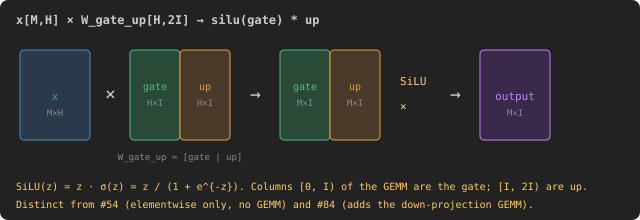

# Fused Gate-Up Projection with SiLU

LeetGPU · #146

[打开实现文件](../../practice/leetgpu/146/solution.cu) · [原始材料](../../references/LeetGPU/challenges/hard/146_fused_gate_up_silu/challenge.html)

Implement the fused **gate-up projection with SiLU** used in every LLaMA / Mistral SwiGLU MLP block. A packed weight `W_gate_up` of shape `[H, 2I]` produces both the gate and up projections in one matrix multiply; the gate half is passed through SiLU and multiplied element-wise by the up half. Production CuTe / CUTLASS kernels fuse the SiLU-and-mul into the GEMM epilogue so the `2I`-wide intermediate never lands in HBM. All tensors are `float32`.

## Implementation Requirements

 Implement `solve(x, W_gate_up, output, M, H, I)`:

- `x`: shape `(M, H)`, the token hidden states

- `W_gate_up`: shape `(H, 2I)`, packed gate and up weights laid out row-major so columns `[0, I)` are `W_gate` and columns `[I, 2I)` are `W_up`

- `output`: shape `(M, I)`

 For every token \(m\) and channel \(i\): \[ g_{m,i} = \sum_{h=0}^{H-1} x_{m,h}\, W\_gate\_up_{h,i}, \qquad u_{m,i} = \sum_{h=0}^{H-1} x_{m,h}\, W\_gate\_up_{h,\,I+i} \] \[ output_{m,i} = \mathrm{SiLU}(g_{m,i}) · u_{m,i} = \frac{g_{m,i}}{1 + e^{-g_{m,i}}} · u_{m,i} \]

- Use only native features of the framework you choose (no external libraries); keep the function signature unchanged

- Write the result into `output`; every entry of `output` must be written

- Accumulate the GEMM in `float32` or better; reduced-precision (TF32/FP16) products of `x` and `W_gate_up` exceed the tolerance on the larger tests

## Example

 Input: `M` = 2, `H` = 2, `I` = 2, `x` = identity, `W_gate_up` = identity on both the gate and up halves: \[ x = \begin{bmatrix} 1 & 0 \\ 0 & 1 \end{bmatrix}, \quad W\_gate\_up = \begin{bmatrix} 1 & 0 & 1 & 0 \\ 0 & 1 & 0 & 1 \end{bmatrix} \] So the GEMM yields `gate = up = I`. With \(\mathrm{SiLU}(1) = \sigma(1) \approx 0.731059\) and \(\mathrm{SiLU}(0) = 0\): \[ output = \begin{bmatrix} 0.731059 & 0 \\ 0 & 0.731059 \end{bmatrix} \]

## Constraints

- 1 ≤ `M` ≤ 8,192

- 1 ≤ `H` ≤ 8,192

- 1 ≤ `I` ≤ 16,384

- Inputs are drawn from a normal distribution; `x` and `W_gate_up` may be scaled so gate values reach about ±20

- Performance is measured with `M` = 4,096, `H` = 4,096, `I` = 11,008 (Llama-3-8B-style gate-up widths)

## 本地接口

~~~cpp
extern "C" void solve(const float* x, const float* W_gate_up, float* output, int M, int H, int I);
~~~

## 本地用例

~~~bash
./practice.sh cases leetgpu 146
./practice.sh test leetgpu 146
~~~

展开输入规格

~~~text
  #0 公开样例 · x (2, 2) float32 · W_gate_up (2, 4) float32 · output (2, 2) float32 · M 2 · H 2 · I 2
  #1 公开功能用例 · x (2, 2) float32 · W_gate_up (2, 4) float32 · output (2, 2) float32 · M 2 · H 2 · I 2
  #2 公开功能用例 · x (1, 2) float32 · W_gate_up (2, 4) float32 · output (1, 2) float32 · M 1 · H 2 · I 2
  #3 公开功能用例 · x (4, 8) float32 · W_gate_up (8, 8) float32 · output (4, 4) float32 · M 4 · H 8 · I 4
  #4 公开功能用例 · x (8, 8) float32 · W_gate_up (8, 16) float32 · output (8, 8) float32 · M 8 · H 8 · I 8
  #5 公开功能用例 · x (7, 16) float32 · W_gate_up (16, 34) float32 · output (7, 17) float32 · M 7 · H 16 · I 17
  #6 公开功能用例 · x (16, 32) float32 · W_gate_up (32, 128) float32 · output (16, 64) float32 · M 16 · H 32 · I 64
  #7 公开功能用例 · x (4, 8) float32 · W_gate_up (8, 12) float32 · output (4, 6) float32 · M 4 · H 8 · I 6
  #8 公开功能用例 · x (32, 64) float32 · W_gate_up (64, 96) float32 · output (32, 48) float32 · M 32 · H 64 · I 48
  #9 公开功能用例 · x (64, 256) float32 · W_gate_up (256, 1024) float32 · output (64, 512) float32 · M 64 · H 256 · I 512
  #10 公开功能用例 · x (512, 64) float32 · W_gate_up (64, 256) float32 · output (512, 128) float32 · M 512 · H 64 · I 128
  #11 公开功能用例 · x (8, 512) float32 · W_gate_up (512, 512) float32 · output (8, 256) float32 · M 8 · H 512 · I 256
  #12 首个用例复验 · 原用例 #1 · 种子 2038 · 缓冲区守卫 · x (2, 2) float32 · W_gate_up (2, 4) float32 · output (2, 2) float32 · M 2 · H 2 · I 2
  #13 中间用例复验 · 原用例 #6 · 种子 2039 · 缓冲区守卫 · x (16, 32) float32 · W_gate_up (32, 128) float32 · output (16, 64) float32 · M 16 · H 32 · I 64
  #14 末尾用例复验 · 原用例 #11 · 种子 2040 · 缓冲区守卫 · x (8, 512) float32 · W_gate_up (512, 512) float32 · output (8, 256) float32 · M 8 · H 512 · I 256
14 个功能用例，另有 1 个样例
~~~

