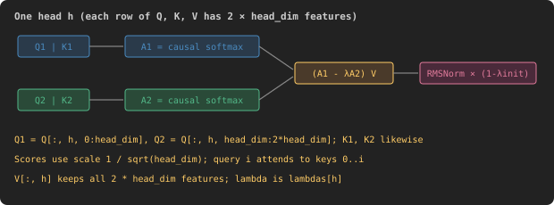

# Differential Attention

LeetGPU · #148

[打开实现文件](../../practice/leetgpu/148/solution.cu) · [原始材料](../../references/LeetGPU/challenges/hard/148_differential_attention/challenge.html)

Implement the causal **differential attention** layer of the Differential Transformer. Every head splits its query and key into two halves, computes two causal softmax attention maps, and attends with their difference `A1 - λ·A2`, which cancels attention noise that both maps share. The per-head result is RMS-normalized over its `2 × head_dim` features and scaled by `1 - lambda_init`. All tensors are `float32`.

## Implementation Requirements

 Implement `solve(Q, K, V, lambdas, output, seq_len, num_heads, head_dim, lambda_init)`:

- `Q`, `K`, `V`: shape `(seq_len, num_heads, 2 * head_dim)`

- `lambdas`: shape `(num_heads,)`, the per-head weight λh of the second map

- `output`: shape `(seq_len, num_heads, 2 * head_dim)`

- `lambda_init`: a scalar; the normalized output is multiplied by `1 - lambda_init`

 For head \(h\) with \(d = \text{head_dim}\), let \(Q_1, K_1\) be features \(0 \ldots d-1\) and \(Q_2, K_2\) be features \(d \ldots 2d-1\) of `Q[:, h]` and `K[:, h]`. For query row \(i\) and key \(t \le i\): \[ A_1[i, t] = \text{softmax}_t\!\left(\frac{Q_1[i] \cdot K_1[t]}{\sqrt{d}}\right), \quad A_2[i, t] = \text{softmax}_t\!\left(\frac{Q_2[i] \cdot K_2[t]}{\sqrt{d}}\right) \] with keys \(t > i\) masked out of both softmaxes. Then \[ O[i] = \sum_{t=0}^{i} \left(A_1[i, t] - \lambda_h A_2[i, t]\right) V[t, h], \qquad \text{output}[i, h] = (1 - \text{lambda_init}) \cdot \frac{O[i]}{\sqrt{\frac{1}{2d}\sum_{j=0}^{2d-1} O[i]_j^2 + 10^{-5}}} \]

- Use only native features of the framework you choose (no external libraries); keep the function signature unchanged

- Write the result into `output`; every element must be written

- Compute scores and accumulate in `float32` or better; reduced-precision (TF32/FP16) products exceed the tolerance

## Example

 Input: `seq_len` = 2, `num_heads` = 1, `head_dim` = 1, `lambdas` = [0.5], `lambda_init` = 0.2. Each row below is one token's `2 × head_dim` features for head 0: \[ Q = \begin{bmatrix} 1 & 0 \\ 1 & 0 \end{bmatrix}, \quad K = \begin{bmatrix} 0 & 5 \\ 1 & 7 \end{bmatrix}, \quad V = \begin{bmatrix} 2 & 0 \\ 0 & 2 \end{bmatrix} \]

 \(Q_2 = 0\), so \(A_2\) is a uniform causal average. Row 0 sees only key 0: \(A_1 = A_2 = [1]\), so \(O[0] = 0.5 \cdot [2, 0] = [1, 0]\), whose RMS is \(\sqrt{0.5}\). Row 1 has \(A_1 = \text{softmax}([0, 1]) = [0.2689, 0.7311]\) and \(A_2 = [0.5, 0.5]\), so the weights are \([0.0189, 0.4811]\) and \(O[1] = [0.0379, 0.9621]\). After RMS normalization and the factor 0.8: \[ \text{output} = \begin{bmatrix} 1.1314 & 0 \\ 0.0445 & 1.1305 \end{bmatrix} \]

## Constraints

- 1 ≤ `seq_len` ≤ 8,192

- 1 ≤ `num_heads` ≤ 64

- 1 ≤ `head_dim` ≤ 128

- -1 ≤ `lambdas[h]` ≤ 1 and 0 ≤ `lambda_init` < 1

- `Q`, `K`, `V` are drawn from a standard normal distribution; `Q` may be scaled so that scores reach about ±30

- When \(O[i]\) is all zeros the output row is all zeros

- Performance is measured with `seq_len` = 4,096, `num_heads` = 32, `head_dim` = 64

## 本地接口

~~~cpp
extern "C" void solve(const float* Q, const float* K, const float* V, const float* lambdas,
                      float* output, int seq_len, int num_heads, int head_dim, float lambda_init);
~~~

## 本地用例

~~~bash
./practice.sh cases leetgpu 148
./practice.sh test leetgpu 148
~~~

展开输入规格

~~~text
  #0 公开样例 · Q (2, 1, 2) float32 · K (2, 1, 2) float32 · V (2, 1, 2) float32 · lambdas (1,) float32 · output (2, 1, 2) float32 · seq_len 2 · num_heads 1 · head_dim 1 · lambda_init 0.2
  #1 公开功能用例 · Q (2, 1, 2) float32 · K (2, 1, 2) float32 · V (2, 1, 2) float32 · lambdas (1,) float32 · output (2, 1, 2) float32 · seq_len 2 · num_heads 1 · head_dim 1 · lambda_init 0.2
  #2 公开功能用例 · Q (1, 1, 2) float32 · K (1, 1, 2) float32 · V (1, 1, 2) float32 · lambdas (1,) float32 · output (1, 1, 2) float32 · seq_len 1 · num_heads 1 · head_dim 1 · lambda_init 0.3
  #3 公开功能用例 · Q (4, 2, 8) float32 · K (4, 2, 8) float32 · V (4, 2, 8) float32 · lambdas (2,) float32 · output (4, 2, 8) float32 · seq_len 4 · num_heads 2 · head_dim 4 · lambda_init 0.5
  #4 公开功能用例 · Q (3, 2, 4) float32 · K (3, 2, 4) float32 · V (3, 2, 4) float32 · lambdas (2,) float32 · output (3, 2, 4) float32 · seq_len 3 · num_heads 2 · head_dim 2 · lambda_init 0.5
  #5 公开功能用例 · Q (6, 2, 8) float32 · K (6, 2, 8) float32 · V (6, 2, 8) float32 · lambdas (2,) float32 · output (6, 2, 8) float32 · seq_len 6 · num_heads 2 · head_dim 4 · lambda_init 0.5
  #6 公开功能用例 · Q (3, 2, 4) float32 · K (3, 2, 4) float32 · V (3, 2, 4) float32 · lambdas (2,) float32 · output (3, 2, 4) float32 · seq_len 3 · num_heads 2 · head_dim 2 · lambda_init 0.5
  #7 公开功能用例 · Q (5, 2, 8) float32 · K (5, 2, 8) float32 · V (5, 2, 8) float32 · lambdas (2,) float32 · output (5, 2, 8) float32 · seq_len 5 · num_heads 2 · head_dim 4 · lambda_init 0.6
  #8 公开功能用例 · Q (16, 4, 16) float32 · K (16, 4, 16) float32 · V (16, 4, 16) float32 · lambdas (4,) float32 · output (16, 4, 16) float32 · seq_len 16 · num_heads 4 · head_dim 8 · lambda_init 0.5
  #9 公开功能用例 · Q (32, 8, 32) float32 · K (32, 8, 32) float32 · V (32, 8, 32) float32 · lambdas (8,) float32 · output (32, 8, 32) float32 · seq_len 32 · num_heads 8 · head_dim 16 · lambda_init 0.8
  #10 公开功能用例 · Q (30, 3, 16) float32 · K (30, 3, 16) float32 · V (30, 3, 16) float32 · lambdas (3,) float32 · output (30, 3, 16) float32 · seq_len 30 · num_heads 3 · head_dim 8 · lambda_init 0.1
  #11 公开功能用例 · Q (100, 5, 64) float32 · K (100, 5, 64) float32 · V (100, 5, 64) float32 · lambdas (5,) float32 · output (100, 5, 64) float32 · seq_len 100 · num_heads 5 · head_dim 32 · lambda_init 0.5
  #12 公开功能用例 · Q (255, 4, 128) float32 · K (255, 4, 128) float32 · V (255, 4, 128) float32 · lambdas (4,) float32 · output (255, 4, 128) float32 · seq_len 255 · num_heads 4 · head_dim 64 · lambda_init 0.35
  #13 公开功能用例 · Q (512, 8, 128) float32 · K (512, 8, 128) float32 · V (512, 8, 128) float32 · lambdas (8,) float32 · output (512, 8, 128) float32 · seq_len 512 · num_heads 8 · head_dim 64 · lambda_init 0.7
  #14 公开功能用例 · Q (1024, 2, 256) float32 · K (1024, 2, 256) float32 · V (1024, 2, 256) float32 · lambdas (2,) float32 · output (1024, 2, 256) float32 · seq_len 1024 · num_heads 2 · head_dim 128 · lambda_init 0.2
  #15 首个用例复验 · 原用例 #1 · 种子 2041 · 缓冲区守卫 · Q (2, 1, 2) float32 · K (2, 1, 2) float32 · V (2, 1, 2) float32 · lambdas (1,) float32 · output (2, 1, 2) float32 · seq_len 2 · num_heads 1 · head_dim 1 · lambda_init 0.2
  #16 中间用例复验 · 原用例 #8 · 种子 2042 · 缓冲区守卫 · Q (16, 4, 16) float32 · K (16, 4, 16) float32 · V (16, 4, 16) float32 · lambdas (4,) float32 · output (16, 4, 16) float32 · seq_len 16 · num_heads 4 · head_dim 8 · lambda_init 0.5
  #17 末尾用例复验 · 原用例 #14 · 种子 2043 · 缓冲区守卫 · Q (1024, 2, 256) float32 · K (1024, 2, 256) float32 · V (1024, 2, 256) float32 · lambdas (2,) float32 · output (1024, 2, 256) float32 · seq_len 1024 · num_heads 2 · head_dim 128 · lambda_init 0.2
17 个功能用例，另有 1 个样例
~~~

