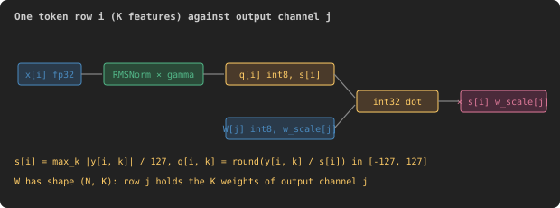

# Fused RMSNorm and W8A8 Linear

LeetGPU · #149

[打开实现文件](../../practice/leetgpu/149/solution.cu) · [原始材料](../../references/LeetGPU/challenges/hard/149_rmsnorm_w8a8_linear/challenge.html)

Implement the **fused RMSNorm + W8A8 linear layer** used by int8 LLM inference (SmoothQuant-style W8A8). Each token row of `x` is RMS-normalized and scaled by `gamma`, then quantized on the fly to `int8` with its own symmetric per-token scale. The int8 activations are multiplied by an `int8` weight matrix that was quantized offline with one scale per output channel, the products are accumulated as integers, and the result is dequantized to `float32`.

## Implementation Requirements

 Implement `solve(x, gamma, W, w_scale, output, M, N, K)`:

- `x`: shape `(M, K)`, `float32`, one row per token

- `gamma`: shape `(K,)`, `float32`, the RMSNorm weight

- `W`: shape `(N, K)`, `int8` with values in [-127, 127]

- `w_scale`: shape `(N,)`, `float32`, one scale per output channel

- `output`: shape `(M, N)`, `float32`

 For token row \(i\), with \(\epsilon = 10^{-6}\): \[ y_{i,k} = \frac{x_{i,k}}{\sqrt{\frac{1}{K}\sum_{k'=0}^{K-1} x_{i,k'}^2 + \epsilon}} \, \gamma_k, \qquad s_i = \frac{\max_k |y_{i,k}|}{127}, \qquad q_{i,k} = \text{clamp}\!\left(\text{round}\!\left(\frac{y_{i,k}}{s_i}\right), -127, 127\right) \] where round is round-to-nearest (ties to even). If \(s_i = 0\), every \(q_{i,k} = 0\). Then \[ \text{output}[i, j] = s_i \cdot \text{w_scale}_j \cdot \sum_{k=0}^{K-1} q_{i,k} \, W_{j,k} \]

- Use only native features of the framework you choose (no external libraries); keep the function signature unchanged

- Write the result into `output`; every element must be written

- The activations must really be quantized to int8 levels; the sums \(\sum_k q_{i,k} W_{j,k}\) are integers and should be accumulated exactly (for example in `int32`)

- Floating-point rounding may move an activation that lies right on a rounding boundary to the neighbouring level; the tolerance allows for this

## Example

 Input: `M` = 2, `N` = 3, `K` = 4, `gamma` = [1, 1, 1, 1], `w_scale` = [0.5, 0.25, 0.01]: \[ x = \begin{bmatrix} 3 & -1 & 0 & 1 \\ 1 & 1 & 1 & 1 \end{bmatrix}, \quad W = \begin{bmatrix} 1 & 0 & 0 & 0 \\ 0 & 2 & -2 & 0 \\ 10 & 10 & 10 & 10 \end{bmatrix} \]

 Row 0 has mean square 2.75, so \(y_0 = x_0 / 1.65831\) and \(s_0 = 1.80907 / 127 = 0.0142446\); \(q_0 = [127, -42, 0, 42]\) and the integer dot products with the rows of \(W\) are \([127, -84, 1270]\). Row 1 normalizes to all ones, so \(s_1 \approx 1/127\), \(q_1 = [127, 127, 127, 127]\) and the dot products are \([127, 0, 5080]\). Scaling by \(s_i \cdot \text{w_scale}_j\): \[ \text{output} = \begin{bmatrix} 0.9045 & -0.2991 & 0.1809 \\ 0.5000 & 0.0000 & 0.4000 \end{bmatrix} \]

## Constraints

- 1 ≤ `M` ≤ 8,192

- 1 ≤ `N` ≤ 16,384

- 1 ≤ `K` ≤ 8,192

- `x` is drawn from a standard normal distribution, possibly scaled, with a few outlier channels or tokens up to about 60× larger; rows may be all zero

- `gamma` is in [0.5, 1.5]; `w_scale` is about 1 / (127 · √K)

- Performance is measured with `M` = 4,096, `N` = 4,096, `K` = 4,096

## 本地接口

~~~cpp
extern "C" void solve(const float* x, const float* gamma, const int8_t* W, const float* w_scale,
                      float* output, int M, int N, int K);
~~~

## 本地用例

~~~bash
./practice.sh cases leetgpu 149
./practice.sh test leetgpu 149
~~~

展开输入规格

~~~text
  #0 公开样例 · x (2, 4) float32 · gamma (4,) float32 · W (3, 4) int8 · w_scale (3,) float32 · output (2, 3) float32 · M 2 · N 3 · K 4
  #1 公开功能用例 · x (2, 4) float32 · gamma (4,) float32 · W (3, 4) int8 · w_scale (3,) float32 · output (2, 3) float32 · M 2 · N 3 · K 4
  #2 公开功能用例 · x (1, 1) float32 · gamma (1,) float32 · W (1, 1) int8 · w_scale (1,) float32 · output (1, 1) float32 · M 1 · N 1 · K 1
  #3 公开功能用例 · x (3, 8) float32 · gamma (8,) float32 · W (5, 8) int8 · w_scale (5,) float32 · output (3, 5) float32 · M 3 · N 5 · K 8
  #4 公开功能用例 · x (4, 16) float32 · gamma (16,) float32 · W (7, 16) int8 · w_scale (7,) float32 · output (4, 7) float32 · M 4 · N 7 · K 16
  #5 公开功能用例 · x (5, 12) float32 · gamma (12,) float32 · W (6, 12) int8 · w_scale (6,) float32 · output (5, 6) float32 · M 5 · N 6 · K 12
  #6 公开功能用例 · x (8, 32) float32 · gamma (32,) float32 · W (16, 32) int8 · w_scale (16,) float32 · output (8, 16) float32 · M 8 · N 16 · K 32
  #7 公开功能用例 · x (16, 64) float32 · gamma (64,) float32 · W (24, 64) int8 · w_scale (24,) float32 · output (16, 24) float32 · M 16 · N 24 · K 64
  #8 公开功能用例 · x (12, 48) float32 · gamma (48,) float32 · W (20, 48) int8 · w_scale (20,) float32 · output (12, 20) float32 · M 12 · N 20 · K 48
  #9 公开功能用例 · x (6, 96) float32 · gamma (96,) float32 · W (10, 96) int8 · w_scale (10,) float32 · output (6, 10) float32 · M 6 · N 10 · K 96
  #10 公开功能用例 · x (33, 129) float32 · gamma (129,) float32 · W (65, 129) int8 · w_scale (65,) float32 · output (33, 65) float32 · M 33 · N 65 · K 129
  #11 公开功能用例 · x (100, 384) float32 · gamma (384,) float32 · W (257, 384) int8 · w_scale (257,) float32 · output (100, 257) float32 · M 100 · N 257 · K 384
  #12 公开功能用例 · x (255, 1000) float32 · gamma (1000,) float32 · W (300, 1000) int8 · w_scale (300,) float32 · output (255, 300) float32 · M 255 · N 300 · K 1000
  #13 公开功能用例 · x (64, 2048) float32 · gamma (2048,) float32 · W (512, 2048) int8 · w_scale (512,) float32 · output (64, 512) float32 · M 64 · N 512 · K 2048
  #14 公开功能用例 · x (17, 4096) float32 · gamma (4096,) float32 · W (1024, 4096) int8 · w_scale (1024,) float32 · output (17, 1024) float32 · M 17 · N 1024 · K 4096
  #15 首个用例复验 · 原用例 #1 · 种子 2041 · 缓冲区守卫 · x (2, 4) float32 · gamma (4,) float32 · W (3, 4) int8 · w_scale (3,) float32 · output (2, 3) float32 · M 2 · N 3 · K 4
  #16 中间用例复验 · 原用例 #8 · 种子 2042 · 缓冲区守卫 · x (12, 48) float32 · gamma (48,) float32 · W (20, 48) int8 · w_scale (20,) float32 · output (12, 20) float32 · M 12 · N 20 · K 48
  #17 末尾用例复验 · 原用例 #14 · 种子 2043 · 缓冲区守卫 · x (17, 4096) float32 · gamma (4096,) float32 · W (1024, 4096) int8 · w_scale (1024,) float32 · output (17, 1024) float32 · M 17 · N 1024 · K 4096
17 个功能用例，另有 1 个样例
~~~

