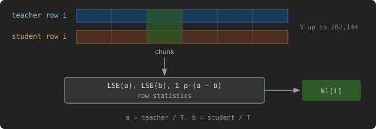

# Distillation KL Divergence

LeetGPU · #150

[打开实现文件](../../practice/leetgpu/150/solution.cu) · [原始材料](../../references/LeetGPU/challenges/medium/150_distillation_kl_divergence/challenge.html)

In knowledge distillation, a small student LLM is trained to match the full next-token distribution of a larger teacher. For each of `N` token positions, compute the forward KL divergence between the temperature-softened teacher and student distributions over a vocabulary of `V` entries. The inputs `teacher_logits` and `student_logits` are float32 matrices of shape `(N, V)`. Write one float32 value per row to `kl`, a vector of shape `(N,)`.

 With temperature \(T\) = `temperature`, let \(a_{i,j} = \text{teacher_logits}_{i,j} / T\) and \(b_{i,j} = \text{student_logits}_{i,j} / T\). For each row \(i\):

 \[ \begin{align} p_{i,j} &= \frac{e^{a_{i,j}}}{\sum_{k=0}^{V-1} e^{a_{i,k}}}, \qquad q_{i,j} = \frac{e^{b_{i,j}}}{\sum_{k=0}^{V-1} e^{b_{i,k}}} \\ \text{kl}_i &= \sum_{j=0}^{V-1} p_{i,j} \left( \log p_{i,j} - \log q_{i,j} \right) \end{align} \]

 This is \(\mathrm{KL}(p \,\|\, q)\) with the teacher as the reference distribution. No \(T^2\) factor is applied. Logits can be large in magnitude, so the exponentials must be computed in a numerically stable way.

## Implementation Requirements

- Use only native features (external libraries are not permitted)

- The `solve` function signature must remain unchanged

- The final result must be stored in `kl`

- `kl` is not zero-initialized; every element must be written

## Example 1

 Input (`N` = 2, `V` = 3, `temperature` = 1.0): \[ \text{teacher_logits} = \begin{bmatrix} 1.0 & 2.0 & 3.0 \\ 0.0 & 0.0 & 0.0 \end{bmatrix}, \quad \text{student_logits} = \begin{bmatrix} 3.0 & 2.0 & 1.0 \\ 0.0 & 0.0 & 0.0 \end{bmatrix} \] Output: \[ \text{kl} = \begin{bmatrix} 1.1504 & 0.0000 \end{bmatrix} \]

## Example 2

 Input (`N` = 2, `V` = 3, `temperature` = 2.0): \[ \text{teacher_logits} = \begin{bmatrix} 1.0 & 2.0 & 3.0 \\ 0.0 & 0.0 & 0.0 \end{bmatrix}, \quad \text{student_logits} = \begin{bmatrix} 3.0 & 2.0 & 1.0 \\ 0.0 & 0.0 & 0.0 \end{bmatrix} \] Output: \[ \text{kl} = \begin{bmatrix} 0.3202 & 0.0000 \end{bmatrix} \]

## Constraints

- 1 ≤ `N` ≤ 65,536

- 1 ≤ `V` ≤ 262,144

- 0.5 ≤ `temperature` ≤ 10.0

- All logits are float32 values in [−500, 500]

- Performance is measured with `N` = 2,048, `V` = 128,256, `temperature` = 2.0

## 本地接口

~~~cpp
extern "C" void solve(const float* teacher_logits, const float* student_logits, float* kl, int N,
                      int V, float temperature);
~~~

## 本地用例

~~~bash
./practice.sh cases leetgpu 150
./practice.sh test leetgpu 150
~~~

展开输入规格

~~~text
  #0 公开样例 · teacher_logits (2, 3) float32 · student_logits (2, 3) float32 · kl (2,) float32 · N 2 · V 3 · temperature 1.0
  #1 公开功能用例 · teacher_logits (2, 3) float32 · student_logits (2, 3) float32 · kl (2,) float32 · N 2 · V 3 · temperature 1.0
  #2 公开功能用例 · teacher_logits (2, 3) float32 · student_logits (2, 3) float32 · kl (2,) float32 · N 2 · V 3 · temperature 2.0
  #3 公开功能用例 · teacher_logits (1, 1) float32 · student_logits (1, 1) float32 · kl (1,) float32 · N 1 · V 1 · temperature 1.0
  #4 公开功能用例 · teacher_logits (2, 4) float32 · student_logits (2, 4) float32 · kl (2,) float32 · N 2 · V 4 · temperature 1.0
  #5 公开功能用例 · teacher_logits (4, 64) float32 · student_logits (4, 64) float32 · kl (4,) float32 · N 4 · V 64 · temperature 1.0
  #6 公开功能用例 · teacher_logits (3, 100) float32 · student_logits (3, 100) float32 · kl (3,) float32 · N 3 · V 100 · temperature 1.0
  #7 公开功能用例 · teacher_logits (8, 255) float32 · student_logits (8, 255) float32 · kl (8,) float32 · N 8 · V 255 · temperature 0.5
  #8 公开功能用例 · teacher_logits (2, 5000) float32 · student_logits (2, 5000) float32 · kl (2,) float32 · N 2 · V 5000 · temperature 1.5
  #9 公开功能用例 · teacher_logits (16, 32) float32 · student_logits (16, 32) float32 · kl (16,) float32 · N 16 · V 32 · temperature 1.0
  #10 公开功能用例 · teacher_logits (64, 1024) float32 · student_logits (64, 1024) float32 · kl (64,) float32 · N 64 · V 1024 · temperature 0.5
  #11 公开功能用例 · teacher_logits (16, 32768) float32 · student_logits (16, 32768) float32 · kl (16,) float32 · N 16 · V 32768 · temperature 4.0
  #12 公开功能用例 · teacher_logits (30, 255) float32 · student_logits (30, 255) float32 · kl (30,) float32 · N 30 · V 255 · temperature 1.0
  #13 公开功能用例 · teacher_logits (100, 1000) float32 · student_logits (100, 1000) float32 · kl (100,) float32 · N 100 · V 1000 · temperature 2.0
  #14 公开功能用例 · teacher_logits (256, 32000) float32 · student_logits (256, 32000) float32 · kl (256,) float32 · N 256 · V 32000 · temperature 1.0
  #15 公开功能用例 · teacher_logits (4, 128256) float32 · student_logits (4, 128256) float32 · kl (4,) float32 · N 4 · V 128256 · temperature 2.0
  #16 首个用例复验 · 原用例 #1 · 种子 2042 · 缓冲区守卫 · teacher_logits (2, 3) float32 · student_logits (2, 3) float32 · kl (2,) float32 · N 2 · V 3 · temperature 1.0
  #17 中间用例复验 · 原用例 #8 · 种子 2043 · 缓冲区守卫 · teacher_logits (2, 5000) float32 · student_logits (2, 5000) float32 · kl (2,) float32 · N 2 · V 5000 · temperature 1.5
  #18 末尾用例复验 · 原用例 #15 · 种子 2044 · 缓冲区守卫 · teacher_logits (4, 128256) float32 · student_logits (4, 128256) float32 · kl (4,) float32 · N 4 · V 128256 · temperature 2.0
18 个功能用例，另有 1 个样例
~~~

