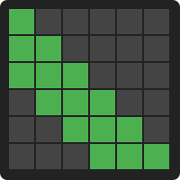

# Softcapped Sliding Window Attention

LeetGPU · #152

[打开实现文件](../../practice/leetgpu/152/solution.cu) · [原始材料](../../references/LeetGPU/challenges/hard/152_softcapped_sliding_window_attention/challenge.html)

Implement causal **sliding window attention with logit soft-capping** and grouped query attention, as used in the local attention layers of Gemma 2. Each query attends only to itself and the previous `window_size - 1` tokens, and every attention score is squashed by `softcap · tanh(score / softcap)` before the softmax. Several query heads share each key/value head. All tensors are `float32`.

## Implementation Requirements

 Implement `solve(Q, K, V, output, num_q_heads, num_kv_heads, seq_len, head_dim, window_size, softcap)`:

- `Q`: shape `(num_q_heads, seq_len, head_dim)`, queries

- `K`, `V`: shape `(num_kv_heads, seq_len, head_dim)`, keys and values

- `output`: shape `(num_q_heads, seq_len, head_dim)`, the attention output

- `window_size`: number of keys each query can see, counting itself; `softcap`: the logit cap

 Query head `h` uses key/value head `g = h / (num_q_heads / num_kv_heads)` (integer division), so consecutive query heads share a key/value head. For query position `i` and key position `j`: \[ s_{ij} = \text{softcap} \cdot \tanh\!\left(\frac{Q_h[i] \cdot K_g[j]}{\sqrt{head\_dim}\;\text{softcap}}\right), \qquad j \in \mathcal{W}(i) = \{\, j : \max(0,\, i - window\_size + 1) \le j \le i \,\} \] \[ output_h[i] = \sum_{j \in \mathcal{W}(i)} \frac{e^{s_{ij}}}{\sum_{j' \in \mathcal{W}(i)} e^{s_{ij'}}}\, V_g[j] \] The `1/sqrt(head_dim)` scale is applied before the cap. Keys outside the window (later tokens, or tokens more than `window_size - 1` positions back) get zero weight. If `window_size` ≥ `seq_len` this is ordinary causal attention with soft-capping.

- Use only native features of the framework you choose (no external libraries); keep the function signature unchanged

- Write the result into `output`; every entry of `output` must be written

- Accumulate dot products and the softmax in `float32` or better

## Example

 Input: `num_q_heads` = 2, `num_kv_heads` = 1, `seq_len` = 3, `head_dim` = 2, `window_size` = 2, `softcap` = 1.0: \[ Q_0 = \begin{bmatrix} 2 & 0 \\ 0 & 2 \\ 2 & 2 \end{bmatrix}, \quad Q_1 = \begin{bmatrix} -2 & 0 \\ 0 & -2 \\ 2 & -2 \end{bmatrix}, \quad K_0 = \begin{bmatrix} 1 & 0 \\ 0 & 1 \\ 1 & -1 \end{bmatrix}, \quad V_0 = \begin{bmatrix} 1 & 2 \\ 3 & 4 \\ 5 & 6 \end{bmatrix} \] Output: \[ output_0 = \begin{bmatrix} 1.0000000 & 2.0000000 \\ 2.4171138 & 3.4171138 \\ 3.5828862 & 4.5828862 \end{bmatrix}, \quad output_1 = \begin{bmatrix} 1.0000000 & 2.0000000 \\ 1.5828862 & 2.5828862 \\ 4.7355490 & 5.7355485 \end{bmatrix} \] Row 2 of each head sees only keys 1 and 2, because key 0 is outside the window of size 2.

## Constraints

- All tensors are `float32`

- 1 ≤ `num_kv_heads` ≤ `num_q_heads` ≤ 32, and `num_q_heads` is divisible by `num_kv_heads`

- 1 ≤ `seq_len` ≤ 4,096; 1 ≤ `head_dim` ≤ 128

- 1 ≤ `window_size` ≤ 8,192 (it may exceed `seq_len`)

- 0 < `softcap` ≤ 50.0

- Performance is measured with `num_q_heads` = 16, `num_kv_heads` = 4, `seq_len` = 4,096, `head_dim` = 64, `window_size` = 1,024, `softcap` = 10.0

## 本地接口

~~~cpp
extern "C" void solve(const float* Q, const float* K, const float* V, float* output,
                      int num_q_heads, int num_kv_heads, int seq_len, int head_dim, int window_size,
                      float softcap);
~~~

## 本地用例

~~~bash
./practice.sh cases leetgpu 152
./practice.sh test leetgpu 152
~~~

展开输入规格

~~~text
  #0 公开样例 · Q (2, 3, 2) float32 · K (1, 3, 2) float32 · V (1, 3, 2) float32 · output (2, 3, 2) float32 · num_q_heads 2 · num_kv_heads 1 · seq_len 3 · head_dim 2 · window_size 2 · softcap 1.0
  #1 公开功能用例 · Q (2, 3, 2) float32 · K (1, 3, 2) float32 · V (1, 3, 2) float32 · output (2, 3, 2) float32 · num_q_heads 2 · num_kv_heads 1 · seq_len 3 · head_dim 2 · window_size 2 · softcap 1.0
  #2 公开功能用例 · Q (2, 1, 4) float32 · K (1, 1, 4) float32 · V (1, 1, 4) float32 · output (2, 1, 4) float32 · num_q_heads 2 · num_kv_heads 1 · seq_len 1 · head_dim 4 · window_size 1 · softcap 5.0
  #3 公开功能用例 · Q (4, 5, 8) float32 · K (2, 5, 8) float32 · V (2, 5, 8) float32 · output (4, 5, 8) float32 · num_q_heads 4 · num_kv_heads 2 · seq_len 5 · head_dim 8 · window_size 1 · softcap 10.0
  #4 公开功能用例 · Q (2, 7, 4) float32 · K (1, 7, 4) float32 · V (1, 7, 4) float32 · output (2, 7, 4) float32 · num_q_heads 2 · num_kv_heads 1 · seq_len 7 · head_dim 4 · window_size 3 · softcap 30.0
  #5 公开功能用例 · Q (4, 16, 8) float32 · K (2, 16, 8) float32 · V (2, 16, 8) float32 · output (4, 16, 8) float32 · num_q_heads 4 · num_kv_heads 2 · seq_len 16 · head_dim 8 · window_size 4 · softcap 50.0
  #6 公开功能用例 · Q (2, 32, 16) float32 · K (2, 32, 16) float32 · V (2, 32, 16) float32 · output (2, 32, 16) float32 · num_q_heads 2 · num_kv_heads 2 · seq_len 32 · head_dim 16 · window_size 100 · softcap 20.0
  #7 公开功能用例 · Q (2, 64, 32) float32 · K (1, 64, 32) float32 · V (1, 64, 32) float32 · output (2, 64, 32) float32 · num_q_heads 2 · num_kv_heads 1 · seq_len 64 · head_dim 32 · window_size 20 · softcap 2.0
  #8 公开功能用例 · Q (8, 64, 16) float32 · K (2, 64, 16) float32 · V (2, 64, 16) float32 · output (8, 64, 16) float32 · num_q_heads 8 · num_kv_heads 2 · seq_len 64 · head_dim 16 · window_size 16 · softcap 10.0
  #9 公开功能用例 · Q (4, 255, 32) float32 · K (4, 255, 32) float32 · V (4, 255, 32) float32 · output (4, 255, 32) float32 · num_q_heads 4 · num_kv_heads 4 · seq_len 255 · head_dim 32 · window_size 37 · softcap 15.0
  #10 公开功能用例 · Q (8, 1000, 64) float32 · K (1, 1000, 64) float32 · V (1, 1000, 64) float32 · output (8, 1000, 64) float32 · num_q_heads 8 · num_kv_heads 1 · seq_len 1000 · head_dim 64 · window_size 129 · softcap 10.0
  #11 公开功能用例 · Q (16, 2048, 64) float32 · K (4, 2048, 64) float32 · V (4, 2048, 64) float32 · output (16, 2048, 64) float32 · num_q_heads 16 · num_kv_heads 4 · seq_len 2048 · head_dim 64 · window_size 512 · softcap 10.0
  #12 首个用例复验 · 原用例 #1 · 种子 2038 · 缓冲区守卫 · Q (2, 3, 2) float32 · K (1, 3, 2) float32 · V (1, 3, 2) float32 · output (2, 3, 2) float32 · num_q_heads 2 · num_kv_heads 1 · seq_len 3 · head_dim 2 · window_size 2 · softcap 1.0
  #13 中间用例复验 · 原用例 #6 · 种子 2039 · 缓冲区守卫 · Q (2, 32, 16) float32 · K (2, 32, 16) float32 · V (2, 32, 16) float32 · output (2, 32, 16) float32 · num_q_heads 2 · num_kv_heads 2 · seq_len 32 · head_dim 16 · window_size 100 · softcap 20.0
  #14 末尾用例复验 · 原用例 #11 · 种子 2040 · 缓冲区守卫 · Q (16, 2048, 64) float32 · K (4, 2048, 64) float32 · V (4, 2048, 64) float32 · output (16, 2048, 64) float32 · num_q_heads 16 · num_kv_heads 4 · seq_len 2048 · head_dim 64 · window_size 512 · softcap 10.0
14 个功能用例，另有 1 个样例
~~~

