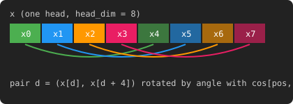

# Fused RoPE Causal Attention

LeetGPU · #153

[打开实现文件](../../practice/leetgpu/153/solution.cu) · [原始材料](../../references/LeetGPU/challenges/hard/153_fused_rope_causal_attention/challenge.html)

Implement causal **grouped-query attention with rotary positional embeddings (RoPE) fused in**, as in the attention layers of Llama, Qwen and Mistral. Before the scores are computed, every query and key vector is rotated by an angle that depends on its position, using precomputed `cos` / `sin` tables, so the attention score between two tokens depends on how far apart they are. Each query attends to itself and all earlier tokens, and several query heads share each key/value head. All tensors are `float32`.

## Implementation Requirements

 Implement `solve(Q, K, V, cos, sin, output, num_q_heads, num_kv_heads, seq_len, head_dim)`:

- `Q`: shape `(num_q_heads, seq_len, head_dim)`, queries before RoPE

- `K`, `V`: shape `(num_kv_heads, seq_len, head_dim)`, keys before RoPE and values (values are not rotated)

- `cos`, `sin`: shape `(seq_len, head_dim / 2)`, the rotation table for each position and frequency

- `output`: shape `(num_q_heads, seq_len, head_dim)`, the attention output

 RoPE uses the rotate-half (Llama / GPT-NeoX) layout: with \(m = head\_dim / 2\), element `d` of the first half is paired with element `d + m`, for \(0 \le d < m\). For a vector \(x\) at position \(p\): \[ \text{rope}(x)_d = x_d \cos_{p,d} - x_{d+m} \sin_{p,d}, \qquad \text{rope}(x)_{d+m} = x_{d+m} \cos_{p,d} + x_d \sin_{p,d} \] Query head `h` uses key/value head `g = h / (num_q_heads / num_kv_heads)` (integer division), so consecutive query heads share a key/value head. For query position `i` and key position `j ≤ i`: \[ s_{ij} = \frac{\text{rope}(Q_h[i]) \cdot \text{rope}(K_g[j])}{\sqrt{head\_dim}}, \qquad output_h[i] = \sum_{j=0}^{i} \frac{e^{s_{ij}}}{\sum_{j'=0}^{i} e^{s_{ij'}}}\, V_g[j] \] Query `i` is rotated with row `i` of the tables and key `j` with row `j`. Later keys (`j > i`) get zero weight.

- Use only native features of the framework you choose (no external libraries); keep the function signature unchanged

- Write the result into `output`; every entry of `output` must be written, and the inputs must not be modified

- Accumulate dot products and the softmax in `float32` or better

## Example

 Input: `num_q_heads` = 1, `num_kv_heads` = 1, `seq_len` = 3, `head_dim` = 4. Pair 0 (elements 0 and 2) turns by 90° per position and pair 1 (elements 1 and 3) does not turn: \[ Q_0 = K_0 = \begin{bmatrix} 1 & 0 & 0 & 1 \\ 1 & 0 & 0 & 1 \\ 1 & 0 & 0 & 1 \end{bmatrix}, \quad V_0 = \begin{bmatrix} 1 & 0 & 0 & 0 \\ 0 & 1 & 0 & 0 \\ 0 & 0 & 1 & 0 \end{bmatrix}, \quad \cos = \begin{bmatrix} 1 & 1 \\ 0 & 1 \\ -1 & 1 \end{bmatrix}, \quad \sin = \begin{bmatrix} 0 & 0 \\ 1 & 0 \\ 0 & 0 \end{bmatrix} \] After RoPE, row `p` of both Q and K is \([\cos_{p,0},\ 0,\ \sin_{p,0},\ 1]\), so \(s_{ij} = (\cos(90^\circ (i - j)) + 1) / 2\). Output: \[ output_0 = \begin{bmatrix} 1.0000000 & 0.0000000 & 0.0000000 & 0.0000000 \\ 0.3775407 & 0.6224593 & 0.0000000 & 0.0000000 \\ 0.1863237 & 0.3071959 & 0.5064804 & 0.0000000 \end{bmatrix} \] Without RoPE every score would be equal and row 2 would be the plain average \([1/3,\ 1/3,\ 1/3,\ 0]\).

## Constraints

- All tensors are `float32`

- 1 ≤ `num_kv_heads` ≤ `num_q_heads` ≤ 32, and `num_q_heads` is divisible by `num_kv_heads`

- 1 ≤ `seq_len` ≤ 4,096; 2 ≤ `head_dim` ≤ 128, and `head_dim` is even

- -1 ≤ `cos`, `sin` ≤ 1

- Performance is measured with `num_q_heads` = 16, `num_kv_heads` = 4, `seq_len` = 4,096, `head_dim` = 64

## 本地接口

~~~cpp
extern "C" void solve(const float* Q, const float* K, const float* V, const float* cos,
                      const float* sin, float* output, int num_q_heads, int num_kv_heads,
                      int seq_len, int head_dim);
~~~

## 本地用例

~~~bash
./practice.sh cases leetgpu 153
./practice.sh test leetgpu 153
~~~

展开输入规格

~~~text
  #0 公开样例 · Q (1, 3, 4) float32 · K (1, 3, 4) float32 · V (1, 3, 4) float32 · cos (3, 2) float32 · sin (3, 2) float32 · output (1, 3, 4) float32 · num_q_heads 1 · num_kv_heads 1 · seq_len 3 · head_dim 4
  #1 公开功能用例 · Q (1, 3, 4) float32 · K (1, 3, 4) float32 · V (1, 3, 4) float32 · cos (3, 2) float32 · sin (3, 2) float32 · output (1, 3, 4) float32 · num_q_heads 1 · num_kv_heads 1 · seq_len 3 · head_dim 4
  #2 公开功能用例 · Q (2, 1, 4) float32 · K (1, 1, 4) float32 · V (1, 1, 4) float32 · cos (1, 2) float32 · sin (1, 2) float32 · output (2, 1, 4) float32 · num_q_heads 2 · num_kv_heads 1 · seq_len 1 · head_dim 4
  #3 公开功能用例 · Q (2, 7, 4) float32 · K (1, 7, 4) float32 · V (1, 7, 4) float32 · cos (7, 2) float32 · sin (7, 2) float32 · output (2, 7, 4) float32 · num_q_heads 2 · num_kv_heads 1 · seq_len 7 · head_dim 4
  #4 公开功能用例 · Q (4, 16, 8) float32 · K (2, 16, 8) float32 · V (2, 16, 8) float32 · cos (16, 4) float32 · sin (16, 4) float32 · output (4, 16, 8) float32 · num_q_heads 4 · num_kv_heads 2 · seq_len 16 · head_dim 8
  #5 公开功能用例 · Q (2, 32, 16) float32 · K (2, 32, 16) float32 · V (2, 32, 16) float32 · cos (32, 8) float32 · sin (32, 8) float32 · output (2, 32, 16) float32 · num_q_heads 2 · num_kv_heads 2 · seq_len 32 · head_dim 16
  #6 公开功能用例 · Q (2, 64, 32) float32 · K (1, 64, 32) float32 · V (1, 64, 32) float32 · cos (64, 16) float32 · sin (64, 16) float32 · output (2, 64, 32) float32 · num_q_heads 2 · num_kv_heads 1 · seq_len 64 · head_dim 32
  #7 公开功能用例 · Q (8, 64, 16) float32 · K (2, 64, 16) float32 · V (2, 64, 16) float32 · cos (64, 8) float32 · sin (64, 8) float32 · output (8, 64, 16) float32 · num_q_heads 8 · num_kv_heads 2 · seq_len 64 · head_dim 16
  #8 公开功能用例 · Q (4, 255, 34) float32 · K (4, 255, 34) float32 · V (4, 255, 34) float32 · cos (255, 17) float32 · sin (255, 17) float32 · output (4, 255, 34) float32 · num_q_heads 4 · num_kv_heads 4 · seq_len 255 · head_dim 34
  #9 公开功能用例 · Q (8, 1000, 128) float32 · K (1, 1000, 128) float32 · V (1, 1000, 128) float32 · cos (1000, 64) float32 · sin (1000, 64) float32 · output (8, 1000, 128) float32 · num_q_heads 8 · num_kv_heads 1 · seq_len 1000 · head_dim 128
  #10 公开功能用例 · Q (16, 2048, 64) float32 · K (4, 2048, 64) float32 · V (4, 2048, 64) float32 · cos (2048, 32) float32 · sin (2048, 32) float32 · output (16, 2048, 64) float32 · num_q_heads 16 · num_kv_heads 4 · seq_len 2048 · head_dim 64
  #11 首个用例复验 · 原用例 #1 · 种子 2037 · 缓冲区守卫 · Q (1, 3, 4) float32 · K (1, 3, 4) float32 · V (1, 3, 4) float32 · cos (3, 2) float32 · sin (3, 2) float32 · output (1, 3, 4) float32 · num_q_heads 1 · num_kv_heads 1 · seq_len 3 · head_dim 4
  #12 中间用例复验 · 原用例 #6 · 种子 2038 · 缓冲区守卫 · Q (2, 64, 32) float32 · K (1, 64, 32) float32 · V (1, 64, 32) float32 · cos (64, 16) float32 · sin (64, 16) float32 · output (2, 64, 32) float32 · num_q_heads 2 · num_kv_heads 1 · seq_len 64 · head_dim 32
  #13 末尾用例复验 · 原用例 #10 · 种子 2039 · 缓冲区守卫 · Q (16, 2048, 64) float32 · K (4, 2048, 64) float32 · V (4, 2048, 64) float32 · cos (2048, 32) float32 · sin (2048, 32) float32 · output (16, 2048, 64) float32 · num_q_heads 16 · num_kv_heads 4 · seq_len 2048 · head_dim 64
13 个功能用例，另有 1 个样例
~~~

