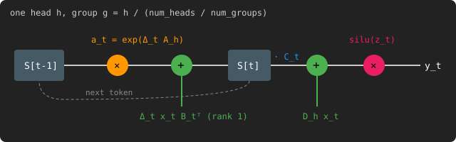

# Fused Mamba-2 SSD Scan

LeetGPU · #154

[打开实现文件](../../practice/leetgpu/154/solution.cu) · [原始材料](../../references/LeetGPU/challenges/hard/154_fused_mamba2_ssd_scan/challenge.html)

Implement the **fused Mamba-2 selective state space (SSD) layer** used for prefill in Mamba-2 and hybrid LLMs such as Codestral Mamba, Nemotron-H and Granite 4. Each head keeps a `head_dim` × `state_dim` state that decays by a data-dependent scalar every token, takes a rank-1 update from the token, and is read out by the token's `C` vector. Fuse the time-step softplus, the scan, the `D` skip connection and the `silu(z)` output gate into one pass. All tensors are `float32`.

## Implementation Requirements

 Implement `solve(x, dt, dt_bias, A, B, C, D, z, y, batch, seq_len, num_heads, head_dim, num_groups, state_dim)`:

- `x`, `z`: shape `(batch, seq_len, num_heads, head_dim)`, the SSM input and the gate input

- `dt`: shape `(batch, seq_len, num_heads)`, the raw time step

- `dt_bias`, `A`, `D`: shape `(num_heads,)`; every `A[h]` is negative

- `B`, `C`: shape `(batch, seq_len, num_groups, state_dim)`, shared by the heads of a group

- `y`: shape `(batch, seq_len, num_heads, head_dim)`, the output

 Head `h` reads group `g = h / (num_heads / num_groups)` (integer division), so consecutive heads share `B` and `C`. For each sequence `b` and head `h`, the state \(S \in \mathbb{R}^{head\_dim \times state\_dim}\) starts at zero and, for \(t = 0, \ldots, seq\_len - 1\): \[ \Delta_t = \text{softplus}(dt_{b,t,h} + dt\_bias_h) = \ln\!\left(1 + e^{dt_{b,t,h} + dt\_bias_h}\right), \qquad S_t = e^{\Delta_t A_h}\, S_{t-1} + \Delta_t\, x_{b,t,h}\, B_{b,t,g}^{\top} \] \[ y_{b,t,h} = \left(S_t\, C_{b,t,g} + D_h\, x_{b,t,h}\right) \odot \text{silu}(z_{b,t,h}), \qquad \text{silu}(v) = \frac{v}{1 + e^{-v}} \] The state decays before the new token is added, and the new token's own update is included in its output. Sequences in the batch are independent.

- Use only native features of the framework you choose (no external libraries); keep the function signature unchanged

- Write the result into `y`; every entry of `y` must be written, and the inputs must not be modified

- Accumulate in `float32` or better. A sequential scan is correct but slow; the chunked SSD form (a masked quadratic form inside each chunk plus states carried between chunks) maps onto matrix multiplies

## Example

 Input: `batch` = 1, `seq_len` = 3, `num_heads` = 1, `head_dim` = 2, `num_groups` = 1, `state_dim` = 2, `dt` = 0, `dt_bias` = [0], `A` = [-1], `D` = [0.5], and every entry of `z` is 1. Rows are time steps: \[ x = \begin{bmatrix} 1 & 2 \\ 0 & -1 \\ 2 & 0 \end{bmatrix}, \quad B = \begin{bmatrix} 1 & 0 \\ 0 & 1 \\ 1 & 1 \end{bmatrix}, \quad C = \begin{bmatrix} 1 & 0 \\ 1 & 1 \\ 0 & 1 \end{bmatrix} \] Then \(\Delta_t = \ln 2\), each step decays the state by \(e^{-\ln 2} = 0.5\), and \(\text{silu}(1) = 0.7310586\): \[ S_0 = \ln 2 \begin{bmatrix} 1 & 0 \\ 2 & 0 \end{bmatrix}, \quad S_1 = \ln 2 \begin{bmatrix} 0.5 & 0 \\ 1 & -1 \end{bmatrix}, \quad S_2 = \ln 2 \begin{bmatrix} 2.25 & 2 \\ 0.5 & -0.5 \end{bmatrix} \] \[ S_t C_t + D x_t = \begin{bmatrix} \ln 2 + 0.5 & 2 \ln 2 + 1 \\ 0.5 \ln 2 & -0.5 \\ 2 \ln 2 + 1 & -0.5 \ln 2 \end{bmatrix}, \quad y = \begin{bmatrix} 0.8722605 & 1.7445210 \\ 0.2533656 & -0.3655293 \\ 1.7445210 & -0.2533656 \end{bmatrix} \]

## Constraints

- All tensors are `float32`

- 1 ≤ `batch` ≤ 4; 1 ≤ `seq_len` ≤ 4,096

- 1 ≤ `num_groups` ≤ `num_heads` ≤ 32, and `num_heads` is divisible by `num_groups`

- 1 ≤ `head_dim` ≤ 128; 1 ≤ `state_dim` ≤ 128

- -16 ≤ `A` < 0; -30 ≤ `dt` + `dt_bias` ≤ 30

- Performance is measured with `batch` = 2, `seq_len` = 4,096, `num_heads` = 32, `head_dim` = 64, `num_groups` = 4, `state_dim` = 128

## 本地接口

~~~cpp
extern "C" void solve(const float* x, const float* dt, const float* dt_bias, const float* A,
                      const float* B, const float* C, const float* D, const float* z, float* y,
                      int batch, int seq_len, int num_heads, int head_dim, int num_groups,
                      int state_dim);
~~~

## 本地用例

~~~bash
./practice.sh cases leetgpu 154
./practice.sh test leetgpu 154
~~~

展开输入规格

~~~text
  #0 公开样例 · x (1, 3, 1, 2) float32 · dt (1, 3, 1) float32 · dt_bias (1,) float32 · A (1,) float32 · B (1, 3, 1, 2) float32 · C (1, 3, 1, 2) float32 · D (1,) float32 · z (1, 3, 1, 2) float32 · y (1, 3, 1, 2) float32 · batch 1 · seq_len 3 · num_heads 1 · head_dim 2 · num_groups 1 · state_dim 2
  #1 公开功能用例 · x (1, 3, 1, 2) float32 · dt (1, 3, 1) float32 · dt_bias (1,) float32 · A (1,) float32 · B (1, 3, 1, 2) float32 · C (1, 3, 1, 2) float32 · D (1,) float32 · z (1, 3, 1, 2) float32 · y (1, 3, 1, 2) float32 · batch 1 · seq_len 3 · num_heads 1 · head_dim 2 · num_groups 1 · state_dim 2
  #2 公开功能用例 · x (1, 1, 2, 3) float32 · dt (1, 1, 2) float32 · dt_bias (2,) float32 · A (2,) float32 · B (1, 1, 1, 4) float32 · C (1, 1, 1, 4) float32 · D (2,) float32 · z (1, 1, 2, 3) float32 · y (1, 1, 2, 3) float32 · batch 1 · seq_len 1 · num_heads 2 · head_dim 3 · num_groups 1 · state_dim 4
  #3 公开功能用例 · x (1, 16, 2, 4) float32 · dt (1, 16, 2) float32 · dt_bias (2,) float32 · A (2,) float32 · B (1, 16, 1, 8) float32 · C (1, 16, 1, 8) float32 · D (2,) float32 · z (1, 16, 2, 4) float32 · y (1, 16, 2, 4) float32 · batch 1 · seq_len 16 · num_heads 2 · head_dim 4 · num_groups 1 · state_dim 8
  #4 公开功能用例 · x (1, 300, 2, 8) float32 · dt (1, 300, 2) float32 · dt_bias (2,) float32 · A (2,) float32 · B (1, 300, 1, 16) float32 · C (1, 300, 1, 16) float32 · D (2,) float32 · z (1, 300, 2, 8) float32 · y (1, 300, 2, 8) float32 · batch 1 · seq_len 300 · num_heads 2 · head_dim 8 · num_groups 1 · state_dim 16
  #5 公开功能用例 · x (1, 64, 4, 16) float32 · dt (1, 64, 4) float32 · dt_bias (4,) float32 · A (4,) float32 · B (1, 64, 2, 16) float32 · C (1, 64, 2, 16) float32 · D (4,) float32 · z (1, 64, 4, 16) float32 · y (1, 64, 4, 16) float32 · batch 1 · seq_len 64 · num_heads 4 · head_dim 16 · num_groups 2 · state_dim 16
  #6 公开功能用例 · x (1, 64, 8, 16) float32 · dt (1, 64, 8) float32 · dt_bias (8,) float32 · A (8,) float32 · B (1, 64, 2, 32) float32 · C (1, 64, 2, 32) float32 · D (8,) float32 · z (1, 64, 8, 16) float32 · y (1, 64, 8, 16) float32 · batch 1 · seq_len 64 · num_heads 8 · head_dim 16 · num_groups 2 · state_dim 32
  #7 公开功能用例 · x (3, 100, 4, 8) float32 · dt (3, 100, 4) float32 · dt_bias (4,) float32 · A (4,) float32 · B (3, 100, 4, 16) float32 · C (3, 100, 4, 16) float32 · D (4,) float32 · z (3, 100, 4, 8) float32 · y (3, 100, 4, 8) float32 · batch 3 · seq_len 100 · num_heads 4 · head_dim 8 · num_groups 4 · state_dim 16
  #8 公开功能用例 · x (2, 255, 6, 34) float32 · dt (2, 255, 6) float32 · dt_bias (6,) float32 · A (6,) float32 · B (2, 255, 3, 17) float32 · C (2, 255, 3, 17) float32 · D (6,) float32 · z (2, 255, 6, 34) float32 · y (2, 255, 6, 34) float32 · batch 2 · seq_len 255 · num_heads 6 · head_dim 34 · num_groups 3 · state_dim 17
  #9 公开功能用例 · x (1, 1000, 4, 64) float32 · dt (1, 1000, 4) float32 · dt_bias (4,) float32 · A (4,) float32 · B (1, 1000, 1, 128) float32 · C (1, 1000, 1, 128) float32 · D (4,) float32 · z (1, 1000, 4, 64) float32 · y (1, 1000, 4, 64) float32 · batch 1 · seq_len 1000 · num_heads 4 · head_dim 64 · num_groups 1 · state_dim 128
  #10 公开功能用例 · x (1, 2048, 32, 64) float32 · dt (1, 2048, 32) float32 · dt_bias (32,) float32 · A (32,) float32 · B (1, 2048, 4, 128) float32 · C (1, 2048, 4, 128) float32 · D (32,) float32 · z (1, 2048, 32, 64) float32 · y (1, 2048, 32, 64) float32 · batch 1 · seq_len 2048 · num_heads 32 · head_dim 64 · num_groups 4 · state_dim 128
  #11 首个用例复验 · 原用例 #1 · 种子 2037 · 缓冲区守卫 · x (1, 3, 1, 2) float32 · dt (1, 3, 1) float32 · dt_bias (1,) float32 · A (1,) float32 · B (1, 3, 1, 2) float32 · C (1, 3, 1, 2) float32 · D (1,) float32 · z (1, 3, 1, 2) float32 · y (1, 3, 1, 2) float32 · batch 1 · seq_len 3 · num_heads 1 · head_dim 2 · num_groups 1 · state_dim 2
  #12 中间用例复验 · 原用例 #6 · 种子 2038 · 缓冲区守卫 · x (1, 64, 8, 16) float32 · dt (1, 64, 8) float32 · dt_bias (8,) float32 · A (8,) float32 · B (1, 64, 2, 32) float32 · C (1, 64, 2, 32) float32 · D (8,) float32 · z (1, 64, 8, 16) float32 · y (1, 64, 8, 16) float32 · batch 1 · seq_len 64 · num_heads 8 · head_dim 16 · num_groups 2 · state_dim 32
  #13 末尾用例复验 · 原用例 #10 · 种子 2039 · 缓冲区守卫 · x (1, 2048, 32, 64) float32 · dt (1, 2048, 32) float32 · dt_bias (32,) float32 · A (32,) float32 · B (1, 2048, 4, 128) float32 · C (1, 2048, 4, 128) float32 · D (32,) float32 · z (1, 2048, 32, 64) float32 · y (1, 2048, 32, 64) float32 · batch 1 · seq_len 2048 · num_heads 32 · head_dim 64 · num_groups 4 · state_dim 128
13 个功能用例，另有 1 个样例
~~~

