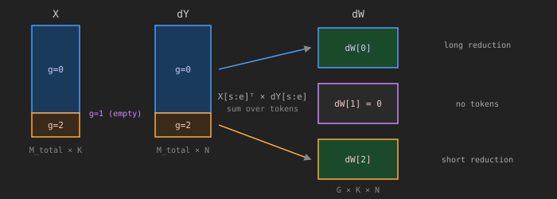

# MoE Expert Weight Gradient

LeetGPU · #155

[打开实现文件](../../practice/leetgpu/155/solution.cu) · [原始材料](../../references/LeetGPU/challenges/medium/155_moe_expert_weight_gradient/challenge.html)

Compute the weight gradients of a Mixture-of-Experts (MoE) expert projection in the backward pass. Routed tokens have already been sorted by expert: the activations `X` (`M_total × K`) and the upstream gradients `dY` (`M_total × N`) are partitioned into `G` contiguous row groups whose boundaries are given by `group_offsets` (length `G + 1`). For every expert `g`, with `s = group_offsets[g]` and `e = group_offsets[g+1]`, compute `dW[g] = X[s:e]T × dY[s:e]`, a `K × N` matrix. All floating-point tensors are 32-bit.

 \[ dW[g]_{k,n} = \sum_{m=s}^{e-1} X_{m,k}\, dY_{m,n} \]

 Unlike the forward grouped GEMM, the ragged dimension (tokens per expert) is the *reduction* dimension: every expert's output has the same fixed size, but the amount of work behind it depends on how many tokens the router sent to that expert. An expert that received no tokens has an all-zero gradient.

## Implementation Requirements

- Implement the `solve` function; do not change its signature.

- External libraries are not permitted.

- Write the result into `dW`, laid out as `G` consecutive row-major `K × N` matrices.

- `dW` is not zero-initialized; every element must be written, including the gradients of experts that received no tokens (which must be 0).

- Any router / gate weighting is already folded into `dY`; do not apply gate weights.

- Use `float32` operands and accumulate in `float32` or better; rounding `X` or `dY` to TF32, FP16 or BF16 is outside the tolerance.

## Example

 Input: `G` = 3, `M_total` = 3, `K` = 2, `N` = 2, `group_offsets` = `[0, 2, 2, 3]` \[ X = \begin{bmatrix} 1 & 2 \\ 3 & -1 \\ 0 & 4 \end{bmatrix}, \quad dY = \begin{bmatrix} 1 & 0 \\ 2 & 1 \\ -1 & 3 \end{bmatrix} \] Output: \[ dW[0] = \begin{bmatrix} 7 & 3 \\ 0 & -1 \end{bmatrix}, \quad dW[1] = \begin{bmatrix} 0 & 0 \\ 0 & 0 \end{bmatrix}, \quad dW[2] = \begin{bmatrix} 0 & 0 \\ -4 & 12 \end{bmatrix} \]

 Expert 0 owns rows 0 and 1, so \(dW[0] = \begin{bmatrix} 1 \\ 2 \end{bmatrix} \begin{bmatrix} 1 & 0 \end{bmatrix} + \begin{bmatrix} 3 \\ -1 \end{bmatrix} \begin{bmatrix} 2 & 1 \end{bmatrix}\). Expert 1 is empty, so its gradient is zero. Expert 2 owns row 2 only.

## Constraints

- 1 ≤ `G` ≤ 128 (number of experts)

- 1 ≤ `M_total` ≤ 65,536 (total routed rows across all experts)

- 1 ≤ `K`, `N` ≤ 4,096

- `group_offsets[0]` = 0, `group_offsets[G]` = `M_total`, and `group_offsets` is non-decreasing; a group may be empty

- `X`, `dY` and `dW` are 32-bit floats; `group_offsets` is 32-bit integer

- Values of `X` and `dY` are in the range [-1, 1]

- Performance is measured with `G` = 64, `M_total` = 32,768, `K` = 1,024, `N` = 512 (skewed expert loads, two experts empty)

## 本地接口

~~~cpp
extern "C" void solve(const float* X, const float* dY, const int* group_offsets, float* dW, int G,
                      int M_total, int K, int N);
~~~

## 本地用例

~~~bash
./practice.sh cases leetgpu 155
./practice.sh test leetgpu 155
~~~

展开输入规格

~~~text
  #0 公开样例 · X (3, 2) float32 · dY (3, 2) float32 · group_offsets (4,) int32 · dW (3, 2, 2) float32 · G 3 · M_total 3 · K 2 · N 2
  #1 公开功能用例 · X (3, 2) float32 · dY (3, 2) float32 · group_offsets (4,) int32 · dW (3, 2, 2) float32 · G 3 · M_total 3 · K 2 · N 2
  #2 公开功能用例 · X (1, 1) float32 · dY (1, 1) float32 · group_offsets (2,) int32 · dW (1, 1, 1) float32 · G 1 · M_total 1 · K 1 · N 1
  #3 公开功能用例 · X (6, 3) float32 · dY (6, 5) float32 · group_offsets (2,) int32 · dW (1, 3, 5) float32 · G 1 · M_total 6 · K 3 · N 5
  #4 公开功能用例 · X (37, 8) float32 · dY (37, 12) float32 · group_offsets (5,) int32 · dW (4, 8, 12) float32 · G 4 · M_total 37 · K 8 · N 12
  #5 公开功能用例 · X (10, 16) float32 · dY (10, 16) float32 · group_offsets (4,) int32 · dW (3, 16, 16) float32 · G 3 · M_total 10 · K 16 · N 16
  #6 公开功能用例 · X (8, 4) float32 · dY (8, 4) float32 · group_offsets (9,) int32 · dW (8, 4, 4) float32 · G 8 · M_total 8 · K 4 · N 4
  #7 公开功能用例 · X (64, 32) float32 · dY (64, 64) float32 · group_offsets (5,) int32 · dW (4, 32, 64) float32 · G 4 · M_total 64 · K 32 · N 64
  #8 公开功能用例 · X (31, 33) float32 · dY (31, 27) float32 · group_offsets (4,) int32 · dW (3, 33, 27) float32 · G 3 · M_total 31 · K 33 · N 27
  #9 公开功能用例 · X (2057, 64) float32 · dY (2057, 48) float32 · group_offsets (5,) int32 · dW (4, 64, 48) float32 · G 4 · M_total 2057 · K 64 · N 48
  #10 公开功能用例 · X (505, 24) float32 · dY (505, 40) float32 · group_offsets (65,) int32 · dW (64, 24, 40) float32 · G 64 · M_total 505 · K 24 · N 40
  #11 公开功能用例 · X (10868, 256) float32 · dY (10868, 128) float32 · group_offsets (9,) int32 · dW (8, 256, 128) float32 · G 8 · M_total 10868 · K 256 · N 128
  #12 首个用例复验 · 原用例 #1 · 种子 2038 · 缓冲区守卫 · X (3, 2) float32 · dY (3, 2) float32 · group_offsets (4,) int32 · dW (3, 2, 2) float32 · G 3 · M_total 3 · K 2 · N 2
  #13 中间用例复验 · 原用例 #6 · 种子 2039 · 缓冲区守卫 · X (8, 4) float32 · dY (8, 4) float32 · group_offsets (9,) int32 · dW (8, 4, 4) float32 · G 8 · M_total 8 · K 4 · N 4
  #14 末尾用例复验 · 原用例 #11 · 种子 2040 · 缓冲区守卫 · X (10868, 256) float32 · dY (10868, 128) float32 · group_offsets (9,) int32 · dW (8, 256, 128) float32 · G 8 · M_total 10868 · K 256 · N 128
14 个功能用例，另有 1 个样例
~~~

