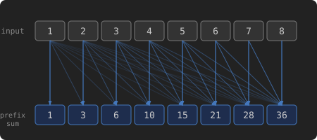

# Prefix Sum

LeetGPU · #16

[打开实现文件](../../practice/leetgpu/16/solution.cu) · [原始材料](../../references/LeetGPU/challenges/medium/16_prefix_sum/challenge.html)

Write a GPU program that computes the prefix sum (cumulative sum) of an array of 32-bit floating point numbers. For an input array `[a, b, c, d, ...]`, the prefix sum is `[a, a+b, a+b+c, a+b+c+d, ...]`.

## Implementation Requirements

- Use only GPU native features (external libraries are not permitted)

- The `solve` function signature must remain unchanged

- The result must be stored in the `output` array

## Example 1:

~~~text

Input: [1.0, 2.0, 3.0, 4.0]
Output: [1.0, 3.0, 6.0, 10.0]

~~~

## Example 2:

~~~text

Input: [5.0, -2.0, 3.0, 1.0, -4.0]
Output: [5.0, 3.0, 6.0, 7.0, 3.0]

~~~

## Constraints

- 1 ≤ `N` ≤ 100,000,000

- -1000.0 ≤ `input[i]` ≤ 1000.0

- The largest value in the output array will fit within a 32-bit float

- Performance is measured with `N` = 250,000

## 本地接口

~~~cpp
extern "C" void solve(const float* input, float* output, int N);
~~~

## 本地用例

~~~bash
./practice.sh cases leetgpu 16
./practice.sh test leetgpu 16
~~~

展开输入规格

~~~text
  #0 公开样例 · input (4,) float32 · output (4,) float32 · N 4
  #1 公开功能用例 · input (4,) float32 · output (4,) float32 · N 4
  #2 公开功能用例 · input (5,) float32 · output (5,) float32 · N 5
  #3 公开功能用例 · input (1,) float32 · output (1,) float32 · N 1
  #4 公开功能用例 · input (8,) float32 · output (8,) float32 · N 8
  #5 公开功能用例 · input (1024,) float32 · output (1024,) float32 · N 1024
  #6 公开功能用例 · input (2025,) float32 · output (2025,) float32 · N 2025
  #7 首个用例复验 · 原用例 #1 · 种子 2033 · 缓冲区守卫 · input (4,) float32 · output (4,) float32 · N 4
  #8 中间用例复验 · 原用例 #4 · 种子 2034 · 缓冲区守卫 · input (8,) float32 · output (8,) float32 · N 8
  #9 末尾用例复验 · 原用例 #6 · 种子 2035 · 缓冲区守卫 · input (2025,) float32 · output (2025,) float32 · N 2025
9 个功能用例，另有 1 个样例
~~~

