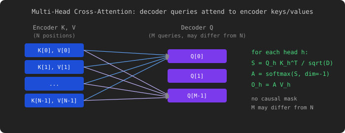

# Multi-Head Cross-Attention

LeetGPU · #26

[打开实现文件](../../practice/leetgpu/26/solution.cu) · [原始材料](../../references/LeetGPU/challenges/hard/26_multi_head_cross_attention/challenge.html)

Implement multi-head cross-attention, the building block used in encoder-decoder transformers such as T5, BART, and Whisper, as well as the text-conditioning layers of diffusion models like Stable Diffusion. Given decoder queries `Q` of shape `(M, H, D)` and encoder keys `K` / values `V` of shape `(N, H, D)`, compute, for each head `h`, scaled dot-product attention where every one of the `M` queries attends to all `N` encoder positions:

 \[ \text{head}_h = \text{softmax}\!\left(\frac{Q_h K_h^{\top}}{\sqrt{D}}\right) V_h \]

 There is no causal mask — encoder positions are fully visible to every decoder query — and the query length `M` may differ from the key/value length `N`. All tensors use `float32`.

## Implementation Requirements

- Implement the function `solve(Q, K, V, output, M, N, H, D)`.

- Do not change the function signature or use external libraries beyond the standard GPU framework.

- Write the result into the provided `output` buffer of shape `(M, H, D)`.

- Use scaled dot-product attention with scale factor `1 / sqrt(D)` and a softmax over the key dimension.

- No causal mask is applied — every query attends to all `N` encoder positions.

## Example

 With `M` = 2, `N` = 3, `H` = 2, `D` = 2. Tensors are laid out as `(position, head, dim)`. Per-head views:

 \(Q_0\) (2×2): \[ \begin{bmatrix} 1 & 0 \\ 0 & 1 \end{bmatrix} \qquad Q_1\text{ (2}\times\text{2):} \begin{bmatrix} 0 & 1 \\ 1 & 0 \end{bmatrix} \] \(K_0\) (3×2): \[ \begin{bmatrix} 1 & 0 \\ 0 & 1 \\ 1 & 1 \end{bmatrix} \qquad K_1\text{ (3}\times\text{2):} \begin{bmatrix} 0 & 1 \\ 1 & 0 \\ 1 & 1 \end{bmatrix} \] \(V_0\) (3×2): \[ \begin{bmatrix} 1 & 2 \\ 3 & 4 \\ 5 & 6 \end{bmatrix} \qquad V_1\text{ (3}\times\text{2):} \begin{bmatrix} 7 & 8 \\ 9 & 10 \\ 11 & 12 \end{bmatrix} \]

 **Output** (values rounded to 4 decimals): \[ \text{output}_0\text{ (head 0, 2}\times\text{2):} \begin{bmatrix} 3.0000 & 4.0000 \\ 3.4067 & 4.4067 \end{bmatrix} \qquad \text{output}_1\text{ (head 1, 2}\times\text{2):} \begin{bmatrix} 9.0000 & 10.0000 \\ 9.4067 & 10.4067 \end{bmatrix} \]

## Constraints

- 1 ≤ `M` ≤ 4,096

- 1 ≤ `N` ≤ 4,096

- 1 ≤ `H` ≤ 64

- 1 ≤ `D` ≤ 256

- All tensor values are `float32`

- Performance is measured with `M` = 1,024, `N` = 2,048, `H` = 16, `D` = 128

## 本地接口

~~~cpp
extern "C" void solve(const float* Q, const float* K, const float* V, float* output, int M, int N,
                      int H, int D);
~~~

## 本地用例

~~~bash
./practice.sh cases leetgpu 26
./practice.sh test leetgpu 26
~~~

展开输入规格

~~~text
  #0 公开样例 · Q (2, 2, 2) float32 · K (3, 2, 2) float32 · V (3, 2, 2) float32 · output (2, 2, 2) float32 · M 2 · N 3 · H 2 · D 2
  #1 公开功能用例 · Q (2, 2, 2) float32 · K (3, 2, 2) float32 · V (3, 2, 2) float32 · output (2, 2, 2) float32 · M 2 · N 3 · H 2 · D 2
  #2 公开功能用例 · Q (1, 1, 8) float32 · K (1, 1, 8) float32 · V (1, 1, 8) float32 · output (1, 1, 8) float32 · M 1 · N 1 · H 1 · D 8
  #3 公开功能用例 · Q (1, 4, 8) float32 · K (16, 4, 8) float32 · V (16, 4, 8) float32 · output (1, 4, 8) float32 · M 1 · N 16 · H 4 · D 8
  #4 公开功能用例 · Q (4, 2, 8) float32 · K (1, 2, 8) float32 · V (1, 2, 8) float32 · output (4, 2, 8) float32 · M 4 · N 1 · H 2 · D 8
  #5 公开功能用例 · Q (3, 2, 4) float32 · K (5, 2, 4) float32 · V (5, 2, 4) float32 · output (3, 2, 4) float32 · M 3 · N 5 · H 2 · D 4
  #6 公开功能用例 · Q (4, 2, 8) float32 · K (6, 2, 8) float32 · V (6, 2, 8) float32 · output (4, 2, 8) float32 · M 4 · N 6 · H 2 · D 8
  #7 公开功能用例 · Q (16, 4, 32) float32 · K (32, 4, 32) float32 · V (32, 4, 32) float32 · output (16, 4, 32) float32 · M 16 · N 32 · H 4 · D 32
  #8 公开功能用例 · Q (30, 6, 32) float32 · K (45, 6, 32) float32 · V (45, 6, 32) float32 · output (30, 6, 32) float32 · M 30 · N 45 · H 6 · D 32
  #9 公开功能用例 · Q (100, 8, 64) float32 · K (200, 8, 64) float32 · V (200, 8, 64) float32 · output (100, 8, 64) float32 · M 100 · N 200 · H 8 · D 64
  #10 公开功能用例 · Q (128, 16, 64) float32 · K (512, 16, 64) float32 · V (512, 16, 64) float32 · output (128, 16, 64) float32 · M 128 · N 512 · H 16 · D 64
  #11 首个用例复验 · 原用例 #1 · 种子 2037 · 缓冲区守卫 · Q (2, 2, 2) float32 · K (3, 2, 2) float32 · V (3, 2, 2) float32 · output (2, 2, 2) float32 · M 2 · N 3 · H 2 · D 2
  #12 中间用例复验 · 原用例 #6 · 种子 2038 · 缓冲区守卫 · Q (4, 2, 8) float32 · K (6, 2, 8) float32 · V (6, 2, 8) float32 · output (4, 2, 8) float32 · M 4 · N 6 · H 2 · D 8
  #13 末尾用例复验 · 原用例 #10 · 种子 2039 · 缓冲区守卫 · Q (128, 16, 64) float32 · K (512, 16, 64) float32 · V (512, 16, 64) float32 · output (128, 16, 64) float32 · M 128 · N 512 · H 16 · D 64
13 个功能用例，另有 1 个样例
~~~

