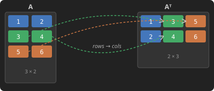

# Matrix Transpose

LeetGPU · #3

[打开实现文件](../../practice/leetgpu/3/solution.cu) · [原始材料](../../references/LeetGPU/challenges/easy/3_matrix_transpose/challenge.html)

Write a program that transposes a matrix of 32-bit floating point numbers on a GPU. The transpose of a matrix switches its rows and columns. Given a matrix \(A\) of dimensions \(rows \times cols\), the transpose \(A^T\) will have dimensions \(cols \times rows\). All matrices are stored in row-major format.

## Implementation Requirements

- Use only native features (external libraries are not permitted)

- The `solve` function signature must remain unchanged

- The final result must be stored in the matrix `output`

## Example 1:

Input: 2×3 matrix
 \[ \begin{bmatrix} 1.0 & 2.0 & 3.0 \\ 4.0 & 5.0 & 6.0 \end{bmatrix} \]
Output: 3×2 matrix
 \[ \begin{bmatrix} 1.0 & 4.0 \\ 2.0 & 5.0 \\ 3.0 & 6.0 \end{bmatrix} \]

## Example 2:

Input: 3×1 matrix
 \[ \begin{bmatrix} 1.0 \\ 2.0 \\ 3.0 \end{bmatrix} \]
Output: 1×3 matrix
 \[ \begin{bmatrix} 1.0 & 2.0 & 3.0 \end{bmatrix} \]

## Constraints

- 1 ≤ `rows`, `cols` ≤ 8192

- Input matrix dimensions: `rows` × `cols`

- Output matrix dimensions: `cols` × `rows`

- Performance is measured with `cols` = 6,000, `rows` = 7,000

## 本地接口

~~~cpp
extern "C" void solve(const float* input, float* output, int rows, int cols);
~~~

## 本地用例

~~~bash
./practice.sh cases leetgpu 3
./practice.sh test leetgpu 3
~~~

展开输入规格

~~~text
  #0 公开样例 · input (2, 3) float32 · output (3, 2) float32 · rows 2 · cols 3
  #1 公开功能用例 · input (2, 3) float32 · output (3, 2) float32 · rows 2 · cols 3
  #2 公开功能用例 · input (3, 1) float32 · output (1, 3) float32 · rows 3 · cols 1
  #3 公开功能用例 · input (2, 2) float32 · output (2, 2) float32 · rows 2 · cols 2
  #4 公开功能用例 · input (1, 4) float32 · output (4, 1) float32 · rows 1 · cols 4
  #5 公开功能用例 · input (4, 1) float32 · output (1, 4) float32 · rows 4 · cols 1
  #6 公开功能用例 · input (4, 6) float32 · output (6, 4) float32 · rows 4 · cols 6
  #7 公开功能用例 · input (8, 8) float32 · output (8, 8) float32 · rows 8 · cols 8
  #8 公开功能用例 · input (16, 12) float32 · output (12, 16) float32 · rows 16 · cols 12
  #9 公开功能用例 · input (32, 8) float32 · output (8, 32) float32 · rows 32 · cols 8
  #10 公开功能用例 · input (8, 32) float32 · output (32, 8) float32 · rows 8 · cols 32
  #11 公开功能用例 · input (1, 1) float32 · output (1, 1) float32 · rows 1 · cols 1
  #12 公开功能用例 · input (8192, 8192) float32 · output (8192, 8192) float32 · rows 8192 · cols 8192
  #13 首个用例复验 · 原用例 #1 · 种子 2039 · 缓冲区守卫 · input (2, 3) float32 · output (3, 2) float32 · rows 2 · cols 3
  #14 中间用例复验 · 原用例 #7 · 种子 2040 · 缓冲区守卫 · input (8, 8) float32 · output (8, 8) float32 · rows 8 · cols 8
  #15 末尾用例复验 · 原用例 #12 · 种子 2041 · 缓冲区守卫 · input (8192, 8192) float32 · output (8192, 8192) float32 · rows 8192 · cols 8192
15 个功能用例，另有 1 个样例
~~~

