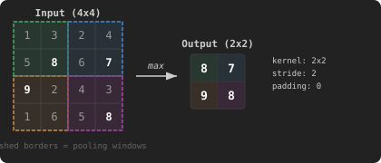

# 2D Max Pooling

LeetGPU · #42

[打开实现文件](../../practice/leetgpu/42/solution.cu) · [原始材料](../../references/LeetGPU/challenges/medium/42_2d_max_pooling/challenge.html)

Implement a 2D max pooling operation for image/feature map downsampling. The program should take an input tensor and produce an output tensor by applying max pooling with specified kernel size, stride, and padding.

## Implementation Requirements

- External libraries are not permitted

- The `solve` function signature must remain unchanged

- The final result must be stored in tensor `output`

## Max Pooling Operation

 For each output position (n, c, h_out, w_out), compute the maximum value over the corresponding input window:
 `output[n, c, h_out, w_out] = max(input[n, c, h:h+kernel_size, w:w+kernel_size])`
 where h = h_out * stride and w = w_out * stride

## Example 1:

~~~text

Input:  input = [[[[1.0, 2.0, 3.0],
                   [4.0, 5.0, 6.0],
                   [7.0, 8.0, 9.0]]]]
        kernel_size = 2
        stride = 1
        padding = 0
Output: output = [[[[5.0, 6.0],
                    [8.0, 9.0]]]]

~~~

## Example 2:

~~~text

Input:  input = [[[[1.0, 2.0, 3.0, 4.0, 5.0],
                   [6.0, 7.0, 8.0, 9.0, 10.0],
                   [11.0, 12.0, 13.0, 14.0, 15.0],
                   [16.0, 17.0, 18.0, 19.0, 20.0],
                   [21.0, 22.0, 23.0, 24.0, 25.0]]]]
        kernel_size = 3
        stride = 1
        padding = 1
Output: output = [[[[7.0, 8.0, 9.0, 10.0, 10.0],
                    [12.0, 13.0, 14.0, 15.0, 15.0],
                    [17.0, 18.0, 19.0, 20.0, 20.0],
                    [22.0, 23.0, 24.0, 25.0, 25.0],
                    [22.0, 23.0, 24.0, 25.0, 25.0]]]]

~~~

## Constraints

- 1 ≤ N ≤ 100 (batch size)

- 1 ≤ C ≤ 512 (channels)

- 1 ≤ H, W ≤ 1024 (height, width)

- 1 ≤ kernel_size ≤ 16

- 1 ≤ stride ≤ 16

- 0 ≤ padding ≤ 16

- Input and output tensors use float32 precision

- Performance is measured with `N` = 4, `kernel_size` = 3, `stride` = 2

## 本地接口

~~~cpp
extern "C" void solve(const float* input, float* output, int N, int C, int H, int W,
                      int kernel_size, int stride, int padding);
~~~

## 本地用例

~~~bash
./practice.sh cases leetgpu 42
./practice.sh test leetgpu 42
~~~

展开输入规格

~~~text
  #0 公开样例 · input (9,) float32 · output (4,) float32 · N 1 · C 1 · H 3 · W 3 · kernel_size 2 · stride 1 · padding 0
  #1 公开功能用例 · input (16,) float32 · output (4,) float32 · N 1 · C 1 · H 4 · W 4 · kernel_size 2 · stride 2 · padding 0
  #2 公开功能用例 · input (50,) float32 · output (50,) float32 · N 1 · C 2 · H 5 · W 5 · kernel_size 3 · stride 1 · padding 1
  #3 公开功能用例 · input (384,) float32 · output (384,) float32 · N 2 · C 3 · H 8 · W 8 · kernel_size 1 · stride 1 · padding 0
  #4 公开功能用例 · input (100,) float32 · output (25,) float32 · N 1 · C 1 · H 10 · W 10 · kernel_size 5 · stride 2 · padding 2
  #5 公开功能用例 · input (4,) float32 · output (1,) float32 · N 1 · C 1 · H 2 · W 2 · kernel_size 2 · stride 1 · padding 0
  #6 公开功能用例 · input (9,) float32 · output (1,) float32 · N 1 · C 1 · H 3 · W 3 · kernel_size 3 · stride 1 · padding 0
  #7 公开功能用例 · input (16,) float32 · output (25,) float32 · N 1 · C 1 · H 4 · W 4 · kernel_size 2 · stride 1 · padding 1
  #8 公开功能用例 · input (108,) float32 · output (48,) float32 · N 1 · C 3 · H 6 · W 6 · kernel_size 2 · stride 2 · padding 1
  #9 公开功能用例 · input (25,) float32 · output (16,) float32 · N 1 · C 1 · H 5 · W 5 · kernel_size 2 · stride 1 · padding 0
  #10 公开功能用例 · input (77,) float32 · output (24,) float32 · N 1 · C 1 · H 7 · W 11 · kernel_size 3 · stride 2 · padding 1
  #11 首个用例复验 · 原用例 #1 · 种子 2037 · 缓冲区守卫 · input (16,) float32 · output (4,) float32 · N 1 · C 1 · H 4 · W 4 · kernel_size 2 · stride 2 · padding 0
  #12 中间用例复验 · 原用例 #6 · 种子 2038 · 缓冲区守卫 · input (9,) float32 · output (1,) float32 · N 1 · C 1 · H 3 · W 3 · kernel_size 3 · stride 1 · padding 0
  #13 末尾用例复验 · 原用例 #10 · 种子 2039 · 缓冲区守卫 · input (77,) float32 · output (24,) float32 · N 1 · C 1 · H 7 · W 11 · kernel_size 3 · stride 2 · padding 1
13 个功能用例，另有 1 个样例
~~~

