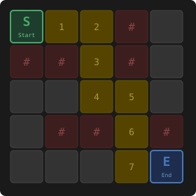

# BFS Shortest Path

LeetGPU · #46

[打开实现文件](../../practice/leetgpu/46/solution.cu) · [原始材料](../../references/LeetGPU/challenges/hard/46_bfs_shortest_path/challenge.html)

Implement a program that finds the shortest path in an unweighted 2D grid using Breadth-First Search (BFS). Given a grid with obstacles and start/end positions, return the minimum number of steps needed to reach the destination.

## Implementation Requirements

- Use only native features (external libraries are not permitted)

- The `solve` function signature must remain unchanged

- Return the shortest path length, or -1 if no path exists

- Grid cells with value 0 are free, cells with value 1 are obstacles

- Movement is allowed in 4 directions: up, down, left, right

## Example 1:

~~~text

Input:
  grid (4x4) = [
    [0, 0, 0, 0],
    [1, 1, 0, 1],
    [0, 0, 0, 0],
    [0, 1, 1, 0]
  ]
  start_row = 0, start_col = 0
  end_row = 3, end_col = 3

Output: 6

Explanation: One possible shortest path:
(0,0) → (0,1) → (0,2) → (1,2) → (2,2) → (2,3) → (3,3)

~~~

## Example 2:

~~~text

Input:
  grid (3x3) = [
    [0, 1, 0],
    [1, 1, 1],
    [0, 0, 0]
  ]
  start_row = 0, start_col = 0
  end_row = 0, end_col = 2

Output: -1

Explanation: No path exists due to obstacles completely blocking the way.

~~~

## Constraints

- 1 ≤ `rows`, `cols` ≤ 1000

- Grid values are either 0 (free) or 1 (obstacle)

- Start and end positions are guaranteed to be within bounds and on free cells (value 0)

- Start and end positions may be the same (return 0 in this case)

- Performance is measured with `cols` = 500, `rows` = 500

## 本地接口

~~~cpp
extern "C" void solve(const int* grid, int* result, int rows, int cols, int start_row,
                      int start_col, int end_row, int end_col);
~~~

## 本地用例

~~~bash
./practice.sh cases leetgpu 46
./practice.sh test leetgpu 46
~~~

展开输入规格

~~~text
  #0 公开样例 · grid (16,) int32 · result (1,) int32 · rows 4 · cols 4 · start_row 0 · start_col 0 · end_row 3 · end_col 3
  #1 公开功能用例 · grid (6,) int32 · result (1,) int32 · rows 2 · cols 3 · start_row 0 · start_col 0 · end_row 1 · end_col 2
  #2 公开功能用例 · grid (5,) int32 · result (1,) int32 · rows 1 · cols 5 · start_row 0 · start_col 0 · end_row 0 · end_col 4
  #3 公开功能用例 · grid (4,) int32 · result (1,) int32 · rows 2 · cols 2 · start_row 0 · start_col 0 · end_row 0 · end_col 0
  #4 公开功能用例 · grid (1,) int32 · result (1,) int32 · rows 1 · cols 1 · start_row 0 · start_col 0 · end_row 0 · end_col 0
  #5 公开功能用例 · grid (25,) int32 · result (1,) int32 · rows 5 · cols 5 · start_row 0 · start_col 0 · end_row 4 · end_col 4
  #6 公开功能用例 · grid (25,) int32 · result (1,) int32 · rows 5 · cols 5 · start_row 0 · start_col 0 · end_row 4 · end_col 4
  #7 首个用例复验 · 原用例 #1 · 种子 2033 · 缓冲区守卫 · grid (6,) int32 · result (1,) int32 · rows 2 · cols 3 · start_row 0 · start_col 0 · end_row 1 · end_col 2
  #8 中间用例复验 · 原用例 #4 · 种子 2034 · 缓冲区守卫 · grid (1,) int32 · result (1,) int32 · rows 1 · cols 1 · start_row 0 · start_col 0 · end_row 0 · end_col 0
  #9 末尾用例复验 · 原用例 #6 · 种子 2035 · 缓冲区守卫 · grid (25,) int32 · result (1,) int32 · rows 5 · cols 5 · start_row 0 · start_col 0 · end_row 4 · end_col 4
9 个功能用例，另有 1 个样例
~~~

