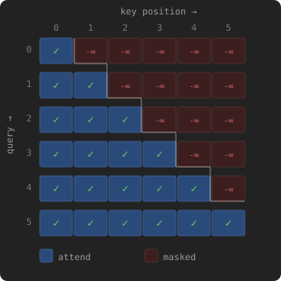

# Causal Self-Attention

LeetGPU · #53

[打开实现文件](../../practice/leetgpu/53/solution.cu) · [原始材料](../../references/LeetGPU/challenges/hard/53_casual_attention/challenge.html)

Implement Causal (masked) Self-Attention for a given set of matrices. Given the query matrix `Q` of size `M×d`, key matrix `K` of size `M×d`, and value matrix `V` of size `M×d`, your program should compute the output matrix using the formula: $$\text{Attention}_{\text{causal}}(Q, K, V) = \text{softmax}\Bigl(\text{masked}\Bigl( \frac{QK^T}{\sqrt{d}} \Bigr)\Bigr)V$$

 where `mask` is a causal mask that sets all positions corresponding to keys **after** the current query to \(-\infty\). $$$$ i.e., for query `i` and key `j`: $$ \text{masked}(a_{ij}) = \begin{cases} a_{ij}, & j \le i \\ -\infty, & j > i \end{cases} $$ The softmax function is applied row-wise. `Q`, `K`, `V`, and `output` are all of data type `float32`; `M`, and `d` are of data type `int32`.

## Implementation Requirements

- Use only native features (external libraries are not permitted)

- The `solve` function signature must remain unchanged

- The final result must be stored in the output matrix `output`

## Example 1:

 **Input:**
 `Q` (2×4): \[ \begin{bmatrix} 1.0 & 0.0 & 0.0 & 0.0 \\ 0.0 & 1.0 & 0.0 & 0.0 \end{bmatrix} \] `K` (2×4): \[ \begin{bmatrix} 1.0 & 0.0 & 0.0 & 0.0 \\ 0.0 & 1.0 & 0.0 & 0.0 \end{bmatrix} \] `V` (2×4): \[ \begin{bmatrix} 1.0 & 2.0 & 3.0 & 4.0 \\ 5.0 & 6.0 & 7.0 & 8.0 \end{bmatrix} \]

 **Output:**
 `output` (2×4): \[ \begin{bmatrix} 1.0 & 2.0 & 3.0 & 4.0 \\ 3.4898374 & 4.4898374 & 5.4898374 & 6.4898374 \end{bmatrix} \]

## Example 2:

 **Input:**
 `Q` (2×2): \[ \begin{bmatrix} 0.0 & 0.0 \\ 1.0 & 1.0 \end{bmatrix} \] `K` (2×2): \[ \begin{bmatrix} 1.0 & 0.0 \\ 0.0 & 1.0 \end{bmatrix} \] `V` (2×2): \[ \begin{bmatrix} 3.0 & 4.0 \\ 5.0 & 6.0 \end{bmatrix} \]

 **Output:**
 `output` (2×2): \[ \begin{bmatrix} 3.0 & 4.0 \\ 4.0 & 5.0 \end{bmatrix} \]

## Constraints

- Matrix `Q`, `K`, and `V` are all of size `M×d`

- 1 ≤ `M` ≤ 10000

- 1 ≤ `d` ≤ 128

- All elements in `Q`, `K`, and `V` are sampled from`[-1.0, 1.0]`

- Data type for all matrices is `float32`

- Performance is measured with `M` = 5,000

## 本地接口

~~~cpp
extern "C" void solve(const float* Q, const float* K, const float* V, float* output, int M, int d);
~~~

## 本地用例

~~~bash
./practice.sh cases leetgpu 53
./practice.sh test leetgpu 53
~~~

展开输入规格

~~~text
  #0 公开样例 · Q (2, 4) float32 · K (2, 4) float32 · V (2, 4) float32 · output (2, 4) float32 · M 2 · d 4
  #1 公开功能用例 · Q (2, 4) float32 · K (2, 4) float32 · V (2, 4) float32 · output (2, 4) float32 · M 2 · d 4
  #2 公开功能用例 · Q (3, 5) float32 · K (3, 5) float32 · V (3, 5) float32 · output (3, 5) float32 · M 3 · d 5
  #3 公开功能用例 · Q (4, 3) float32 · K (4, 3) float32 · V (4, 3) float32 · output (4, 3) float32 · M 4 · d 3
  #4 公开功能用例 · Q (128, 32) float32 · K (128, 32) float32 · V (128, 32) float32 · output (128, 32) float32 · M 128 · d 32
  #5 首个用例复验 · 原用例 #1 · 种子 2031 · 缓冲区守卫 · Q (2, 4) float32 · K (2, 4) float32 · V (2, 4) float32 · output (2, 4) float32 · M 2 · d 4
  #6 中间用例复验 · 原用例 #3 · 种子 2032 · 缓冲区守卫 · Q (4, 3) float32 · K (4, 3) float32 · V (4, 3) float32 · output (4, 3) float32 · M 4 · d 3
  #7 末尾用例复验 · 原用例 #4 · 种子 2033 · 缓冲区守卫 · Q (128, 32) float32 · K (128, 32) float32 · V (128, 32) float32 · output (128, 32) float32 · M 128 · d 32
7 个功能用例，另有 1 个样例
~~~

