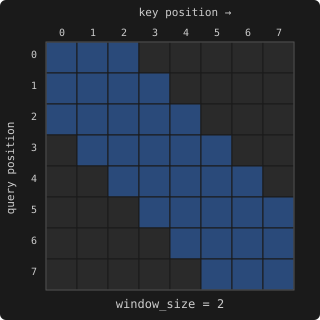

# Sliding Window Self-Attention

LeetGPU · #59

[打开实现文件](../../practice/leetgpu/59/solution.cu) · [原始材料](../../references/LeetGPU/challenges/hard/59_sliding_window_attn/challenge.html)

Implement **Sliding Window Self-Attention** for a given set of matrices. Before introducing the sliding window version, let's first recall standard Self-Attention.

### 1. Standard Softmax Attention

 Given query matrix `Q`, key matrix `K`, and value matrix `V`, each position `i` attends to all positions `j` using a softmax-weighted sum:

 \( \text{score}_{i,j} = \frac{Q_i \cdot K_j}{\sqrt{d}} \)

 \( \text{output}_i = \sum_{j=1}^{M} \text{softmax}(\text{score}_{i,*})_j \cdot V_j \)

 In other words, each query computes similarity with all keys, applies a softmax to get attention weights, and then computes a weighted sum of values.

### 2. Sliding Window Self-Attention

 Sliding Window Attention modifies standard attention by restricting each query to attend only to a local window around its position.

- For each position `i`, only consider the keys and values within a window of size `window_size` around `i` (positions `[i-window_size, ..., i+window_size]`).

- Compute similarity scores between `Qi` and the keys in this window:

 \( \text{score}_{i,j} = \frac{Q_i \cdot K_j}{\sqrt{d}} \)

- Apply `softmax` over these local scores to obtain attention weights.

- Use the weights to compute a weighted average of the values in the same window:

 \( \text{output}_i = \sum_{j \in [i-\text{window_size}, \, i+\text{window_size}]} \text{softmax}(\text{score}_{i,*})_j \cdot V_j \)

 In short, each query only attends to its nearby neighbors.

## Implementation Requirements

- Use only native features (external libraries are not permitted)

- The `solve` function signature must remain unchanged

- The final result must be stored in the output matrix `output`

## Example 1:

 **Input:**
 `Q` (2×4): \[ \begin{bmatrix} 1.0 & 0.0 & 0.0 & 0.0 \\ 0.0 & 1.0 & 0.0 & 0.0 \end{bmatrix} \] `K` (2×4): \[ \begin{bmatrix} 1.0 & 0.0 & 0.0 & 0.0 \\ 0.0 & 1.0 & 0.0 & 0.0 \end{bmatrix} \] `V` (2×4): \[ \begin{bmatrix} 1.0 & 2.0 & 3.0 & 4.0 \\ 5.0 & 6.0 & 7.0 & 8.0 \end{bmatrix} \] `window_size`: 1

 **Output:**
 `output` (2×4): \[ \begin{bmatrix} 2.5101628 & 3.5101628 & 4.510163 & 5.510163 \\ 3.4898374 & 4.4898376 & 5.4898376 & 6.489837 \end{bmatrix} \]

## Example 2:

 **Input:**
 `Q` (2×3): \[ \begin{bmatrix} 0.0 & 0.0 & 0.0 \\ 0.0 & 1.0 & 0.0 \end{bmatrix} \] `K` (2×3): \[ \begin{bmatrix} 1.0 & 0.0 & 0.0 \\ 0.0 & 1.0 & 0.0 \end{bmatrix} \] `V` (2×3): \[ \begin{bmatrix} 1.0 & 2.0 & 3.0 \\ 5.0 & 6.0 & 7.0 \end{bmatrix} \] `window_size`: 1

 **Output:**
 `output` (2×3): \[ \begin{bmatrix} 3.0 & 4.0 & 5.0 \\ 3.5618298 & 4.56183 & 5.5618296 \end{bmatrix} \]

## Constraints

- Matrix `Q`, `K`, and `V` are all of size `M×d`

- 1 ≤ `M` ≤ 10000

- 1 ≤ `d` ≤ 128

- 1 ≤ `window_size` ≤ 32

- All elements in `Q`, `K`, and `V` are in `[-100.0, 100.0]`

- Data type for all matrices is `float32`

- Performance is measured with `M` = 5,000 and elements of `Q`, `K` and `V` sampled from `[-1.0, 1.0]`

## 本地接口

~~~cpp
extern "C" void solve(const float* Q, const float* K, const float* V, float* output, int M, int d,
                      int window_size);
~~~

## 本地用例

~~~bash
./practice.sh cases leetgpu 59
./practice.sh test leetgpu 59
~~~

展开输入规格

~~~text
  #0 公开样例 · Q (2, 4) float32 · K (2, 4) float32 · V (2, 4) float32 · output (2, 4) float32 · M 2 · d 4 · window_size 1
  #1 公开功能用例 · Q (2, 4) float32 · K (2, 4) float32 · V (2, 4) float32 · output (2, 4) float32 · M 2 · d 4 · window_size 1
  #2 公开功能用例 · Q (2, 3) float32 · K (2, 3) float32 · V (2, 3) float32 · output (2, 3) float32 · M 2 · d 3 · window_size 1
  #3 公开功能用例 · Q (3, 5) float32 · K (3, 5) float32 · V (3, 5) float32 · output (3, 5) float32 · M 3 · d 5 · window_size 2
  #4 公开功能用例 · Q (4, 3) float32 · K (4, 3) float32 · V (4, 3) float32 · output (4, 3) float32 · M 4 · d 3 · window_size 2
  #5 公开功能用例 · Q (128, 32) float32 · K (128, 32) float32 · V (128, 32) float32 · output (128, 32) float32 · M 128 · d 32 · window_size 8
  #6 首个用例复验 · 原用例 #1 · 种子 2032 · 缓冲区守卫 · Q (2, 4) float32 · K (2, 4) float32 · V (2, 4) float32 · output (2, 4) float32 · M 2 · d 4 · window_size 1
  #7 中间用例复验 · 原用例 #3 · 种子 2033 · 缓冲区守卫 · Q (3, 5) float32 · K (3, 5) float32 · V (3, 5) float32 · output (3, 5) float32 · M 3 · d 5 · window_size 2
  #8 末尾用例复验 · 原用例 #5 · 种子 2034 · 缓冲区守卫 · Q (128, 32) float32 · K (128, 32) float32 · V (128, 32) float32 · output (128, 32) float32 · M 128 · d 32 · window_size 8
8 个功能用例，另有 1 个样例
~~~

