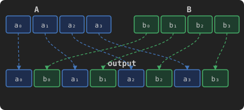

# Interleave Arrays

LeetGPU · #63

[打开实现文件](../../practice/leetgpu/63/solution.cu) · [原始材料](../../references/LeetGPU/challenges/easy/63_interleave/challenge.html)

Write a GPU program that interleaves two arrays of 32-bit floating point numbers. Given two input arrays `A` and `B`, each of length `N`, produce an output array of length `2N` where elements alternate between the two inputs: `[A[0], B[0], A[1], B[1], A[2], B[2], ...]`

## Implementation Requirements

- Use only native features (external libraries are not permitted)

- The `solve` function signature must remain unchanged

- The final result must be stored in the `output` array

## Example 1:

~~~text

Input:  A = [1.0, 2.0, 3.0], B = [4.0, 5.0, 6.0]
Output: [1.0, 4.0, 2.0, 5.0, 3.0, 6.0]

~~~

## Example 2:

~~~text

Input:  A = [10.0, 20.0], B = [30.0, 40.0]
Output: [10.0, 30.0, 20.0, 40.0]

~~~

## Constraints

- 1 ≤ `N` ≤ 50,000,000

- Performance is measured with `N` = 25,000,000

## 本地接口

~~~cpp
extern "C" void solve(const float* A, const float* B, float* output, int N);
~~~

## 本地用例

~~~bash
./practice.sh cases leetgpu 63
./practice.sh test leetgpu 63
~~~

展开输入规格

~~~text
  #0 公开样例 · A (3,) float32 · B (3,) float32 · output (6,) float32 · N 3
  #1 公开功能用例 · A (3,) float32 · B (3,) float32 · output (6,) float32 · N 3
  #2 公开功能用例 · A (1,) float32 · B (1,) float32 · output (2,) float32 · N 1
  #3 公开功能用例 · A (2,) float32 · B (2,) float32 · output (4,) float32 · N 2
  #4 公开功能用例 · A (3,) float32 · B (3,) float32 · output (6,) float32 · N 3
  #5 公开功能用例 · A (4,) float32 · B (4,) float32 · output (8,) float32 · N 4
  #6 公开功能用例 · A (5,) float32 · B (5,) float32 · output (10,) float32 · N 5
  #7 公开功能用例 · A (2,) float32 · B (2,) float32 · output (4,) float32 · N 2
  #8 公开功能用例 · A (1024,) float32 · B (1024,) float32 · output (2048,) float32 · N 1024
  #9 公开功能用例 · A (10000,) float32 · B (10000,) float32 · output (20000,) float32 · N 10000
  #10 公开功能用例 · A (100000,) float32 · B (100000,) float32 · output (200000,) float32 · N 100000
  #11 首个用例复验 · 原用例 #1 · 种子 2037 · 缓冲区守卫 · A (3,) float32 · B (3,) float32 · output (6,) float32 · N 3
  #12 中间用例复验 · 原用例 #6 · 种子 2038 · 缓冲区守卫 · A (5,) float32 · B (5,) float32 · output (10,) float32 · N 5
  #13 末尾用例复验 · 原用例 #10 · 种子 2039 · 缓冲区守卫 · A (100000,) float32 · B (100000,) float32 · output (200000,) float32 · N 100000
13 个功能用例，另有 1 个样例
~~~

