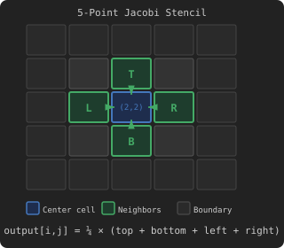

# 2D Jacobi Stencil

LeetGPU · #69

[打开实现文件](../../practice/leetgpu/69/solution.cu) · [原始材料](../../references/LeetGPU/challenges/medium/69_jacobi_stencil_2d/challenge.html)

Given a 2D grid of 32-bit floating point values, apply one iteration of the 5-point Jacobi stencil: each interior cell of the output is set to the average of its four cardinal neighbors (top, bottom, left, right) from the input grid. Boundary cells (first/last row and column) are copied unchanged from the input to the output.

## Implementation Requirements

- Use only native features (external libraries are not permitted)

- The `solve` function signature must remain unchanged

- The final result must be stored in `output`

- Read exclusively from `input` and write exclusively to `output` (do not update `input`)

## Example:

 Input (\(4 \times 4\)): \[ \begin{bmatrix} 1.0 & 2.0 & 3.0 & 4.0 \\ 5.0 & 6.0 & 7.0 & 8.0 \\ 9.0 & 10.0 & 11.0 & 12.0 \\ 13.0 & 14.0 & 15.0 & 16.0 \end{bmatrix} \] Output (\(4 \times 4\)): \[ \begin{bmatrix} 1.0 & 2.0 & 3.0 & 4.0 \\ 5.0 & 6.0 & 7.0 & 8.0 \\ 9.0 & 10.0 & 11.0 & 12.0 \\ 13.0 & 14.0 & 15.0 & 16.0 \end{bmatrix} \] Interior cell \((1,1)\): \(0.25 \times (\text{input}[0,1] + \text{input}[2,1] + \text{input}[1,0] + \text{input}[1,2])\) \(= 0.25 \times (2.0 + 10.0 + 5.0 + 7.0) = 6.0\)
 Interior cell \((1,2)\): \(0.25 \times (\text{input}[0,2] + \text{input}[2,2] + \text{input}[1,1] + \text{input}[1,3])\) \(= 0.25 \times (3.0 + 11.0 + 6.0 + 8.0) = 7.0\)
 Interior cell \((2,1)\): \(0.25 \times (\text{input}[1,1] + \text{input}[3,1] + \text{input}[2,0] + \text{input}[2,2])\) \(= 0.25 \times (6.0 + 14.0 + 9.0 + 11.0) = 10.0\)
 Interior cell \((2,2)\): \(0.25 \times (\text{input}[1,2] + \text{input}[3,2] + \text{input}[2,1] + \text{input}[2,3])\) \(= 0.25 \times (7.0 + 15.0 + 10.0 + 12.0) = 11.0\)

## Constraints

- 1 ≤ `rows`, `cols` ≤ 16,384

- Input values are in the range [-100, 100]

- All values are 32-bit floats

- Performance is measured with `rows` = 8,192, `cols` = 8,192

## 本地接口

~~~cpp
extern "C" void solve(const float* input, float* output, int rows, int cols);
~~~

## 本地用例

~~~bash
./practice.sh cases leetgpu 69
./practice.sh test leetgpu 69
~~~

展开输入规格

~~~text
  #0 公开样例 · input (4, 4) float32 · output (4, 4) float32 · rows 4 · cols 4
  #1 公开功能用例 · input (3, 3) float32 · output (3, 3) float32 · rows 3 · cols 3
  #2 公开功能用例 · input (1, 1) float32 · output (1, 1) float32 · rows 1 · cols 1
  #3 公开功能用例 · input (1, 4) float32 · output (1, 4) float32 · rows 1 · cols 4
  #4 公开功能用例 · input (4, 1) float32 · output (4, 1) float32 · rows 4 · cols 1
  #5 公开功能用例 · input (16, 16) float32 · output (16, 16) float32 · rows 16 · cols 16
  #6 公开功能用例 · input (32, 32) float32 · output (32, 32) float32 · rows 32 · cols 32
  #7 公开功能用例 · input (64, 64) float32 · output (64, 64) float32 · rows 64 · cols 64
  #8 公开功能用例 · input (128, 128) float32 · output (128, 128) float32 · rows 128 · cols 128
  #9 公开功能用例 · input (30, 30) float32 · output (30, 30) float32 · rows 30 · cols 30
  #10 公开功能用例 · input (100, 100) float32 · output (100, 100) float32 · rows 100 · cols 100
  #11 公开功能用例 · input (255, 33) float32 · output (255, 33) float32 · rows 255 · cols 33
  #12 公开功能用例 · input (17, 97) float32 · output (17, 97) float32 · rows 17 · cols 97
  #13 公开功能用例 · input (512, 256) float32 · output (512, 256) float32 · rows 512 · cols 256
  #14 公开功能用例 · input (1024, 1024) float32 · output (1024, 1024) float32 · rows 1024 · cols 1024
  #15 首个用例复验 · 原用例 #1 · 种子 2041 · 缓冲区守卫 · input (3, 3) float32 · output (3, 3) float32 · rows 3 · cols 3
  #16 中间用例复验 · 原用例 #8 · 种子 2042 · 缓冲区守卫 · input (128, 128) float32 · output (128, 128) float32 · rows 128 · cols 128
  #17 末尾用例复验 · 原用例 #14 · 种子 2043 · 缓冲区守卫 · input (1024, 1024) float32 · output (1024, 1024) float32 · rows 1024 · cols 1024
17 个功能用例，另有 1 个样例
~~~

