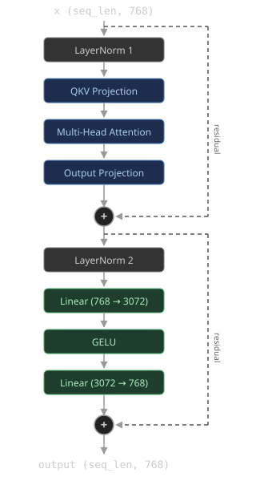

# GPT-2 Transformer Block

LeetGPU · #74

[打开实现文件](../../practice/leetgpu/74/solution.cu) · [原始材料](../../references/LeetGPU/challenges/hard/74_gpt2_block/challenge.html)

Implement a single GPT-2 transformer decoder block. Given an input tensor \(x\) of shape `(seq_len, 768)` and a packed weight buffer containing all block parameters, compute the output using pre-norm architecture with multi-head self-attention and a feed-forward network with GELU activation.

The block uses GPT-2's **pre-norm** architecture: LayerNorm is applied *before* each sub-layer (attention and feed-forward), not after. At a high level:
 \[ \begin{aligned} x' &= x + \text{MultiHeadAttn}\!\left(\text{LN}_1(x)\right) \\[4pt] \text{output} &= x' + \text{FeedForward}\!\left(\text{LN}_2(x')\right) \end{aligned} \]
where the sub-layers are defined as:
 \[ \begin{aligned} \text{LN}(z) &= \frac{z - \mu}{\sqrt{\sigma^2 + \epsilon}} \odot \gamma + \beta, \quad \mu = \frac{1}{d}\sum_i z_i, \quad \sigma^2 = \frac{1}{d}\sum_i (z_i - \mu)^2 \\[8pt] [Q \mid K \mid V] &= \text{LN}_1(x) \cdot W_{qkv} + b_{qkv} \\[4pt] \text{head}_i &= \text{softmax}\!\left(\frac{Q_i K_i^\top}{\sqrt{d_k}}\right) V_i, \quad d_k = 64 \\[4pt] \text{MultiHeadAttn}(z) &= \text{Concat}(\text{head}_1, \ldots, \text{head}_{12}) \cdot W_{\text{attn}} + b_{\text{attn}} \\[8pt] \text{FeedForward}(z) &= \text{GELU}\!\left(z \cdot W_{fc} + b_{fc}\right) \cdot W_{\text{proj}} + b_{\text{proj}} \end{aligned} \]
Expanding into individual steps:

1. **Layer Norm 1:** \(x_{\text{norm}} = \text{LN}_1(x)\) with parameters \(\gamma_1, \beta_1\)

1. **QKV Projection:** \(QKV = x_{\text{norm}} \cdot W_{qkv} + b_{qkv}\), split into \(Q, K, V\) each of shape `(seq_len, 768)`

1. **Multi-Head Attention:** Reshape \(Q, K, V\) into 12 heads of dimension 64, compute per-head scaled dot-product attention (no causal mask), then concatenate heads into \(A\)

1. **Output Projection:** \(P = A \cdot W_{\text{attn}} + b_{\text{attn}}\)

1. **Residual 1:** \(x' = x + P\)

1. **Layer Norm 2:** \(h_{\text{norm}} = \text{LN}_2(x')\) with parameters \(\gamma_2, \beta_2\)

1. **Feed-Forward:** \(F = \text{GELU}(h_{\text{norm}} \cdot W_{fc} + b_{fc}) \cdot W_{\text{proj}} + b_{\text{proj}}\)

1. **Residual 2:** \(\text{output} = x' + F\)

## Implementation Requirements

- Use only native features (external libraries are not permitted)

- The `solve` function signature must remain unchanged

- The final result must be stored in the `output` tensor

- LayerNorm uses \(\epsilon = 10^{-5}\)

- Use the [GELU tanh approximation](https://docs.pytorch.org/docs/stable/generated/torch.nn.GELU.html): \(\text{GELU}(x) = 0.5\,x\!\left(1 + \tanh\!\left(\sqrt{\tfrac{2}{\pi}}\left(x + 0.044715\,x^3\right)\right)\right)\)

## Weight Layout

All block parameters are packed into a single contiguous `weights` buffer (7,087,872 floats) in the following order. Index into the buffer using the offsets below (e.g. \(W_{qkv}[i][j]\) is at `weights[1536 + i * 2304 + j]`). All 2D matrices are stored in row-major order.

<table style="border-collapse:separate; border-spacing:16px 8px;">
  <tr>
    <th style="text-align:left;">Parameter</th>
    <th style="text-align:left;">Shape</th>
    <th style="text-align:right;">Size</th>
    <th style="text-align:right;">Offset</th>
  </tr>
  <tr>
    <td>\(\gamma_1\) (LN1 weight)</td>
    <td>(768,)</td>
    <td style="text-align:right;">768</td>
    <td style="text-align:right;">0</td>
  </tr>
  <tr>
    <td>\(\beta_1\) (LN1 bias)</td>
    <td>(768,)</td>
    <td style="text-align:right;">768</td>
    <td style="text-align:right;">768</td>
  </tr>
  <tr>
    <td>\(W_{qkv}\)</td>
    <td>(768, 2304)</td>
    <td style="text-align:right;">1,769,472</td>
    <td style="text-align:right;">1,536</td>
  </tr>
  <tr>
    <td>\(b_{qkv}\)</td>
    <td>(2304,)</td>
    <td style="text-align:right;">2,304</td>
    <td style="text-align:right;">1,771,008</td>
  </tr>
  <tr>
    <td>\(W_{\text{attn}}\)</td>
    <td>(768, 768)</td>
    <td style="text-align:right;">589,824</td>
    <td style="text-align:right;">1,773,312</td>
  </tr>
  <tr>
    <td>\(b_{\text{attn}}\)</td>
    <td>(768,)</td>
    <td style="text-align:right;">768</td>
    <td style="text-align:right;">2,363,136</td>
  </tr>
  <tr>
    <td>\(\gamma_2\) (LN2 weight)</td>
    <td>(768,)</td>
    <td style="text-align:right;">768</td>
    <td style="text-align:right;">2,363,904</td>
  </tr>
  <tr>
    <td>\(\beta_2\) (LN2 bias)</td>
    <td>(768,)</td>
    <td style="text-align:right;">768</td>
    <td style="text-align:right;">2,364,672</td>
  </tr>
  <tr>
    <td>\(W_{fc}\)</td>
    <td>(768, 3072)</td>
    <td style="text-align:right;">2,359,296</td>
    <td style="text-align:right;">2,365,440</td>
  </tr>
  <tr>
    <td>\(b_{fc}\)</td>
    <td>(3072,)</td>
    <td style="text-align:right;">3,072</td>
    <td style="text-align:right;">4,724,736</td>
  </tr>
  <tr>
    <td>\(W_{\text{proj}}\)</td>
    <td>(3072, 768)</td>
    <td style="text-align:right;">2,359,296</td>
    <td style="text-align:right;">4,727,808</td>
  </tr>
  <tr>
    <td>\(b_{\text{proj}}\)</td>
    <td>(768,)</td>
    <td style="text-align:right;">768</td>
    <td style="text-align:right;">7,087,104</td>
  </tr>
</table>

## Example

With `seq_len` = 4, `x` uniformly drawn from [−1, 1], and weights randomly initialized (see Weight Layout for the packing structure):

~~~text

Input:  x.shape       = (4, 768)       # 4 token embeddings
        weights.shape = (7,087,872,)   # packed weight buffer
        seq_len       = 4
Output: output.shape  = (4, 768)       # transformed token embeddings

~~~

## Constraints

- `d_model` = 768, `n_heads` = 12, `ffn_dim` = 3,072 (GPT-2 124M architecture)

- 1 ≤ `seq_len` ≤ 4,096

- All tensors use 32-bit floating point

- Performance is measured with `seq_len` = 1,024

## 本地接口

~~~cpp
extern "C" void solve(const float* x, float* output, const float* weights, int seq_len);
~~~

## 本地用例

~~~bash
./practice.sh cases leetgpu 74
./practice.sh test leetgpu 74
~~~

展开输入规格

~~~text
  #0 公开样例 · x (4, 768) float32 · output (4, 768) float32 · weights (7087872,) float32 · seq_len 4
  #1 公开功能用例 · x (1, 768) float32 · output (1, 768) float32 · weights (7087872,) float32 · seq_len 1
  #2 公开功能用例 · x (4, 768) float32 · output (4, 768) float32 · weights (7087872,) float32 · seq_len 4
  #3 公开功能用例 · x (2, 768) float32 · output (2, 768) float32 · weights (7087872,) float32 · seq_len 2
  #4 公开功能用例 · x (4, 768) float32 · output (4, 768) float32 · weights (7087872,) float32 · seq_len 4
  #5 公开功能用例 · x (16, 768) float32 · output (16, 768) float32 · weights (7087872,) float32 · seq_len 16
  #6 公开功能用例 · x (64, 768) float32 · output (64, 768) float32 · weights (7087872,) float32 · seq_len 64
  #7 公开功能用例 · x (30, 768) float32 · output (30, 768) float32 · weights (7087872,) float32 · seq_len 30
  #8 公开功能用例 · x (100, 768) float32 · output (100, 768) float32 · weights (7087872,) float32 · seq_len 100
  #9 公开功能用例 · x (128, 768) float32 · output (128, 768) float32 · weights (7087872,) float32 · seq_len 128
  #10 公开功能用例 · x (256, 768) float32 · output (256, 768) float32 · weights (7087872,) float32 · seq_len 256
  #11 首个用例复验 · 原用例 #1 · 种子 2037 · 缓冲区守卫 · x (1, 768) float32 · output (1, 768) float32 · weights (7087872,) float32 · seq_len 1
  #12 中间用例复验 · 原用例 #6 · 种子 2038 · 缓冲区守卫 · x (64, 768) float32 · output (64, 768) float32 · weights (7087872,) float32 · seq_len 64
  #13 末尾用例复验 · 原用例 #10 · 种子 2039 · 缓冲区守卫 · x (256, 768) float32 · output (256, 768) float32 · weights (7087872,) float32 · seq_len 256
13 个功能用例，另有 1 个样例
~~~

