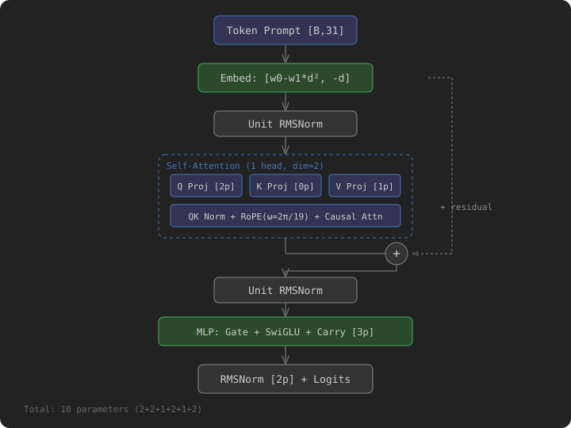

# Adder Transformer Inference

LeetGPU · #76

[打开实现文件](../../practice/leetgpu/76/solution.cu) · [原始材料](../../references/LeetGPU/challenges/medium/76_adder_transformer/challenge.html)

Run batched autoregressive inference for a 10-parameter transformer that adds two 10-digit numbers. Given prompts of shape `[batch_size, 31]` (int32) and a 10-float weight buffer, write output logits of shape `[batch_size, 11, 10]` — one logit row per decode step over the 10-digit vocabulary (0–9). All tensors are float32 except the int32 prompts.

 The model comes from the [AdderBoard](https://gist.github.com/Lokimorty/d54e5c61997e00fb922b6692739a0f6c) competition for the smallest autoregressive transformer that adds 10-digit numbers at ≥99% accuracy. It encodes carry propagation in 10 learned parameters via RoPE geometry, tied embeddings, and SwiGLU gating.

## Model Architecture

Single-layer pre-norm transformer. Hidden dim 2, 1 head, head dim 2, vocab 10 (digits 0–9), tied input/output embeddings.

Each step runs the full sequence `[batch_size, seq_len, 2]` through:

**1. Token Embedding** (2 parameters: `w0`, `w1`)

$$e(d) = \begin{bmatrix} w_0 - w_1 \cdot d^2 \\ -d \end{bmatrix}$$

**2. Unit RMSNorm** (no parameters)

$$\text{UnitRMSNorm}(x) = \frac{x}{\sqrt{\text{mean}(x^2) + \epsilon}}, \quad \epsilon = 10^{-6}$$

**3. Self-Attention** (3 parameters: `q0`, `q1`, `v0`)

Projections applied to the normed hidden state `h` with shape `[*, 2]`:

$$Q = \begin{bmatrix} h_0 \cdot q_0 \\ h_0 \cdot q_1 \end{bmatrix}, \quad K = \begin{bmatrix} h_0 \\ 0 \end{bmatrix}, \quad V = \begin{bmatrix} h_1 \cdot v_0 \\ 0 \end{bmatrix}$$

After projection, Q and K are each normalized with Unit RMSNorm, then RoPE is applied with angular frequency `ω = 2π/19`:

$$\text{RoPE}(x, p) = \begin{bmatrix} x_0 \cos(p\omega) - x_1 \sin(p\omega) \\ x_0 \sin(p\omega) + x_1 \cos(p\omega) \end{bmatrix}$$

Scaled dot-product attention with causal mask uses scale factor:

$$\text{scale} = \frac{1}{\sqrt{d_h}} \cdot S^2$$

where \(d_h = 2\) is the head dimension and \(S^2\) is the QK-norm scale constant (see weight table below for exact value).

The output projection maps `[attn_0, attn_1]` → `[0, attn_0]` (no parameters), followed by a residual connection.

**4. MLP** (3 parameters: `a`, `c`, `carry`)

Applied to the unit-RMSNorm of the post-attention hidden state:

$$g_0 = h_0 \cdot a + h_1 \cdot c, \quad g_1 = h_0 \cdot (a - c / 1000) + h_1 \cdot c$$

$$\text{base} = h_0, \quad \text{up} = [\text{base}, \text{base}]$$

$$\text{mix} = \text{SiLU}([g_0, g_1]) \odot \text{up}$$

$$\text{MLP}(h) = \begin{bmatrix} 0 \\ \text{carry} \cdot (\text{mix}_1 - \text{mix}_0) \end{bmatrix}$$

followed by a residual connection.

**5. Final RMSNorm** (2 parameters: `n0`, `n1`)

Standard RMSNorm with learned weight:

$$\text{out} = \frac{h}{\sqrt{\text{mean}(h^2) + \epsilon}} \odot [n_0, n_1]$$

**6. Output Logits** (tied with embedding)

$$\text{logits} = \text{out} \cdot E^T \quad \text{where } E_{d} = e(d)$$

## Autoregressive Decoding

Starting from the 31-token prompt, repeat 11 times:

1. Run the full forward pass on the current sequence

1. Extract logits at the last position → store in output

1. Append `argmax(logits)` as the next token

The sequence grows from length 31 to 42 over the 11 decode steps.

## Weight Layout

<table border="1" cellpadding="6" cellspacing="0" style="border-collapse:collapse; color:#ccc; border-color:#555;">
  <tr style="background:#333;"><th>Offset</th><th>Size</th><th>Name</th><th>Description</th></tr>
  <tr><td>0</td><td>2</td><td>embed</td><td>Embedding: <code>e(d) = [w0 - w1*d&sup2;, -d]</code></td></tr>
  <tr><td>2</td><td>2</td><td>q_proj</td><td>Q projection weights <code>[q0, q1]</code></td></tr>
  <tr><td>4</td><td>1</td><td>v_proj</td><td>V projection weight <code>v0</code></td></tr>
  <tr><td>5</td><td>2</td><td>gate</td><td>MLP gate weights <code>[a, c]</code></td></tr>
  <tr><td>7</td><td>1</td><td>carry</td><td>MLP carry weight</td></tr>
  <tr><td>8</td><td>2</td><td>norm</td><td>Final RMSNorm weight <code>[n0, n1]</code></td></tr>
</table>

## Token Encoding

Each input pair `(a, b)` of 10-digit numbers is encoded as a 31-token sequence:

~~~text

[0, a_rev_0, ..., a_rev_9, 0, 0, 0, 0, 0, 0, 0, 0, 0, b_rev_0, ..., b_rev_9, 0]

~~~

where `a_rev` and `b_rev` are the digits in least-significant-first order, zero-padded to 10 digits. The model then generates 11 output tokens (digits of the sum, also least-significant-first).

## Implementation Requirements

- Implement `solve(prompts, output, weights, batch_size)` with the exact signature shown (JAX exception: `solve(prompts, weights, batch_size)` returns the output tensor directly)

- Do not use any external libraries beyond what the framework provides

- The function must write logits into the `output` buffer (except JAX, which returns it)

- Architecture constants are fixed: `vocab_size` = 10, `hidden_dim` = 2, `head_dim` = 2, `num_heads` = 1, `prompt_len` = 31, `decode_steps` = 11

- RMSNorm epsilon = 10−6

- RoPE angular frequency ω = 2π/19

- Attention scale = (1/√2) · `S`² where `S`² = ln(10) / (√2 · (cos(0.3ω) − cos(0.7ω)))

- SiLU activation: `silu(x) = x · sigmoid(x)`

## Example

With `batch_size` = 2 and pairs (3, 5), (99, 1):

~~~text

Input prompts (shape [2, 31]):
  [0, 3, 0, 0, 0, 0, 0, 0, 0, 0, 0, 0, 0, 0, 0, 0, 0, 0, 0, 0, 5, 0, 0, 0, 0, 0, 0, 0, 0, 0, 0]
  [0, 9, 9, 0, 0, 0, 0, 0, 0, 0, 0, 0, 0, 0, 0, 0, 0, 0, 0, 0, 1, 0, 0, 0, 0, 0, 0, 0, 0, 0, 0]

Output logits shape: [2, 11, 10]
  (logits at each of 11 decode steps over 10 digit classes)

Expected decoded tokens (via argmax):
  Pair (3, 5):   sum = 8       → [8, 0, 0, 0, 0, 0, 0, 0, 0, 0, 0]
  Pair (99, 1):  sum = 100     → [0, 0, 1, 0, 0, 0, 0, 0, 0, 0, 0]

~~~

## Constraints

- `batch_size`: 1 ≤ `batch_size` ≤ 100,000

- `prompts`: 32-bit integer tensor, values in [0, 9]

- `weights`: 32-bit float tensor with exactly 10 elements

- `output`: 32-bit float tensor of shape `[batch_size, 11, 10]`

- Input numbers are in range [0, 9,999,999,999] (10-digit unsigned integers)

- Performance is measured with `batch_size` = 100,000

## 本地接口

~~~cpp
extern "C" void solve(const int* prompts, float* output, const float* weights, int batch_size);
~~~

## 本地用例

~~~bash
./practice.sh cases leetgpu 76
./practice.sh test leetgpu 76
~~~

展开输入规格

~~~text
  #0 公开样例 · prompts (2, 31) int32 · output (2, 11, 10) float32 · weights (10,) float32 · batch_size 2
  #1 公开功能用例 · prompts (1, 31) int32 · output (1, 11, 10) float32 · weights (10,) float32 · batch_size 1
  #2 公开功能用例 · prompts (1, 31) int32 · output (1, 11, 10) float32 · weights (10,) float32 · batch_size 1
  #3 公开功能用例 · prompts (2, 31) int32 · output (2, 11, 10) float32 · weights (10,) float32 · batch_size 2
  #4 公开功能用例 · prompts (16, 31) int32 · output (16, 11, 10) float32 · weights (10,) float32 · batch_size 16
  #5 公开功能用例 · prompts (64, 31) int32 · output (64, 11, 10) float32 · weights (10,) float32 · batch_size 64
  #6 公开功能用例 · prompts (30, 31) int32 · output (30, 11, 10) float32 · weights (10,) float32 · batch_size 30
  #7 公开功能用例 · prompts (100, 31) int32 · output (100, 11, 10) float32 · weights (10,) float32 · batch_size 100
  #8 公开功能用例 · prompts (1000, 31) int32 · output (1000, 11, 10) float32 · weights (10,) float32 · batch_size 1000
  #9 公开功能用例 · prompts (8, 31) int32 · output (8, 11, 10) float32 · weights (10,) float32 · batch_size 8
  #10 公开功能用例 · prompts (4, 31) int32 · output (4, 11, 10) float32 · weights (10,) float32 · batch_size 4
  #11 首个用例复验 · 原用例 #1 · 种子 2037 · 缓冲区守卫 · prompts (1, 31) int32 · output (1, 11, 10) float32 · weights (10,) float32 · batch_size 1
  #12 中间用例复验 · 原用例 #6 · 种子 2038 · 缓冲区守卫 · prompts (30, 31) int32 · output (30, 11, 10) float32 · weights (10,) float32 · batch_size 30
  #13 末尾用例复验 · 原用例 #10 · 种子 2039 · 缓冲区守卫 · prompts (4, 31) int32 · output (4, 11, 10) float32 · weights (10,) float32 · batch_size 4
13 个功能用例，另有 1 个样例
~~~

