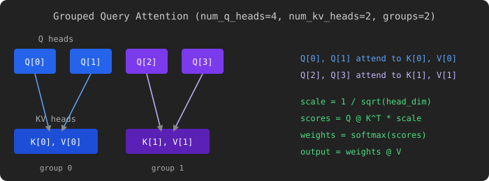

# Grouped Query Attention

LeetGPU · #80

[打开实现文件](../../practice/leetgpu/80/solution.cu) · [原始材料](../../references/LeetGPU/challenges/medium/80_grouped_query_attention/challenge.html)

Implement Grouped Query Attention (GQA), the attention mechanism used in modern large language models such as LLaMA-3, Mistral, and Gemma. GQA reduces the KV-cache memory footprint during inference by sharing key and value heads across groups of query heads. Given query tensor `Q` with `num_q_heads` heads and key/value tensors `K`, `V` each with `num_kv_heads` heads, compute scaled dot-product attention where every group of `num_q_heads / num_kv_heads` consecutive query heads attends to the same key and value head. All tensors use `float32`.

## Implementation Requirements

- Implement the function `solve(Q, K, V, output, num_q_heads, num_kv_heads, seq_len, head_dim)`.

- Do not change the function signature or use external libraries beyond the standard GPU frameworks.

- Write the result into the provided `output` buffer.

- `num_q_heads` is always divisible by `num_kv_heads`.

- Use scaled dot-product attention with scale factor `1 / sqrt(head_dim)` and a softmax over the key dimension.

## Example

 With `num_q_heads` = 4, `num_kv_heads` = 2 (groups of 2), `seq_len` = 3, `head_dim` = 4:

 **Input:**
 \(Q_0\) (3×4): \[ \begin{bmatrix} 1 & 0 & 0 & 1 \\ 0 & 1 & 1 & 0 \\ 1 & 1 & 0 & 0 \end{bmatrix} \] \(Q_1\) (3×4): \[ \begin{bmatrix} 0 & 1 & 0 & 1 \\ 1 & 0 & 1 & 0 \\ 0 & 0 & 1 & 1 \end{bmatrix} \] \(Q_2\) (3×4): \[ \begin{bmatrix} -1 & 0 & 0.5 & 0 \\ 0 & -1 & 0 & 0.5 \\ 0.5 & 0 & -1 & 0 \end{bmatrix} \] \(Q_3\) (3×4): \[ \begin{bmatrix} 0 & 0.5 & 0 & -1 \\ 0.5 & 0 & 0 & -1 \\ 0 & 0 & 0.5 & 0.5 \end{bmatrix} \] \(K_0\) (3×4): \[ \begin{bmatrix} 1 & 0 & 1 & 0 \\ 0 & 1 & 0 & 1 \\ 1 & 1 & 1 & 1 \end{bmatrix} \] \(K_1\) (3×4): \[ \begin{bmatrix} 0 & 1 & 0 & -1 \\ -1 & 0 & 1 & 0 \\ 0 & -1 & 0 & 1 \end{bmatrix} \] \(V_0\) (3×4): \[ \begin{bmatrix} 1 & 2 & 3 & 4 \\ 5 & 6 & 7 & 8 \\ 9 & 10 & 11 & 12 \end{bmatrix} \] \(V_1\) (3×4): \[ \begin{bmatrix} -1 & -2 & -3 & -4 \\ 2 & 3 & 4 & 5 \\ 6 & 7 & 8 & 9 \end{bmatrix} \] Groups: \(Q_0, Q_1 \to K_0, V_0\); \quad \(Q_2, Q_3 \to K_1, V_1\)

 **Output** (values rounded to 2 decimal places):
 \(\text{output}_0\) (3×4): \[ \begin{bmatrix} 5.71 & 6.71 & 7.71 & 8.71 \\ 5.71 & 6.71 & 7.71 & 8.71 \\ 5.71 & 6.71 & 7.71 & 8.71 \end{bmatrix} \] \(\text{output}_1\) (3×4): \[ \begin{bmatrix} 6.07 & 7.07 & 8.07 & 9.07 \\ 5.00 & 6.00 & 7.00 & 8.00 \\ 5.71 & 6.71 & 7.71 & 8.71 \end{bmatrix} \] \(\text{output}_2\) (3×4): \[ \begin{bmatrix} 2.24 & 2.76 & 3.27 & 3.79 \\ 3.96 & 4.70 & 5.44 & 6.17 \\ 2.40 & 2.60 & 2.79 & 2.98 \end{bmatrix} \] \(\text{output}_3\) (3×4): \[ \begin{bmatrix} 0.76 & 0.58 & 0.40 & 0.22 \\ 1.17 & 1.08 & 1.00 & 0.91 \\ 2.84 & 3.37 & 3.91 & 4.44 \end{bmatrix} \]

## Constraints

- 1 ≤ `num_kv_heads` ≤ `num_q_heads` ≤ 64

- `num_q_heads` is divisible by `num_kv_heads`

- 1 ≤ `seq_len` ≤ 4,096

- 8 ≤ `head_dim` ≤ 256; `head_dim` is a multiple of 8

- All tensor values are `float32`

- Performance is measured with `num_q_heads` = 32, `num_kv_heads` = 8, `seq_len` = 1,024, `head_dim` = 128

## 本地接口

~~~cpp
extern "C" void solve(const float* Q, const float* K, const float* V, float* output,
                      int num_q_heads, int num_kv_heads, int seq_len, int head_dim);
~~~

## 本地用例

~~~bash
./practice.sh cases leetgpu 80
./practice.sh test leetgpu 80
~~~

展开输入规格

~~~text
  #0 公开样例 · Q (4, 3, 4) float32 · K (2, 3, 4) float32 · V (2, 3, 4) float32 · output (4, 3, 4) float32 · num_q_heads 4 · num_kv_heads 2 · seq_len 3 · head_dim 4
  #1 公开功能用例 · Q (4, 1, 8) float32 · K (1, 1, 8) float32 · V (1, 1, 8) float32 · output (4, 1, 8) float32 · num_q_heads 4 · num_kv_heads 1 · seq_len 1 · head_dim 8
  #2 公开功能用例 · Q (2, 2, 4) float32 · K (1, 2, 4) float32 · V (1, 2, 4) float32 · output (2, 2, 4) float32 · num_q_heads 2 · num_kv_heads 1 · seq_len 2 · head_dim 4
  #3 公开功能用例 · Q (4, 4, 8) float32 · K (2, 4, 8) float32 · V (2, 4, 8) float32 · output (4, 4, 8) float32 · num_q_heads 4 · num_kv_heads 2 · seq_len 4 · head_dim 8
  #4 公开功能用例 · Q (8, 16, 32) float32 · K (2, 16, 32) float32 · V (2, 16, 32) float32 · output (8, 16, 32) float32 · num_q_heads 8 · num_kv_heads 2 · seq_len 16 · head_dim 32
  #5 公开功能用例 · Q (4, 32, 64) float32 · K (2, 32, 64) float32 · V (2, 32, 64) float32 · output (4, 32, 64) float32 · num_q_heads 4 · num_kv_heads 2 · seq_len 32 · head_dim 64
  #6 公开功能用例 · Q (4, 30, 32) float32 · K (2, 30, 32) float32 · V (2, 30, 32) float32 · output (4, 30, 32) float32 · num_q_heads 4 · num_kv_heads 2 · seq_len 30 · head_dim 32
  #7 公开功能用例 · Q (6, 100, 32) float32 · K (3, 100, 32) float32 · V (3, 100, 32) float32 · output (6, 100, 32) float32 · num_q_heads 6 · num_kv_heads 3 · seq_len 100 · head_dim 32
  #8 公开功能用例 · Q (8, 255, 64) float32 · K (1, 255, 64) float32 · V (1, 255, 64) float32 · output (8, 255, 64) float32 · num_q_heads 8 · num_kv_heads 1 · seq_len 255 · head_dim 64
  #9 公开功能用例 · Q (8, 64, 32) float32 · K (8, 64, 32) float32 · V (8, 64, 32) float32 · output (8, 64, 32) float32 · num_q_heads 8 · num_kv_heads 8 · seq_len 64 · head_dim 32
  #10 公开功能用例 · Q (8, 128, 64) float32 · K (2, 128, 64) float32 · V (2, 128, 64) float32 · output (8, 128, 64) float32 · num_q_heads 8 · num_kv_heads 2 · seq_len 128 · head_dim 64
  #11 首个用例复验 · 原用例 #1 · 种子 2037 · 缓冲区守卫 · Q (4, 1, 8) float32 · K (1, 1, 8) float32 · V (1, 1, 8) float32 · output (4, 1, 8) float32 · num_q_heads 4 · num_kv_heads 1 · seq_len 1 · head_dim 8
  #12 中间用例复验 · 原用例 #6 · 种子 2038 · 缓冲区守卫 · Q (4, 30, 32) float32 · K (2, 30, 32) float32 · V (2, 30, 32) float32 · output (4, 30, 32) float32 · num_q_heads 4 · num_kv_heads 2 · seq_len 30 · head_dim 32
  #13 末尾用例复验 · 原用例 #10 · 种子 2039 · 缓冲区守卫 · Q (8, 128, 64) float32 · K (2, 128, 64) float32 · V (2, 128, 64) float32 · output (8, 128, 64) float32 · num_q_heads 8 · num_kv_heads 2 · seq_len 128 · head_dim 64
13 个功能用例，另有 1 个样例
~~~

