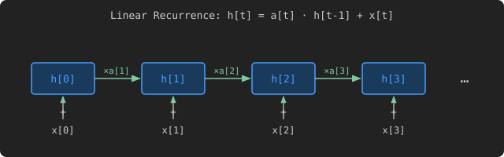

# Linear Recurrence

LeetGPU · #82

[打开实现文件](../../practice/leetgpu/82/solution.cu) · [原始材料](../../references/LeetGPU/challenges/medium/82_linear_recurrence/challenge.html)

Given two matrices `a` and `x`, each of shape `[B, L]` (batch size × sequence length), compute the linear recurrence `h` of shape `[B, L]` defined by: `h[b, 0] = x[b, 0]` and `h[b, t] = a[b, t] × h[b, t−1] + x[b, t]` for `t ≥ 1`. All values are `float32`. This operation is the core computational primitive of State Space Models (SSMs) such as Mamba, S4, and H3.

## Implementation Requirements

- Use only native features (external libraries are not permitted)

- The `solve` function signature must remain unchanged

- The result must be stored in the output tensor `h`

## Examples

Example 1 — exponential decay (`a = 0.5`, single impulse):
 \[ a = \begin{bmatrix} 0.5 & 0.5 & 0.5 & 0.5 \end{bmatrix}, \quad x = \begin{bmatrix} 1.0 & 0.0 & 0.0 & 0.0 \end{bmatrix} \] \[ h = \begin{bmatrix} 1.0 & 0.5 & 0.25 & 0.125 \end{bmatrix} \]
Example 2 — prefix sum (`a = 1`, unit inputs):
 \[ a = \begin{bmatrix} 1.0 & 1.0 & 1.0 & 1.0 \end{bmatrix}, \quad x = \begin{bmatrix} 1.0 & 1.0 & 1.0 & 1.0 \end{bmatrix} \] \[ h = \begin{bmatrix} 1.0 & 2.0 & 3.0 & 4.0 \end{bmatrix} \]
Full example with `B = 2`, `L = 4`:
 \[ a = \begin{bmatrix} 0.5 & 0.5 & 0.5 & 0.5 \\ 1.0 & 1.0 & 1.0 & 1.0 \end{bmatrix}, \quad x = \begin{bmatrix} 1.0 & 0.0 & 0.0 & 0.0 \\ 1.0 & 1.0 & 1.0 & 1.0 \end{bmatrix} \] \[ h = \begin{bmatrix} 1.0 & 0.5 & 0.25 & 0.125 \\ 1.0 & 2.0 & 3.0 & 4.0 \end{bmatrix} \]

## Constraints

- 1 ≤ `B` ≤ 256 (batch size)

- 1 ≤ `L` ≤ 65,536 (sequence length)

- All values in `a` and `x` are `float32`

- Performance is measured with `B` = 64, `L` = 16,384

## 本地接口

~~~cpp
extern "C" void solve(const float* a, const float* x, float* h, int B, int L);
~~~

## 本地用例

~~~bash
./practice.sh cases leetgpu 82
./practice.sh test leetgpu 82
~~~

展开输入规格

~~~text
  #0 公开样例 · a (2, 4) float32 · x (2, 4) float32 · h (2, 4) float32 · B 2 · L 4
  #1 公开功能用例 · a (1, 1) float32 · x (1, 1) float32 · h (1, 1) float32 · B 1 · L 1
  #2 公开功能用例 · a (1, 2) float32 · x (1, 2) float32 · h (1, 2) float32 · B 1 · L 2
  #3 公开功能用例 · a (4, 4) float32 · x (4, 4) float32 · h (4, 4) float32 · B 4 · L 4
  #4 公开功能用例 · a (4, 16) float32 · x (4, 16) float32 · h (4, 16) float32 · B 4 · L 16
  #5 公开功能用例 · a (4, 16) float32 · x (4, 16) float32 · h (4, 16) float32 · B 4 · L 16
  #6 公开功能用例 · a (8, 32) float32 · x (8, 32) float32 · h (8, 32) float32 · B 8 · L 32
  #7 公开功能用例 · a (8, 256) float32 · x (8, 256) float32 · h (8, 256) float32 · B 8 · L 256
  #8 公开功能用例 · a (4, 30) float32 · x (4, 30) float32 · h (4, 30) float32 · B 4 · L 30
  #9 公开功能用例 · a (8, 100) float32 · x (8, 100) float32 · h (8, 100) float32 · B 8 · L 100
  #10 公开功能用例 · a (16, 1024) float32 · x (16, 1024) float32 · h (16, 1024) float32 · B 16 · L 1024
  #11 首个用例复验 · 原用例 #1 · 种子 2037 · 缓冲区守卫 · a (1, 1) float32 · x (1, 1) float32 · h (1, 1) float32 · B 1 · L 1
  #12 中间用例复验 · 原用例 #6 · 种子 2038 · 缓冲区守卫 · a (8, 32) float32 · x (8, 32) float32 · h (8, 32) float32 · B 8 · L 32
  #13 末尾用例复验 · 原用例 #10 · 种子 2039 · 缓冲区守卫 · a (16, 1024) float32 · x (16, 1024) float32 · h (16, 1024) float32 · B 16 · L 1024
13 个功能用例，另有 1 个样例
~~~

