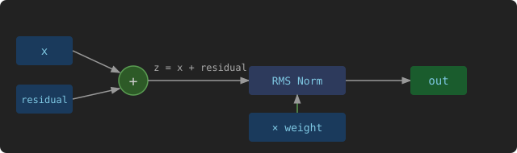

# Fused Residual Add and RMS Norm

LeetGPU · #83

[打开实现文件](../../practice/leetgpu/83/solution.cu) · [原始材料](../../references/LeetGPU/challenges/medium/83_fused_residual_add_rms_norm/challenge.html)

Implement a fused kernel that adds an input tensor `x` to a `residual` tensor and then RMS-normalizes the result, scaling each feature by a learned per-feature `weight` vector. Inputs are float32 tensors: `x` and `residual` have shape `(N, C)` where `N` is the number of tokens and `C` is the hidden dimension, and `weight` has shape `(C,)`. This pattern appears before every sublayer in modern LLMs such as LLaMA and Mistral: fusing the addition and normalization into a single kernel saves a full read–write pass over the data compared to two separate operations.

 For each row `i` (token), the kernel must compute:

 \[ z_i = x_i + \text{residual}_i, \quad \text{rms}_i = \sqrt{\frac{1}{C}\sum_{j=0}^{C-1} z_{i,j}^2 + \varepsilon}, \quad \text{out}_{i,j} = \frac{z_{i,j}}{\text{rms}_i} \cdot \text{weight}_j \]

 Each row's RMS is computed independently, making this a per-token normalization. The challenge is to fuse the addition and normalization into a single GPU kernel, avoiding writing the intermediate sum `z` to global memory.

## Implementation Requirements

- Do not change the function signature.

- Do not use external libraries beyond what is available in the starter.

- `out[i, j]` must equal `(x[i,j] + residual[i,j]) / rms_i × weight[j]` where `rms_i` is computed over the full row `i`.

## Example

~~~text

N = 1, C = 4
x        = [1.0,  0.0, -1.0,  2.0]
residual = [0.5,  1.5,  0.5, -0.5]
weight   = [1.0,  1.0,  1.0,  1.0]
eps      = 1e-5

z   = [1.5,  1.5, -0.5,  1.5]
rms = sqrt((1.5^2 + 1.5^2 + 0.5^2 + 1.5^2) / 4 + 1e-5)
    = sqrt(1.75 + 1e-5) ≈ 1.32288

out ≈ [1.1339,  1.1339, -0.3780,  1.1339]

~~~

## Constraints

- 1 ≤ `N` ≤ 65,536

- 1 ≤ `C` ≤ 65,536

- `x`, `residual`, `weight`, and `out` are float32

- Values in `x` and `residual` are in the range [−10, 10]

- `weight` values are in the range [0.5, 1.5]

- `eps` = 1e-5

- Performance is measured with `N` = 4,096, `C` = 4,096

## 本地接口

~~~cpp
extern "C" void solve(const float* x, const float* residual, const float* weight, float* out, int N,
                      int C, float eps);
~~~

## 本地用例

~~~bash
./practice.sh cases leetgpu 83
./practice.sh test leetgpu 83
~~~

展开输入规格

~~~text
  #0 公开样例 · x (1, 4) float32 · residual (1, 4) float32 · weight (4,) float32 · out (1, 4) float32 · N 1 · C 4 · eps 1e-05
  #1 公开功能用例 · x (1, 1) float32 · residual (1, 1) float32 · weight (1,) float32 · out (1, 1) float32 · N 1 · C 1 · eps 1e-05
  #2 公开功能用例 · x (1, 4) float32 · residual (1, 4) float32 · weight (4,) float32 · out (1, 4) float32 · N 1 · C 4 · eps 1e-05
  #3 公开功能用例 · x (2, 4) float32 · residual (2, 4) float32 · weight (4,) float32 · out (2, 4) float32 · N 2 · C 4 · eps 1e-05
  #4 公开功能用例 · x (4, 4) float32 · residual (4, 4) float32 · weight (4,) float32 · out (4, 4) float32 · N 4 · C 4 · eps 1e-05
  #5 公开功能用例 · x (4, 8) float32 · residual (4, 8) float32 · weight (8,) float32 · out (4, 8) float32 · N 4 · C 8 · eps 1e-05
  #6 公开功能用例 · x (16, 64) float32 · residual (16, 64) float32 · weight (64,) float32 · out (16, 64) float32 · N 16 · C 64 · eps 1e-05
  #7 公开功能用例 · x (32, 256) float32 · residual (32, 256) float32 · weight (256,) float32 · out (32, 256) float32 · N 32 · C 256 · eps 1e-05
  #8 公开功能用例 · x (30, 100) float32 · residual (30, 100) float32 · weight (100,) float32 · out (30, 100) float32 · N 30 · C 100 · eps 1e-05
  #9 公开功能用例 · x (100, 255) float32 · residual (100, 255) float32 · weight (255,) float32 · out (100, 255) float32 · N 100 · C 255 · eps 1e-05
  #10 公开功能用例 · x (128, 512) float32 · residual (128, 512) float32 · weight (512,) float32 · out (128, 512) float32 · N 128 · C 512 · eps 1e-05
  #11 首个用例复验 · 原用例 #1 · 种子 2037 · 缓冲区守卫 · x (1, 1) float32 · residual (1, 1) float32 · weight (1,) float32 · out (1, 1) float32 · N 1 · C 1 · eps 1e-05
  #12 中间用例复验 · 原用例 #6 · 种子 2038 · 缓冲区守卫 · x (16, 64) float32 · residual (16, 64) float32 · weight (64,) float32 · out (16, 64) float32 · N 16 · C 64 · eps 1e-05
  #13 末尾用例复验 · 原用例 #10 · 种子 2039 · 缓冲区守卫 · x (128, 512) float32 · residual (128, 512) float32 · weight (512,) float32 · out (128, 512) float32 · N 128 · C 512 · eps 1e-05
13 个功能用例，另有 1 个样例
~~~

