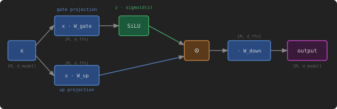

# SwiGLU MLP Block

LeetGPU · #84

[打开实现文件](../../practice/leetgpu/84/solution.cu) · [原始材料](../../references/LeetGPU/challenges/medium/84_swiglu_mlp_block/challenge.html)

Implement the SwiGLU MLP block — the feedforward network used in LLaMA, Mistral, Gemma, and most modern large language models. Given an input matrix `x` of shape `[M, d_model]` and three weight matrices `W_gate`, `W_up` (each `[d_model, d_ffn]`), and `W_down` (`[d_ffn, d_model]`), compute: `output = (SiLU(x × W_gate) ⊙ (x × W_up)) × W_down`, where `SiLU(z) = z × sigmoid(z)` and `⊙` denotes element-wise multiplication. All tensors are `float32`.

## Implementation Requirements

- Implement the `solve` function with the signature unchanged.

- Do not use external libraries beyond the framework provided.

- Write the result into `output` in-place.

## Example

 Input: `M` = 2, `d_model` = 2, `d_ffn` = 4

 \(x\) (float32, \(2 \times 2\)): \[ x = \begin{bmatrix} 1.0 & 0.0 \\ 0.0 & 1.0 \end{bmatrix} \] \(W_\text{gate}\) and \(W_\text{up}\) (both \(2 \times 4\)): \[ W_\text{gate} = W_\text{up} = \begin{bmatrix} 1.0 & 0.0 & 0.0 & 0.0 \\ 0.0 & 1.0 & 0.0 & 0.0 \end{bmatrix} \] \(W_\text{down}\) (\(4 \times 2\)): \[ W_\text{down} = \begin{bmatrix} 1.0 & 0.0 \\ 0.0 & 1.0 \\ 0.0 & 0.0 \\ 0.0 & 0.0 \end{bmatrix} \]

 Intermediate steps: \[ \text{gate} = x \cdot W_\text{gate} = \begin{bmatrix} 1.0 & 0.0 & 0.0 & 0.0 \\ 0.0 & 1.0 & 0.0 & 0.0 \end{bmatrix} \] \[ \text{up} = x \cdot W_\text{up} = \begin{bmatrix} 1.0 & 0.0 & 0.0 & 0.0 \\ 0.0 & 1.0 & 0.0 & 0.0 \end{bmatrix} \] \[ \text{SiLU}(1.0) = 1.0 \times \sigma(1.0) \approx 0.7311 \] \[ \text{hidden} = \text{SiLU}(\text{gate}) \odot \text{up} = \begin{bmatrix} 0.7311 & 0.0 & 0.0 & 0.0 \\ 0.0 & 0.7311 & 0.0 & 0.0 \end{bmatrix} \]

 Output: \[ \text{output} = \text{hidden} \cdot W_\text{down} \approx \begin{bmatrix} 0.7311 & 0.0 \\ 0.0 & 0.7311 \end{bmatrix} \]

## Constraints

- 1 ≤ `M` ≤ 65,536

- 1 ≤ `d_model` ≤ 8,192

- 1 ≤ `d_ffn` ≤ 32,768

- All tensors are `float32` on the GPU.

- Input values are in the range [-10, 10].

-  Performance is measured with `M` = 512, `d_model` = 4,096, `d_ffn` = 14,336

## 本地接口

~~~cpp
extern "C" void solve(const float* x, const float* W_gate, const float* W_up, const float* W_down,
                      float* output, int M, int d_model, int d_ffn);
~~~

## 本地用例

~~~bash
./practice.sh cases leetgpu 84
./practice.sh test leetgpu 84
~~~

展开输入规格

~~~text
  #0 公开样例 · x (2, 2) float32 · W_gate (2, 4) float32 · W_up (2, 4) float32 · W_down (4, 2) float32 · output (2, 2) float32 · M 2 · d_model 2 · d_ffn 4
  #1 公开功能用例 · x (1, 4) float32 · W_gate (4, 8) float32 · W_up (4, 8) float32 · W_down (8, 4) float32 · output (1, 4) float32 · M 1 · d_model 4 · d_ffn 8
  #2 公开功能用例 · x (2, 4) float32 · W_gate (4, 8) float32 · W_up (4, 8) float32 · W_down (8, 4) float32 · output (2, 4) float32 · M 2 · d_model 4 · d_ffn 8
  #3 公开功能用例 · x (4, 8) float32 · W_gate (8, 16) float32 · W_up (8, 16) float32 · W_down (16, 8) float32 · output (4, 8) float32 · M 4 · d_model 8 · d_ffn 16
  #4 公开功能用例 · x (16, 32) float32 · W_gate (32, 64) float32 · W_up (32, 64) float32 · W_down (64, 32) float32 · output (16, 32) float32 · M 16 · d_model 32 · d_ffn 64
  #5 公开功能用例 · x (64, 64) float32 · W_gate (64, 128) float32 · W_up (64, 128) float32 · W_down (128, 64) float32 · output (64, 64) float32 · M 64 · d_model 64 · d_ffn 128
  #6 公开功能用例 · x (30, 32) float32 · W_gate (32, 64) float32 · W_up (32, 64) float32 · W_down (64, 32) float32 · output (30, 32) float32 · M 30 · d_model 32 · d_ffn 64
  #7 公开功能用例 · x (100, 60) float32 · W_gate (60, 120) float32 · W_up (60, 120) float32 · W_down (120, 60) float32 · output (100, 60) float32 · M 100 · d_model 60 · d_ffn 120
  #8 公开功能用例 · x (255, 64) float32 · W_gate (64, 128) float32 · W_up (64, 128) float32 · W_down (128, 64) float32 · output (255, 64) float32 · M 255 · d_model 64 · d_ffn 128
  #9 公开功能用例 · x (128, 256) float32 · W_gate (256, 512) float32 · W_up (256, 512) float32 · W_down (512, 256) float32 · output (128, 256) float32 · M 128 · d_model 256 · d_ffn 512
  #10 公开功能用例 · x (256, 512) float32 · W_gate (512, 1024) float32 · W_up (512, 1024) float32 · W_down (1024, 512) float32 · output (256, 512) float32 · M 256 · d_model 512 · d_ffn 1024
  #11 首个用例复验 · 原用例 #1 · 种子 2037 · 缓冲区守卫 · x (1, 4) float32 · W_gate (4, 8) float32 · W_up (4, 8) float32 · W_down (8, 4) float32 · output (1, 4) float32 · M 1 · d_model 4 · d_ffn 8
  #12 中间用例复验 · 原用例 #6 · 种子 2038 · 缓冲区守卫 · x (30, 32) float32 · W_gate (32, 64) float32 · W_up (32, 64) float32 · W_down (64, 32) float32 · output (30, 32) float32 · M 30 · d_model 32 · d_ffn 64
  #13 末尾用例复验 · 原用例 #10 · 种子 2039 · 缓冲区守卫 · x (256, 512) float32 · W_gate (512, 1024) float32 · W_up (512, 1024) float32 · W_down (1024, 512) float32 · output (256, 512) float32 · M 256 · d_model 512 · d_ffn 1024
13 个功能用例，另有 1 个样例
~~~

