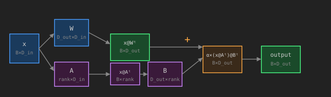

# LoRA Linear

LeetGPU · #85

[打开实现文件](../../practice/leetgpu/85/solution.cu) · [原始材料](../../references/LeetGPU/challenges/medium/85_lora_linear/challenge.html)

Implement a LoRA (Low-Rank Adaptation) linear layer forward pass. Given an input matrix `x` of shape `batch × d_in`, a base weight matrix `W` of shape `d_out × d_in`, a LoRA down-projection matrix `A` of shape `rank × d_in`, and a LoRA up-projection matrix `B` of shape `d_out × rank`, compute `output = x × WT + lora_scale × (x × AT) × BT`. All tensors are `float32`.

## Implementation Requirements

- Implement the `solve` function; do not change its signature.

- Do not use external libraries beyond those provided.

- Write the result into `output`.

## Examples

Example 1:

 \[ x = \begin{bmatrix} 1 & 0 & -1 & 2 \\ 0 & 1 & 1 & -1 \end{bmatrix},\quad W = \begin{bmatrix} 1 & 0 & 0 & 0 \\ 0 & 1 & 0 & 0 \\ 0 & 0 & 1 & 0 \end{bmatrix},\quad A = \begin{bmatrix} 1 & 0 & 0 & 0 \\ 0 & 1 & 0 & 0 \end{bmatrix},\quad B = \begin{bmatrix} 1 & 0 \\ 0 & 1 \\ 0 & 0 \end{bmatrix} \]

With `lora_scale` = 0.5:

 \[ \text{output} = x W^T + 0.5 \cdot (x A^T) B^T = \begin{bmatrix} 1 & 0 & -1 \\ 0 & 1 & 1 \end{bmatrix} + 0.5 \cdot \begin{bmatrix} 1 & 0 \\ 0 & 1 \end{bmatrix} \begin{bmatrix} 1 & 0 & 0 \\ 0 & 1 & 0 \end{bmatrix} = \begin{bmatrix} 1.5 & 0 & -1 \\ 0 & 1.5 & 1 \end{bmatrix} \]

## Constraints

- 1 ≤ `batch` ≤ 1,024

- 1 ≤ `d_in`, `d_out` ≤ 8,192

- 1 ≤ `rank` ≤ 256; `rank` < min(`d_in`, `d_out`)

- All tensors are `float32` on GPU.

- Performance is measured with `batch` = 256, `d_in` = 4,096, `d_out` = 4,096, `rank` = 64

## 本地接口

~~~cpp
extern "C" void solve(const float* x, const float* W, const float* A, const float* B, float* output,
                      int batch, int d_in, int d_out, int rank, float lora_scale);
~~~

## 本地用例

~~~bash
./practice.sh cases leetgpu 85
./practice.sh test leetgpu 85
~~~

展开输入规格

~~~text
  #0 公开样例 · x (2, 4) float32 · W (3, 4) float32 · A (2, 4) float32 · B (3, 2) float32 · output (2, 3) float32 · batch 2 · d_in 4 · d_out 3 · rank 2 · lora_scale 0.5
  #1 公开功能用例 · x (1, 4) float32 · W (4, 4) float32 · A (1, 4) float32 · B (4, 1) float32 · output (1, 4) float32 · batch 1 · d_in 4 · d_out 4 · rank 1 · lora_scale 0.5
  #2 公开功能用例 · x (2, 8) float32 · W (8, 8) float32 · A (2, 8) float32 · B (8, 2) float32 · output (2, 8) float32 · batch 2 · d_in 8 · d_out 8 · rank 2 · lora_scale 0.5
  #3 公开功能用例 · x (4, 16) float32 · W (16, 16) float32 · A (1, 16) float32 · B (16, 1) float32 · output (4, 16) float32 · batch 4 · d_in 16 · d_out 16 · rank 1 · lora_scale 0.5
  #4 公开功能用例 · x (16, 64) float32 · W (64, 64) float32 · A (8, 64) float32 · B (64, 8) float32 · output (16, 64) float32 · batch 16 · d_in 64 · d_out 64 · rank 8 · lora_scale 0.5
  #5 公开功能用例 · x (32, 128) float32 · W (64, 128) float32 · A (16, 128) float32 · B (64, 16) float32 · output (32, 64) float32 · batch 32 · d_in 128 · d_out 64 · rank 16 · lora_scale 0.5
  #6 公开功能用例 · x (30, 100) float32 · W (100, 100) float32 · A (4, 100) float32 · B (100, 4) float32 · output (30, 100) float32 · batch 30 · d_in 100 · d_out 100 · rank 4 · lora_scale 0.5
  #7 公开功能用例 · x (7, 255) float32 · W (128, 255) float32 · A (8, 255) float32 · B (128, 8) float32 · output (7, 128) float32 · batch 7 · d_in 255 · d_out 128 · rank 8 · lora_scale 0.5
  #8 公开功能用例 · x (64, 512) float32 · W (512, 512) float32 · A (16, 512) float32 · B (512, 16) float32 · output (64, 512) float32 · batch 64 · d_in 512 · d_out 512 · rank 16 · lora_scale 0.125
  #9 公开功能用例 · x (4, 32) float32 · W (32, 32) float32 · A (8, 32) float32 · B (32, 8) float32 · output (4, 32) float32 · batch 4 · d_in 32 · d_out 32 · rank 8 · lora_scale 1.0
  #10 公开功能用例 · x (128, 1024) float32 · W (1024, 1024) float32 · A (32, 1024) float32 · B (1024, 32) float32 · output (128, 1024) float32 · batch 128 · d_in 1024 · d_out 1024 · rank 32 · lora_scale 0.0625
  #11 首个用例复验 · 原用例 #1 · 种子 2037 · 缓冲区守卫 · x (1, 4) float32 · W (4, 4) float32 · A (1, 4) float32 · B (4, 1) float32 · output (1, 4) float32 · batch 1 · d_in 4 · d_out 4 · rank 1 · lora_scale 0.5
  #12 中间用例复验 · 原用例 #6 · 种子 2038 · 缓冲区守卫 · x (30, 100) float32 · W (100, 100) float32 · A (4, 100) float32 · B (100, 4) float32 · output (30, 100) float32 · batch 30 · d_in 100 · d_out 100 · rank 4 · lora_scale 0.5
  #13 末尾用例复验 · 原用例 #10 · 种子 2039 · 缓冲区守卫 · x (128, 1024) float32 · W (1024, 1024) float32 · A (32, 1024) float32 · B (1024, 32) float32 · output (128, 1024) float32 · batch 128 · d_in 1024 · d_out 1024 · rank 32 · lora_scale 0.0625
13 个功能用例，另有 1 个样例
~~~

