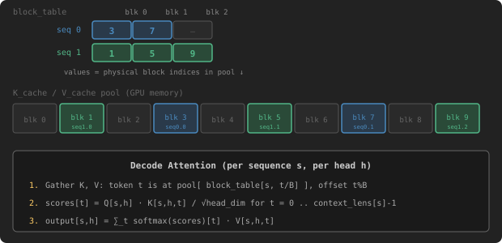

# Paged KV-Cache Attention

LeetGPU · #86

[打开实现文件](../../practice/leetgpu/86/solution.cu) · [原始材料](../../references/LeetGPU/challenges/medium/86_paged_attention/challenge.html)

Implement decode-phase attention over a **paged KV cache**. In LLM serving systems (e.g., vLLM), the key and value tensors for each sequence are stored in fixed-size memory *blocks* (pages) that may be scattered non-contiguously across a shared GPU memory pool. A `block_table` maps each sequence's logical block indices to physical block indices in the cache pool. Given a single query vector per sequence (one new token being generated), compute the attention output by gathering the relevant K/V blocks via the block table and computing scaled dot-product attention over the full context.

## Implementation Requirements

 Implement the function `solve(Q, K_cache, V_cache, block_table, context_lens, output, batch_size, num_heads, head_dim, block_size, max_blocks_per_seq)` that computes paged decode-phase attention:

- `Q`: query tensor of shape `(batch_size, num_heads, head_dim)`, dtype `float32` — one query per sequence

- `K_cache`: paged key cache of shape `(num_blocks, block_size, num_heads, head_dim)`, dtype `float32`

- `V_cache`: paged value cache of shape `(num_blocks, block_size, num_heads, head_dim)`, dtype `float32`

- `block_table`: physical block indices of shape `(batch_size, max_blocks_per_seq)`, dtype `int32`

- `context_lens`: number of valid KV tokens per sequence, shape `(batch_size,)`, dtype `int32`

- `output`: result of shape `(batch_size, num_heads, head_dim)`, dtype `float32`

 For each sequence \(s\) and each attention head \(h\), compute:

1.  Gather the \(\text{context_lens}[s]\) key and value vectors from the paged cache using \(\text{block_table}[s]\). Token at logical position \(t\) lives in physical block \(\text{block_table}[s,\;\lfloor t / B \rfloor]\) at offset \(t \bmod B\) within that block, where \(B = \text{block_size}\).

1.  Compute scaled dot-product attention: \[\text{scores}[t] = \frac{Q[s, h] \cdot K[s, h, t]}{\sqrt{\text{head_dim}}}\]

1.  Apply softmax over all \(\text{context_lens}[s]\) positions to get attention weights.

1.  Compute: \(\displaystyle \text{output}[s, h] = \sum_{t} \text{softmax}(\text{scores})[t] \cdot V[s, h, t]\)

 Do not use external libraries beyond the framework you select. Keep the function signature unchanged. Write results directly into `output`.

## Example

 Input: `batch_size` = 1, `num_heads` = 1, `head_dim` = 4, `block_size` = 2, `context_lens` = [2], `block_table` = [[1]]

 \(Q[0, 0] = \begin{bmatrix} 1.0 & 1.0 & 0.0 & 0.0 \end{bmatrix}\)

 Sequence 0 stores its logical block 0 in physical block 1, so both tokens are read from `K_cache[1]` / `V_cache[1]` (physical block 0 holds unrelated data and must not be attended to).

 Keys gathered from physical block 1 (2 tokens): \[ K_0 = \begin{bmatrix} 1.0 & 0.0 & 0.0 & 0.0 \end{bmatrix}, \quad K_1 = \begin{bmatrix} 0.0 & 1.0 & 0.0 & 0.0 \end{bmatrix} \] Values gathered from physical block 1: \[ V_0 = \begin{bmatrix} 2.0 & 0.0 & 0.0 & 0.0 \end{bmatrix}, \quad V_1 = \begin{bmatrix} 0.0 & 4.0 & 0.0 & 0.0 \end{bmatrix} \]

 Scores (before softmax): \[ s_0 = \frac{Q \cdot K_0}{\sqrt{4}} = \frac{1}{2} = 0.5, \quad s_1 = \frac{Q \cdot K_1}{\sqrt{4}} = \frac{1}{2} = 0.5 \] Attention weights: \(\text{softmax}([0.5, 0.5]) = [0.5, 0.5]\) \[ \text{output}[0, 0] = 0.5 \cdot V_0 + 0.5 \cdot V_1 = \begin{bmatrix} 1.0 & 2.0 & 0.0 & 0.0 \end{bmatrix} \]

## Constraints

- 1 ≤ `batch_size` ≤ 32

- 1 ≤ `num_heads` ≤ 64

- 1 ≤ `head_dim` ≤ 256; `head_dim` is a multiple of 4

- 1 ≤ `block_size` ≤ 64; `block_size` is a power of 2

- 1 ≤ `context_lens[s]` ≤ 8,192 for all sequences `s`

- `max_blocks_per_seq` = `ceil(max(context_lens) / block_size)`

- All input tensors are on the GPU and in `float32` (except `block_table` and `context_lens` which are `int32`)

- `block_table[s, i]` is a valid index into the first dimension of `K_cache` for all `i < ceil(context_lens[s] / block_size)`; physical blocks are scattered arbitrarily through the pool, and entries at or beyond that index are padding that must be ignored

- The cache pool may contain blocks that belong to no sequence; only blocks reachable through `block_table` may be read

- Performance is measured with `batch_size` = 8, `num_heads` = 32, `head_dim` = 128, `block_size` = 16, `context_lens[s]` = 2,048 for all sequences

## 本地接口

~~~cpp
extern "C" void solve(const float* Q, const float* K_cache, const float* V_cache,
                      const int* block_table, const int* context_lens, float* output,
                      int batch_size, int num_heads, int head_dim, int block_size,
                      int max_blocks_per_seq);
~~~

## 本地用例

~~~bash
./practice.sh cases leetgpu 86
./practice.sh test leetgpu 86
~~~

展开输入规格

~~~text
  #0 公开样例 · Q (1, 1, 4) float32 · K_cache (2, 2, 1, 4) float32 · V_cache (2, 2, 1, 4) float32 · block_table (1, 1) int32 · context_lens (1,) int32 · output (1, 1, 4) float32 · batch_size 1 · num_heads 1 · head_dim 4 · block_size 2 · max_blocks_per_seq 1
  #1 公开功能用例 · Q (1, 1, 4) float32 · K_cache (2, 2, 1, 4) float32 · V_cache (2, 2, 1, 4) float32 · block_table (1, 1) int32 · context_lens (1,) int32 · output (1, 1, 4) float32 · batch_size 1 · num_heads 1 · head_dim 4 · block_size 2 · max_blocks_per_seq 1
  #2 公开功能用例 · Q (1, 2, 8) float32 · K_cache (2, 4, 2, 8) float32 · V_cache (2, 4, 2, 8) float32 · block_table (1, 1) int32 · context_lens (1,) int32 · output (1, 2, 8) float32 · batch_size 1 · num_heads 2 · head_dim 8 · block_size 4 · max_blocks_per_seq 1
  #3 公开功能用例 · Q (2, 2, 8) float32 · K_cache (6, 4, 2, 8) float32 · V_cache (6, 4, 2, 8) float32 · block_table (2, 2) int32 · context_lens (2,) int32 · output (2, 2, 8) float32 · batch_size 2 · num_heads 2 · head_dim 8 · block_size 4 · max_blocks_per_seq 2
  #4 公开功能用例 · Q (3, 2, 8) float32 · K_cache (4, 4, 2, 8) float32 · V_cache (4, 4, 2, 8) float32 · block_table (3, 1) int32 · context_lens (3,) int32 · output (3, 2, 8) float32 · batch_size 3 · num_heads 2 · head_dim 8 · block_size 4 · max_blocks_per_seq 1
  #5 公开功能用例 · Q (4, 4, 32) float32 · K_cache (15, 16, 4, 32) float32 · V_cache (15, 16, 4, 32) float32 · block_table (4, 4) int32 · context_lens (4,) int32 · output (4, 4, 32) float32 · batch_size 4 · num_heads 4 · head_dim 32 · block_size 16 · max_blocks_per_seq 4
  #6 公开功能用例 · Q (4, 8, 64) float32 · K_cache (48, 16, 8, 64) float32 · V_cache (48, 16, 8, 64) float32 · block_table (4, 8) int32 · context_lens (4,) int32 · output (4, 8, 64) float32 · batch_size 4 · num_heads 8 · head_dim 64 · block_size 16 · max_blocks_per_seq 8
  #7 公开功能用例 · Q (2, 4, 32) float32 · K_cache (6, 16, 4, 32) float32 · V_cache (6, 16, 4, 32) float32 · block_table (2, 2) int32 · context_lens (2,) int32 · output (2, 4, 32) float32 · batch_size 2 · num_heads 4 · head_dim 32 · block_size 16 · max_blocks_per_seq 2
  #8 公开功能用例 · Q (4, 4, 64) float32 · K_cache (42, 16, 4, 64) float32 · V_cache (42, 16, 4, 64) float32 · block_table (4, 7) int32 · context_lens (4,) int32 · output (4, 4, 64) float32 · batch_size 4 · num_heads 4 · head_dim 64 · block_size 16 · max_blocks_per_seq 7
  #9 公开功能用例 · Q (4, 8, 64) float32 · K_cache (51, 16, 8, 64) float32 · V_cache (51, 16, 8, 64) float32 · block_table (4, 13) int32 · context_lens (4,) int32 · output (4, 8, 64) float32 · batch_size 4 · num_heads 8 · head_dim 64 · block_size 16 · max_blocks_per_seq 13
  #10 公开功能用例 · Q (4, 8, 128) float32 · K_cache (96, 16, 8, 128) float32 · V_cache (96, 16, 8, 128) float32 · block_table (4, 16) int32 · context_lens (4,) int32 · output (4, 8, 128) float32 · batch_size 4 · num_heads 8 · head_dim 128 · block_size 16 · max_blocks_per_seq 16
  #11 首个用例复验 · 原用例 #1 · 种子 2037 · 缓冲区守卫 · Q (1, 1, 4) float32 · K_cache (2, 2, 1, 4) float32 · V_cache (2, 2, 1, 4) float32 · block_table (1, 1) int32 · context_lens (1,) int32 · output (1, 1, 4) float32 · batch_size 1 · num_heads 1 · head_dim 4 · block_size 2 · max_blocks_per_seq 1
  #12 中间用例复验 · 原用例 #6 · 种子 2038 · 缓冲区守卫 · Q (4, 8, 64) float32 · K_cache (48, 16, 8, 64) float32 · V_cache (48, 16, 8, 64) float32 · block_table (4, 8) int32 · context_lens (4,) int32 · output (4, 8, 64) float32 · batch_size 4 · num_heads 8 · head_dim 64 · block_size 16 · max_blocks_per_seq 8
  #13 末尾用例复验 · 原用例 #10 · 种子 2039 · 缓冲区守卫 · Q (4, 8, 128) float32 · K_cache (96, 16, 8, 128) float32 · V_cache (96, 16, 8, 128) float32 · block_table (4, 16) int32 · context_lens (4,) int32 · output (4, 8, 128) float32 · batch_size 4 · num_heads 8 · head_dim 128 · block_size 16 · max_blocks_per_seq 16
13 个功能用例，另有 1 个样例
~~~

